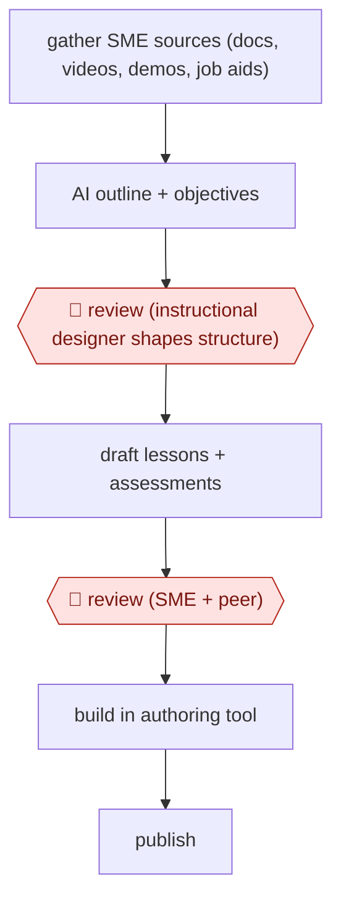

# SME-docs to e-learning

`PRO › EDU › LND` · checkpointed · evidence B · **draft: needs a reference example** ([how to add one](../../../../../CONTRIBUTING.md#1-add-an-example-run))

**Shape:** `gather SME sources (docs, videos, demos, job aids) → AI outline + objectives → 🛑 review (instructional designer shapes structure) → draft lessons + assessments → 🛑 review (SME + peer) → build in authoring tool → publish`
**How it differs:** AWF-0027 Backward-design course (COURSE) is the closest. It starts from learning outcomes. This starts from SME source documents and gates on SME accuracy review for a corporate module. Check whether it counts as a variant.
**Variants:** `leai` · `articulate-rise-ai`

<!-- shape diagram: generated by scripts/build_diagrams.py from `shape`; don't edit -->

<!-- end shape diagram -->

## Background

Corporate training is usually built from material nobody wrote for learners: a product manual, a recording of a webinar, a job aid taped inside a cupboard door, the transcript of an expert explaining a process once. An instructional designer turns that into a module — objectives, lessons, knowledge checks, an assessment — and the expert has to check it, because the designer cannot tell whether the manual's step four is still current. The bottleneck is the first draft and the review loop that follows it: the designer writes something plausible, the expert marks it up, the designer rewrites. An authoring tool with a model inside shortens the first draft to minutes by reading the sources and proposing an outline, lesson copy and questions. That makes the review gates do more work than before, not less. A draft that looks finished invites a reviewer to check the headings rather than the numbers, and the failure that matters in a compliance module — a rule stated backwards, a step that no longer exists, a quiz whose correct answer is the longest option — survives exactly that kind of reading. So the workflow keeps two gates, at the outline and at the draft, and puts the expensive attention where a wrong fact would reach a learner.

**Terms:**
- **SME**: the subject-matter expert who owns the process being taught and can say whether a statement is still true.
- **instructional designer**: the person who shapes objectives, sequence and assessment rather than the subject content.
- **outline**: the proposed lesson structure with objectives, before any lesson text exists.
- **knowledge check**: a quick question inside a lesson, as opposed to the graded assessment at the end.
- **authoring tool**: the software the module is assembled and published in.
- **cognitive level**: how much thinking a question demands (recall versus application), the thing AI-drafted quizzes tend to flatten.
- **distractor**: a wrong answer option, whose plausibility decides whether a question tests anything.
- **source of truth**: the document that governs when the manual and the expert disagree.

## Build it with an agent

**Form:** `project`. A course build runs for weeks across many sessions: the source corpus, the approved outline, the draft lessons, the assessment bank and a house style guide all have to persist and stay consistent while the designer, the expert and a peer reviewer work through versions. That is a repository with a workflow, not a single conversation, and not a service that runs unattended.

**You need:** the SME sources as files with their dates, since the most common defect is teaching a superseded process; the audience and the performance objective, because "make a course about X" produces a module that covers X and changes nothing; the expert's available review time, booked before drafting starts, or the draft waits and the speed gain evaporates; a house style guide, so the model's tone does not become the course's tone; and the assessment rules — how many items, which cognitive level, what a pass mark — written down before generation, because a quiz generated first and justified afterwards will be recall-level. The agent must not publish, and must not decide that a source is current: that is the expert's call and the whole reason the second gate exists.

| Step | Built as |
|---|---|
| gather SME sources | An ingestion pass that records each source's date and owner, and flags where two sources disagree, since that disagreement is the expert's first review task rather than something to average out. |
| AI outline + objectives | The model proposes structure and objectives by mapping the sources to a sequence; it must cite which source each objective came from, so the designer can see an objective that no source supports. |
| 🛑 review (instructional designer shapes structure) | The designer rewrites the outline by prompt and by hand; the approved version is frozen as a file the drafting step reads, so later structural drift is visible as a diff. |
| draft lessons + assessments | Lesson copy and items are generated against the frozen outline; every factual claim keeps a link to the source passage, and items are generated to a stated cognitive level with the pass rule fixed in advance. |
| 🛑 review (SME + peer) | The expert checks claims against sources, not against fluency; the peer checks sequence and assessment validity. Both work from the citation list rather than reading top to bottom, which is the only way a reviewer notices a wrong number inside a well-shaped paragraph. |
| build in authoring tool → publish | Interactions and layout are assembled in the authoring tool and the module is published by a person, since the build has no publishing path. |

**Checkpoints:** `review`, twice: the first gate is structural and belongs to the instructional designer, because a model will happily produce a well-organised course about the wrong problem; the second is factual and belongs to the expert plus a peer, because a model's errors are fluent. The build protects the second gate by attaching a citation to every claim and by generating items to a fixed cognitive level, so the reviewer is checking truth rather than rewriting structure under time pressure.

**Since the sources:** Sources date from 2025-11 and 2026-08: two vendor case studies. Neither was re-opened on this pass. What has changed since: the failure modes are now documented rather than inferred, and they are specific. A 2026 account of building a biomedical-sciences course reports AI drafts that lacked depth and contained inaccuracies, AI-written assessment items misaligned with the objectives and skewed to recall, and — the detail worth keeping — a structural tell in which the correct answer was always the longest option, which lets a learner score without knowing anything. A controlled comparison of four models on real instructional-design tasks found the opposite problem to incompetence: one wrote the best practice activity in the study while its learner feedback taught a false consent rule and cited a procedure clause that does not exist, and a reviewing model ranked two platform issues above the defect every learner would hit — so a rubric that rewards coverage cannot catch a wrong number. The same literature explains why this entry's gates cannot simply be "a person looked at it": in the 2026 Boston Consulting Group field experiment (758 consultants), on a task beyond the model's competence the AI-assisted answers were right 60 to 71 percent of the time against 84.5 percent without AI, and reviewers rated the incorrect AI-assisted answers as more coherent and persuasive than the correct human ones. Fluency is not a proxy for accuracy, so the gate has to be a citation check.

*A design based on this entry's steps and the tool documentation as of 2026-11, not a reported run.*

## Steps

*As reported by the sources.*

1. Upload raw SME material (documents, videos, demos, transcripts, job aids) into the AI authoring tool [[1]](#sources)[[2]](#sources).
2. The AI generates a structured course outline, learning objectives and key-concept summaries [[1]](#sources)[[2]](#sources).
3. 🛑 **Review**: The instructional designer uses prompts to reshape objectives and structure for the audience and format [[1]](#sources).
4. The AI drafts lesson copy, knowledge checks and assessment questions, and adjusts the tone of technical content [[1]](#sources)[[2]](#sources).
5. 🛑 **Review**: SMEs and peers review the draft for accuracy. Someone still needs to humanize the output [[2]](#sources).
6. Build interactions and layouts in the authoring tool and publish [[1]](#sources)[[2]](#sources).

**Output:** A reviewed e-learning module with assessments, published to the company's learning platform.
**Failure modes → guards:** Flat AI copy → human editing and an AI style guide [[2]](#sources). Accuracy drift from source docs → SME review gate [[1]](#sources)[[2]](#sources).

## Public runs

Coverage as of 2026-11-06: **Weak**: only anonymous, vendor-linked or journalist-told accounts. Collected and re-checked in [New workflows for empty categories](../../../../../research/2026-11-new-workflows.md).

- [LearnExperts, Paycor](https://learnexperts.ai/blog/how-paycor-accelerated-learning-design-by-75-using-ai-powered-course-development/) (2026-08-11). AI as a first-draft instructional designer before SME review. "reduced early-stage development time by up to 75%". *First-hand: vendor; confidence: med.*
- [Articulate, Cloud communications company](https://www.articulate.com/resources/case-studies/cloud-communications-company/) (2025-11-03). Technical writer turns SME docs into a Rise course, then SME/peer review. "60% faster course development". *First-hand: vendor; confidence: med.*

## Sources

1. Sood A., How Paycor Accelerated Learning Design by 75% with LEAi, LearnExperts, 2026-08-11. https://learnexperts.ai/blog/how-paycor-accelerated-learning-design-by-75-using-ai-powered-course-development/
2. Heegaard S., A Top Cloud Communications Company Accelerates Human Connection With Thoughtful AI Use, Articulate, 2025-11-03. https://www.articulate.com/resources/case-studies/cloud-communications-company/
3. Generative AI in learning design practice: building an online course for biomedical sciences research programs, PMC, 2026. https://pmc.ncbi.nlm.nih.gov/articles/PMC12965148/
4. Tests show AI can design like an expert instructional designer, so what next? 2026. https://www.downes.ca/post/79930/rd
