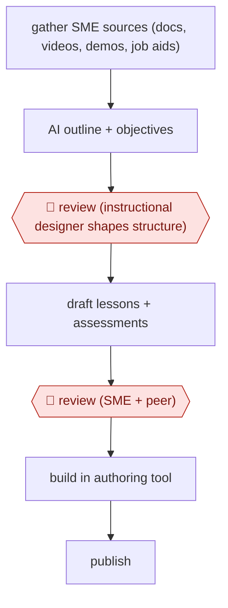

# SME-docs to e-learning

`PRO › EDU › LND` · checkpointed · evidence B · **draft: needs a reference example** ([how to add one](../../../../../CONTRIBUTING.md#1-add-an-example-run))

**Shape:** `gather SME sources (docs, videos, demos, job aids) → AI outline + objectives → 🛑 review (instructional designer shapes structure) → draft lessons + assessments → 🛑 review (SME + peer) → build in authoring tool → publish`
**How it differs:** AWF-0027 Backward-design course (COURSE) is the closest. It starts from learning outcomes. This starts from SME source documents and gates on SME accuracy review for a corporate module. Check whether it counts as a variant.
**Variants:** `leai` · `articulate-rise-ai`

<!-- shape diagram: generated by scripts/build_diagrams.py from `shape`; don't edit -->

<!-- end shape diagram -->

## Steps
1. Upload raw SME material (documents, videos, demos, transcripts, job aids) into the AI authoring tool [[1]](#sources)[[2]](#sources).
2. The AI generates a structured course outline, learning objectives and key-concept summaries [[1]](#sources)[[2]](#sources).
3. 🛑 **Review**: The instructional designer uses prompts to reshape objectives and structure for the audience and format [[1]](#sources).
4. The AI drafts lesson copy, knowledge checks and assessment questions, and adjusts the tone of technical content [[1]](#sources)[[2]](#sources).
5. 🛑 **Review**: SMEs and peers review the draft for accuracy. Someone still needs to humanize the output [[2]](#sources).
6. Build interactions and layouts in the authoring tool and publish [[1]](#sources)[[2]](#sources).

**Output:** A reviewed e-learning module with assessments, published to the company's learning platform.
**Failure modes → guards:** Flat AI copy → human editing and an AI style guide [[2]](#sources). Accuracy drift from source docs → SME review gate [[1]](#sources)[[2]](#sources).

## Public runs

Coverage as of 2026-11-06: **Weak**: only anonymous, vendor-linked or journalist-told accounts. Collected and re-checked in [New workflows for empty categories](../../../../../research/2026-11-new-workflows.md).

- [LearnExperts, Paycor](https://learnexperts.ai/blog/how-paycor-accelerated-learning-design-by-75-using-ai-powered-course-development/) (2026-08-11). AI as a first-draft instructional designer before SME review. "reduced early-stage development time by up to 75%". *First-hand: vendor; confidence: med.*
- [Articulate, Cloud communications company](https://www.articulate.com/resources/case-studies/cloud-communications-company/) (2025-11-03). Technical writer turns SME docs into a Rise course, then SME/peer review. "60% faster course development". *First-hand: vendor; confidence: med.*

## Sources

1. Sood A., How Paycor Accelerated Learning Design by 75% with LEAi, LearnExperts, 2026-08-11. https://learnexperts.ai/blog/how-paycor-accelerated-learning-design-by-75-using-ai-powered-course-development/
2. Heegaard S., A Top Cloud Communications Company Accelerates Human Connection With Thoughtful AI Use, Articulate, 2025-11-03. https://www.articulate.com/resources/case-studies/cloud-communications-company/
