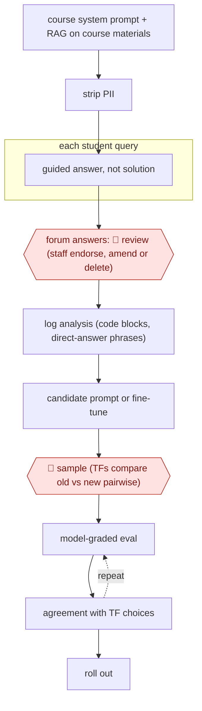

# Guardrailed course tutor

`PRO › EDU › TUTOR` · sampled · evidence A · **draft: needs a reference example** ([how to add one](../../../../../CONTRIBUTING.md#1-add-an-example-run))

**Shape:** `course system prompt + RAG on course materials → strip PII → each student query: guided answer, not solution → forum answers: 🛑 review (staff endorse, amend or delete) → log analysis (code blocks, direct-answer phrases) → candidate prompt or fine-tune → 🛑 sample (TFs compare old vs new pairwise) → (model-graded eval ⟲ agreement with TF choices) → roll out`
**How it differs:** Closest is AWF-0042 Tutor-approved AI turns (TUTOR), which is assist mode: a tutor approves every AI turn before a student sees it. Here students talk to the tutor directly. People check forum answers after they post, and TFs judge prompt or model versions on samples, so the autonomy level (sampled) and checkpoint arrangement differ.
**Variants:** `cs50-ai-azure-gpt4o`

<!-- shape diagram: generated by scripts/build_diagrams.py from `shape`; don't edit -->

<!-- end shape diagram -->

## Background

A course with 200,000 students cannot answer questions one at a time. Office hours become a queue, the queue becomes an hour's wait, and the students who most need to ask something are the least likely to wait in it. The usual fix is a forum, which helps the confident and the patient. An AI tutor changes the arithmetic: every student gets an answer at 3am, in their own words, inside the same editor they are working in. The risk is equally obvious. A tutor that hands over the answer removes the struggle the exercise existed to produce, and at scale it does that to everyone at once. So the design problem is not making the model helpful; it is making it deliberately less helpful than a chatbot, in a way that survives contact with thousands of frustrated people who will ask again in different words. Two things follow. The guidance has to be enforced outside the prompt as well as inside it, because a model told not to give code will still give code some of the time. And the teaching staff keep two jobs that no model can take: they check the answers posted in public, and they judge whether a new version is better than the old one, which requires reading pairs of responses to the same question rather than reading a score.

**Terms:**
- **rubber duck**: an object you explain a problem to, which often surfaces the answer; here, a tutor that asks questions instead of answering.
- **RAG**: retrieval-augmented generation, answering from course materials rather than from general knowledge.
- **system prompt**: the standing instruction that defines the tutor's role and limits.
- **guardrail**: a check that limits what the model may output, enforced in code rather than asked for in the prompt.
- **instruction dilution**: a long prompt whose later instructions stop being followed.
- **pairwise comparison**: showing a judge two responses to the same question and asking which is better.
- **model-graded evaluation**: scoring responses with a model instead of a person, usable only once checked against people.
- **teaching fellow (TF)**: the graduate staff who run sections and office hours.

## Build it with an agent

**Form:** `service`. It runs continuously for a student population far larger than any staff could serve, with nobody starting a run: a query arrives, gets an answer, and the only human interventions are after the fact — staff on forum answers, TFs on version comparisons. That is a service, not a skill one student runs, and not a project with a per-user corpus.

**You need:** the course materials as the retrieval corpus, since a tutor answering from general knowledge will teach the internet's version of the subject; a system prompt that defines the role and the refusal, plus code that inspects a response before delivery and retries it, because the prompt alone does not hold; PII stripping on the way in; a usage cap per student per unit of time, or the students who most need to think will outsource the thinking; a review interface for forum answers, so a staff member can endorse, amend or delete after the fact; logs rich enough to detect drift by pattern rather than by complaint; and a pool of teaching fellows with time booked for pairwise comparison, which is the only step that can tell you a new version is better.

| Step | Built as |
|---|---|
| course system prompt + RAG on course materials | One backend for every surface — editor, web, forum — with the course corpus as the only retrieval source and the prompt versioned like code. |
| strip PII | A pre-processing step on every query, since a student will paste their name, their partner's code and their student ID into a chat box without thinking. |
| each student query: guided answer, not solution | The model answers as a tutor: hints, a question back, a pointer to the lecture. A post-generation check inspects the response for code blocks and direct-answer phrasing and retries before the student sees it. |
| forum answers: 🛑 review (staff endorse, amend or delete) | Answers post immediately and staff review them in the forum itself; the interface must make amendment one action, or the review does not happen at volume. |
| log analysis (code blocks, direct-answer phrases) | A scheduled pass over the logs that counts the tells — a fenced code block, "here's the complete solution" — per version and per course week, which is how drift is found before students report it. |
| candidate prompt or fine-tune | Each fix is a candidate, not a deployment: a prompt revision, or a fine-tune on a set of curated student-tutor conversations. |
| 🛑 sample (TFs compare old vs new pairwise) | TFs see the same student question answered by both versions and pick one, with a written reason; the build collects the choices until there are enough to be evidence. |
| (model-graded eval ⟲ agreement with TF choices) | A model judge is calibrated against the TFs' choices before it is trusted at scale, then used to score the cases the TFs did not read. |

**Checkpoints:** `review`: forum answers are public, so the staff check is after the fact and by exception — endorse, amend or delete — which works only because the volume of answers that need changing is small enough to find. `sample`: teaching fellows compare versions pairwise and leave reasons; that judgement is the ground truth for the model-graded evaluation, so the loop is calibrated on people before it is trusted on volume, and no version reaches students on a score alone.

**Since the sources:** Sources date from 2024 and 2025, the two SIGCSE papers; the public run is the 2025 one. Neither paper was re-opened this pass; a Harvard Gazette interview of 2026-09-25 was opened. What has changed since: the team has published how the guardrail actually works, and it is not the prompt. Malan describes code the team wrote that [evaluates a response before the student sees it and sometimes rejects or retries it](https://dev.news.harvard.edu/gazette/story/2026/09/taming-the-duck-for-starters), because instructions alone "tend not to be sufficient". He also confirms the failure this entry records as a metric is still live — the Duck is told not to answer with blocks of code and still does so up to a quarter of the time — and attributes it to sampling randomness and to training data in which technical answers are code. Two mechanisms are new to this entry's build: the post-generation filter above, and a usage cap borrowed from games, a "heart system" that allows only a few questions per unit of time after the team saw long tails in which a single student asked around 200 questions. The consequences are now visible too: office hours demand fell sharply (waits had reached an hour), grades rose, and the course responded by returning to proctored exams and adding short oral check-ins. That last change matters for this workflow's evaluation loop: if the tutor succeeds, the assessment it feeds has to move, or the improvement shows up as a grade rise that measures the tutor rather than the learning.

*A design based on this entry's steps and the tool documentation as of 2026-11, not a reported run.*

## Steps

*As reported by the sources.*

1. All tools share one backend. It strips personal information from student queries and wraps them in a course-specific system prompt that tells the model to act as a CS50 teaching assistant and guide rather than give answers [[1]](#sources).
2. Forum queries use RAG over course facts to reduce hallucinations. The duck answers students directly in the IDE, on the web and on the Ed forum [[1]](#sources).
3. 🛑 **Review**: every duck answer on Ed can be endorsed, amended or deleted by a human staff member [[1]](#sources).
4. The team mines logs for drift, for example responses containing code blocks or phrases like 'here's an example' that hand out full solutions [[2]](#sources).
5. They build candidate fixes: few-shot prompts, or a fine-tune on 50 curated student-tutor conversations [[2]](#sources).
6. 🛑 **Sample**: teaching fellows compare responses from two versions on the same student queries and leave written feedback. Model-graded evaluations are checked against the TFs' choices before they are scaled up [[2]](#sources).

**Output:** A course-aligned AI tutor students use 24/7, with staff oversight on forum answers and a TF-validated evaluation loop before each prompt or model change.
**Failure modes → guards:** 'Instruction dilution', where the model ignores long prompts; the switch from GPT-4 to GPT-4o raised code-block messages from 20% to 25% → pairwise TF evaluation and fine-tuning before rollout [[2]](#sources). Over-helpful answers that undercut learning → guided-answer prompt plus monitoring for direct-answer phrases [[2]](#sources).

## Public runs

Coverage as of 2026-11-06: **Strong**: a first-hand, detailed run that matches most of the shape. Collected and re-checked in [Second collection pass](../../../../../research/2026-11-second-pass.md).

- [Liu et al., Improving AI in CS50](https://cs.harvard.edu/malan/publications/fp0627-liu.pdf) (2025-02-26). Production tutor at MOOC scale; TF pairwise evaluation of prompt versions. "approximately 211,000 students had used the duck". *First-hand: yes; confidence: high.*

## Sources

1. Liu, Zenke et al., Teaching CS50 with AI, SIGCSE 2024. https://cs.harvard.edu/malan/publications/V1fp0567-liu.pdf
2. Liu, Zhao, Perez, Zhukovets, Xu et al., Improving AI in CS50: Leveraging Human Feedback for Better Learning, SIGCSE TS 2025. https://cs.harvard.edu/malan/publications/fp0627-liu.pdf
3. Max Larkin, Taming the Duck, for starters, Harvard Gazette, 2026-09-25. https://dev.news.harvard.edu/gazette/story/2026/09/taming-the-duck-for-starters
