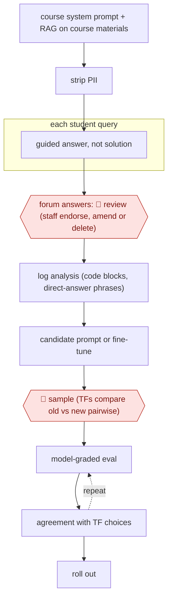

# Guardrailed course tutor

`PRO › EDU › TUTOR` · sampled · evidence A · **draft: needs a reference example** ([how to add one](../../../../../CONTRIBUTING.md#1-add-an-example-run))

**Shape:** `course system prompt + RAG on course materials → strip PII → each student query: guided answer, not solution → forum answers: 🛑 review (staff endorse, amend or delete) → log analysis (code blocks, direct-answer phrases) → candidate prompt or fine-tune → 🛑 sample (TFs compare old vs new pairwise) → (model-graded eval ⟲ agreement with TF choices) → roll out`
**How it differs:** Closest is AWF-0042 Tutor-approved AI turns (TUTOR), which is assist mode: a tutor approves every AI turn before a student sees it. Here students talk to the tutor directly. People check forum answers after they post, and TFs judge prompt or model versions on samples, so the autonomy level (sampled) and checkpoint arrangement differ.
**Variants:** `cs50-ai-azure-gpt4o`

<!-- shape diagram: generated by scripts/build_diagrams.py from `shape`; don't edit -->

<!-- end shape diagram -->

## Steps
1. All tools share one backend. It strips personal information from student queries and wraps them in a course-specific system prompt that tells the model to act as a CS50 teaching assistant and guide rather than give answers [[1]](#sources).
2. Forum queries use RAG over course facts to reduce hallucinations. The duck answers students directly in the IDE, on the web and on the Ed forum [[1]](#sources).
3. 🛑 **Review**: every duck answer on Ed can be endorsed, amended or deleted by a human staff member [[1]](#sources).
4. The team mines logs for drift, for example responses containing code blocks or phrases like 'here's an example' that hand out full solutions [[2]](#sources).
5. They build candidate fixes: few-shot prompts, or a fine-tune on 50 curated student-tutor conversations [[2]](#sources).
6. 🛑 **Sample**: teaching fellows compare responses from two versions on the same student queries and leave written feedback. Model-graded evaluations are checked against the TFs' choices before they are scaled up [[2]](#sources).

**Output:** A course-aligned AI tutor students use 24/7, with staff oversight on forum answers and a TF-validated evaluation loop before each prompt or model change.
**Failure modes → guards:** 'Instruction dilution', where the model ignores long prompts; the switch from GPT-4 to GPT-4o raised code-block messages from 20% to 25% → pairwise TF evaluation and fine-tuning before rollout [[2]](#sources). Over-helpful answers that undercut learning → guided-answer prompt plus monitoring for direct-answer phrases [[2]](#sources).

## Public runs

Coverage as of 2026-11-06: **Strong**: a first-hand, detailed run that matches most of the shape. Collected and re-checked in [Second collection pass](../../../../../research/2026-11-second-pass.md).

- [Liu et al., Improving AI in CS50](https://cs.harvard.edu/malan/publications/fp0627-liu.pdf) (2025-02-26). Production tutor at MOOC scale; TF pairwise evaluation of prompt versions. "approximately 211,000 students had used the duck". *First-hand: yes; confidence: high.*

## Sources

1. Liu, Zenke et al., Teaching CS50 with AI, SIGCSE 2024. https://cs.harvard.edu/malan/publications/V1fp0567-liu.pdf
2. Liu, Zhao, Perez, Zhukovets, Xu et al., Improving AI in CS50: Leveraging Human Feedback for Better Learning, SIGCSE TS 2025. https://cs.harvard.edu/malan/publications/fp0627-liu.pdf
