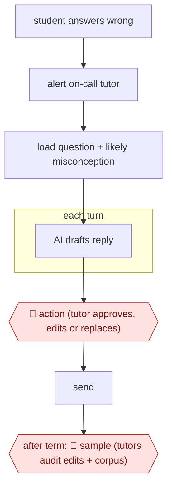

# Tutor-approved AI turns

`PRO › EDU › TUTOR` · assist · evidence A · **draft: needs a reference example** ([how to add one](../../../../../CONTRIBUTING.md#1-add-an-example-run))

**Shape:** `student answers wrong → alert on-call tutor → load question + likely misconception → each turn: AI drafts reply → 🛑 action (tutor approves, edits or replaces) → send → after term: 🛑 sample (tutors audit edits + corpus)`
**How it differs:** AWF-0028 Anchor-calibrated grader (ASSESS) grades finished work. AWF-0027 Backward-design course (COURSE) builds course material. This is live per-message supervised tutoring.
**Variants:** `learnlm-eedi`

<!-- shape diagram: generated by scripts/build_diagrams.py from `shape`; don't edit -->

<!-- end shape diagram -->

## Background

The moment a student gets a question wrong is when tutoring is worth most, and it is exactly the moment a tutor is least available: thirty students in a room, one teacher, and the ones who need help are the ones who will not raise a hand. Software that notices the wrong answer can alert a tutor, but the alert arrives after the chance to intervene has gone. This workflow moves the intervention inside the window: the wrong answer triggers an alert, the tutor opens a chat with the question and the likely misconception already loaded, and a model drafts the next reply. The tutor reads it, approves it, edits it or replaces it, and only then does the student see anything. The student gets a tutor's attention within minutes and the tutor's time goes to judging rather than composing. Two things make this more than a shortcut. Every message is a person's, so the failure mode is not a wrong fact reaching a student but a plausible draft that a busy tutor waves through. And the arrangement is only as good as the tutor's judgement, which is why the after-term audit of drafts, edits and rewrites is the part that keeps the thing honest — it is where the tool's real error rate is measured, rather than assumed.

**Terms:**
- **diagnostic question**: a question the platform uses to locate a misconception, not to score the student.
- **misconception**: the specific wrong idea behind a wrong answer, as opposed to a slip.
- **Socratic reply**: a reply that asks a question back rather than stating the answer.
- **draft**: the model's proposed message, before a tutor has acted on it.
- **supervising tutor**: the person who approves, edits or replaces each draft.
- **edit rate**: the share of drafts a tutor sends unchanged, the closest thing to a quality signal in the loop.
- **audit**: the after-the-fact read of the whole corpus for errors and harmful content.
- **near transfer / far transfer**: whether a student can do the next similar question, versus a test that samples the whole curriculum.

## Build it with an agent

**Form:** `service`. Tutors supervise several concurrent chats at once, drafts arrive continuously during the school day, and every message is logged and gated — the tutor works a queue rather than holding one conversation. The per-turn approval and the corpus audit are service mechanics: there is no single artefact a skill could hand back, and nothing accumulates per student that a project would own.

**You need:** the question bank with each wrong answer mapped to its likely misconception, or the tutor opens a blank chat and the drafting step adds nothing; the maths or subject engine that can check an answer, since a fluent explanation of the wrong method is the failure this design must not produce; a chat surface where approving costs one keystroke and editing is faster than retyping, because the whole economics depends on supervision being cheap per turn; a policy that the tutor's judgement always wins, with no path by which a draft is sent unreviewed under time pressure; logs that store draft, edit and final message together, or the audit has nothing to audit; and a rota with capacity for the supervision load, which is a staffing decision, not a deployment detail.

| Step | Built as |
|---|---|
| student answers wrong | The platform's existing answer checking emits the trigger; no new detection model, which keeps the alert tied to a question the teacher already set. |
| alert on-call tutor | A queue rather than an inbox, ordered by how long the student has been waiting, since the value of the intervention decays in minutes. |
| load question + likely misconception | The chat opens with the question, the student's answer and the mapped misconception, so the tutor's first act is judgement rather than reading. |
| each turn: AI drafts reply | A subject-tuned model drafts a Socratic reply against the misconception; retrieval over the course's own worked examples keeps the hint consistent with how the class was taught. |
| 🛑 action (tutor approves, edits or replaces) | One action per turn, and the build has no send path that bypasses it; the interface shows the draft as a suggestion, never as a message. |
| send | The student sees a normal chat, with no indication of how much of the message came from the model — the sources make the interface identical either way. |
| after term: 🛑 sample (tutors audit edits + corpus) | The audit reads drafts, edits and finals together, scoring errors and tone; its findings are the error rate quoted to the school, not the model's own evaluation. |

**Checkpoints:** `action`: the tutor approves, edits or replaces every message, and the build cannot send without that action — the standard is that the tutor would have sent it themselves. `sample`: after the term, supervising tutors read the whole corpus of drafts and edits for factual errors and harmful content, which is the only place the tool's error rate is measured against a person's judgement rather than against its own confidence.

**Since the sources:** The source is the 2025-12 exploratory RCT: 165 students, 17 supervising tutors, 76.4% of drafts approved with no or minimal edits. What has changed since: the same team published an expanded preregistered RCT on 2026-10-29, and it is both a confirmation and a correction. The confirmation is scale and quality — 1,179 students in Years 8 to 10 across 58 classes in 10 UK state secondary schools, 10 weeks, four arms including expert human tutoring; tutors approved 94.7% of 94,385 drafts unchanged, 77.1% of sessions ran with no revision at all, and an audit of all 114,935 generated drafts flagged 6 with mathematical errors or tone problems. It matched expert tutors on in-platform measures, on questions returning after seven days, and on a mid-trial quiz. The correction is what those measures are. On the externally scored Star Maths test, [no arm beat standard remediation — including expert human tutoring, at -0.09 SD](https://edtechdev.github.io/aied/articles/learnlm-eedi-expanded-rct-2026); the two AI arms sat between -0.01 and +0.02 SD with intervals crossing zero. The reported explanation is time: a repair conversation takes four to seven minutes, so tutored students covered 99 units against 132 under the remediation they would otherwise have had, and ten weeks is too short for depth to show up as breadth. Two further details bear directly on this entry's staffing assumption. When tutors did edit, the median change was 69% of the text — so "approved unchanged" and "rewritten when it mattered" are both true, and the second is what the approval rate hides. And supervision was found to be lighter but more draining: reviewers reported less positive affect and more difficulty managing workload than tutors working directly, and seven of eight interviewees said monitoring several chats at once remained hard. That is the cost line to plan against, and it is why the rota in **You need** is not a footnote.

*A design based on this entry's steps and the tool documentation as of 2026-11, not a reported run.*

## Steps

*As reported by the sources.*

1. When a student answers a diagnostic question incorrectly, the on-call tutor team is alerted and a tutor opens a chat session [[1]](#sources).
2. A pedagogy-tuned model gets the question and the student's likely misconception, and drafts Socratic replies [[1]](#sources).
3. 🛑 **Action**: The tutor approves, edits or replaces every drafted message before it reaches the student. The remit is to revise until the tutor would send it themselves [[1]](#sources).
4. The student interface looks the same whether the tutor writes or supervises [[1]](#sources).
5. 🛑 **Sample**: After the run, supervising tutors review the full corpus of drafts, edits and rewrites for harmful content and factual errors [[1]](#sources).

**Output:** A tutoring chat in which every AI turn was approved by a tutor, plus an audited message log for safety review.
**Failure modes → guards:** Factual errors (5 of 3,617 drafts) → per-message tutor approval plus a post-hoc audit [[1]](#sources). Style slips such as emojis → tutor edits [[1]](#sources).

## Public runs

Coverage as of 2026-11-06: **Strong**: a first-hand, detailed run that matches most of the shape. Collected and re-checked in [New workflows for empty categories](../../../../../research/2026-11-new-workflows.md).

- [LearnLM Team & Eedi, Exploratory RCT in UK classrooms](https://arxiv.org/html/2512.23633) (2025-12-29). 165 students, 17 supervising tutors; supervised AI matched or beat human-only tutoring. "supervising tutors approving 76.4% of its drafted messages making zero or minimal edits". *First-hand: yes; confidence: high.*

## Sources

1. LearnLM Team, Google & Eedi, AI tutoring can safely and effectively support students: An exploratory RCT in UK classrooms, arXiv 2512.23633, 2025-12-29. https://arxiv.org/html/2512.23633
2. LearnLM Team, Google & Eedi, Measuring the impact of AI tutoring, from near transfer to standardised tests: An expanded RCT in UK mathematics classrooms, technical report, 2026-10-29 — figures and quotations here are taken from a detailed third-party summary of the report. https://edtechdev.github.io/aied/articles/learnlm-eedi-expanded-rct-2026
