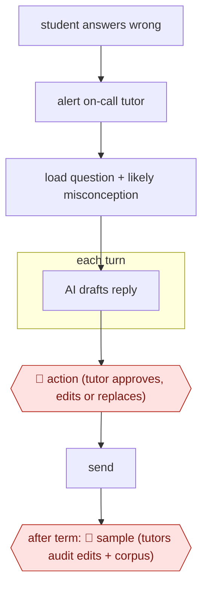

# Tutor-approved AI turns

`PRO › EDU › TUTOR` · assist · evidence A · **draft: needs a reference example** ([how to add one](../../../../../CONTRIBUTING.md#1-add-an-example-run))

**Shape:** `student answers wrong → alert on-call tutor → load question + likely misconception → each turn: AI drafts reply → 🛑 action (tutor approves, edits or replaces) → send → after term: 🛑 sample (tutors audit edits + corpus)`
**How it differs:** AWF-0028 Anchor-calibrated grader (ASSESS) grades finished work. AWF-0027 Backward-design course (COURSE) builds course material. This is live per-message supervised tutoring.
**Variants:** `learnlm-eedi`

<!-- shape diagram: generated by scripts/build_diagrams.py from `shape`; don't edit -->

<!-- end shape diagram -->

## Steps
1. When a student answers a diagnostic question incorrectly, the on-call tutor team is alerted and a tutor opens a chat session [[1]](#sources).
2. A pedagogy-tuned model gets the question and the student's likely misconception, and drafts Socratic replies [[1]](#sources).
3. 🛑 **Action**: The tutor approves, edits or replaces every drafted message before it reaches the student. The remit is to revise until the tutor would send it themselves [[1]](#sources).
4. The student interface looks the same whether the tutor writes or supervises [[1]](#sources).
5. 🛑 **Sample**: After the run, supervising tutors review the full corpus of drafts, edits and rewrites for harmful content and factual errors [[1]](#sources).

**Output:** A tutoring chat in which every AI turn was approved by a tutor, plus an audited message log for safety review.
**Failure modes → guards:** Factual errors (5 of 3,617 drafts) → per-message tutor approval plus a post-hoc audit [[1]](#sources). Style slips such as emojis → tutor edits [[1]](#sources).

## Public runs

Coverage as of 2026-11-06: **Strong**: a first-hand, detailed run that matches most of the shape. Collected and re-checked in [New workflows for empty categories](../../../../../research/2026-11-new-workflows.md).

- [LearnLM Team & Eedi, Exploratory RCT in UK classrooms](https://arxiv.org/html/2512.23633) (2025-12-29). 165 students, 17 supervising tutors; supervised AI matched or beat human-only tutoring. "supervising tutors approving 76.4% of its drafted messages making zero or minimal edits". *First-hand: yes; confidence: high.*

## Sources

1. LearnLM Team, Google & Eedi, AI tutoring can safely and effectively support students: An exploratory RCT in UK classrooms, arXiv 2512.23633, 2025-12-29. https://arxiv.org/html/2512.23633
