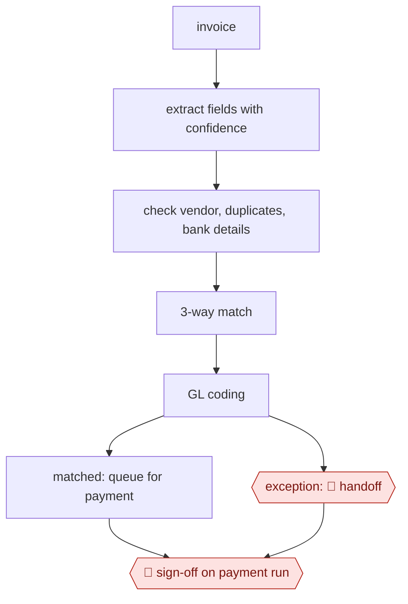

# Invoice extract-match-route

`PRO › FIN › AP` · sampled · evidence B · **draft: needs a reference example** ([how to add one](../../../../../CONTRIBUTING.md#1-add-an-example-run))

**Shape:** `invoice → extract fields with confidence → check vendor, duplicates, bank details → 3-way match → GL coding → matched: queue for payment | exception: 🛑 handoff → 🛑 sign-off on payment run`

<!-- shape diagram: generated by scripts/build_diagrams.py from `shape`; don't edit -->

<!-- end shape diagram -->

## Background

Accounts payable (AP) is the part of a finance team that pays the bills a company receives. Each supplier invoice has to be read, checked against what was actually ordered and delivered, assigned to the right account in the books, approved by someone with the authority to spend that amount, and paid. Invoices arrive in many layouts and languages, so people re-key the same fields over and over, and a duplicate or a doctored invoice is easy to miss. Fraud often shows up as a quiet change of a supplier's bank account. Here the agent reads the invoice, runs the checks, matches it to the order and codes it, so a person sees only what does not fit. A person still resolves each exception, and the people who hold payment authority approve every payment run, because the money leaves the company and the approvers answer for it.

**Terms:**
- **Invoice, PO, receipt**: the supplier's bill; the company's purchase order, which says what was ordered; the record that the goods or services arrived.
- **3-way match**: checking that invoice, PO and receipt agree on what, how many and how much.
- **GL coding**: choosing the general-ledger account (the category in the books) each invoice line is charged to.
- **Vendor master**: the company's list of approved suppliers with their details, including bank accounts.
- **OCR**: software that turns a scanned page into text.
- **ERP**: the company's main accounting and operations system, where approved payables are posted and paid.
- **Delegation-of-authority matrix**: the table of who may approve spending up to which amount, by invoice size and type.
- **SOX**: US law that requires listed companies to keep controls and an audit trail over financial reporting.

## Build it with an agent

**Form:** `service`. Invoices arrive by email and portal whenever suppliers send them, nobody is at the keyboard when one is processed, and people see only exceptions and the payment run.

**You need:** read access to the inbox or portal where invoices land; read access to the vendor master, open POs and receipts in the ERP, through scripts or MCP connectors; a reference file of GL coding rules and the delegation-of-authority matrix; a store outside the conversation for each invoice's extracted fields, checks and status; a queue where exceptions and payment runs wait for people. Give the agent no tool that releases payments or edits a supplier's bank details.

| Step | Built as |
|---|---|
| invoice → extract fields with confidence | A cloud scheduled task, or your own scheduler starting `claude -p` or an Agent SDK program, picks up each new invoice. OCR is a script; the agent reads the text and returns header fields and line items, each with a confidence. |
| check vendor, duplicates, bank details | A script compares the extracted vendor, invoice number and bank details with the vendor master and earlier invoices. A bank-detail change is never resolved by the agent. |
| 3-way match → GL coding | A script matches invoice, PO and receipt and clears differences within a stated tolerance; the agent proposes GL codes from the coding reference file and writes a suggested fix for anything unmatched. |
| matched: queue for payment | The invoice is written to the state store as ready for the payment run. |
| exception: 🛑 handoff | The invoice, extracted data, evidence and suggested fix go to a review queue. |
| 🛑 sign-off on payment run | The agent assembles the run for the named approvers and stops. |

**Checkpoints:** `handoff`: every exception, and every bank-detail change without exception, goes to the review queue with the evidence gathered; a person resolves it in the ERP and the decision is recorded in the state store. `sign-off`: the agent has no tool that pays or releases a payment, so the approvers set by the delegation-of-authority matrix act in the payment system. A rule that a bank-detail change or an amount above the limit always reaches a person belongs in the matching script or a `PreToolUse` hook, not only in the skill's text.

**Since the sources:** Sources date from 2025-04 to 2025-11. Source 1 (Uber's engineering account, 2025-04) could not be opened when this was written; this build rests on the entry's steps and on source 2, a vendor article (2025-11), which describes a product and does not show its internals. The sources report a purpose-built pipeline with OCR, a fine-tuned or hosted model, and a custom review screen; the build above replaces the model step with an agent reading OCR text, and leaves out the review screen, the learning of GL codes from history and the retraining on field-level accuracy. A general agent cannot sign a payment run, and the side-by-side PDF view is a feature of the review tool you choose.

*A design based on this entry's steps and the tool documentation as of 2026-11, not a reported run.*

## Steps

*As reported by the sources.*

**Rules:** a bank-detail change *always* goes to a person, because it's a fraud signal. Payment approval follows the delegation-of-authority matrix. The full audit trail is kept for SOX.

1. The supplier portal (invoices submitted against a PO) and email, which creates tickets, take in invoices; an ingestion service pulls the attached PDFs. The system pre-processes low-resolution scans and handwriting and standardizes multi-page documents [[1]](#sources).
2. The system extracts fields: OCR (Uber's Vision Gateway), then an LLM for header fields and line items. Uber chose GPT-4 because fine-tuned models handled line items poorly. The team tracks field-level accuracy and sends suppliers below a threshold for profiling and labeling [[1]](#sources).
3. The system checks vendor, duplicates and bank details: post-processing business rules cross-reference existing databases [[1]](#sources). A fraud agent flags "unverified bank details, mismatched vendor domains, or edited invoice copies" before approval, and payments above $5,000 to new or unverified accounts pause for human review [[2]](#sources). Any bank-detail change goes to a person (see Rules).
4. The system runs the 3-way match of invoice, PO and receipt. The agent clears small acceptable differences such as slight quantity changes, valid shipping fees and early deliveries. Anything unresolved becomes an exception with context and a suggested fix [[2]](#sources).
5. The agent applies GL codes line by line, learned from the organization's historical payment and accounting data [[2]](#sources). Matched invoices are queued for payment; exceptions are routed to a person.
6. 🛑 **Handoff**: an AP reviewer works each exception in a side-by-side view of the PDF and the extracted data, with alerts and soft warnings in one place [[1]](#sources), using the agent's context and suggested fix [[2]](#sources). Bank-detail changes always land here.
7. 🛑 **Sign-off**: approvers set by the delegation-of-authority matrix sign off on the payment run. Approval paths are configured by invoice size, vendor type or category, and the approval agent summarizes vendor history, contract terms, PO matches and prior invoices [[2]](#sources). Approved invoices go to the ERP for payment [[1]](#sources).

**Output:** Approved payables posted to the ERP for the payment run, with every action, decision and exception recorded in an audit trail [[2]](#sources).
**Failure modes → guards:** Hallucinated values, especially on line items → business-rule checks plus human review [[1]](#sources). New formats, 25+ languages, handwriting, and accuracy drift → pre-processing, labeling low-accuracy suppliers, accuracy tracking and periodic retraining [[1]](#sources). Messy vendor master or inconsistent coding history slows learning → clean them before rollout, with human review and corrections during the "30 to 90 days" learning period [[2]](#sources). Payment rerouted through a changed or unverified bank account → fraud signals and an automatic pause for human review [[2]](#sources); separation of duties through role-based access [[2]](#sources).

## Public runs

Coverage as of 2026-11-06: **Partial**: first-hand runs that cover part of the shape or put checkpoints elsewhere. From [Where are the real runs?](../../../../../research/2026-11-real-runs.md); every number was re-checked against its page.

- [Subudhi, Vagvala, Jain Devichand, Uber Engineering](https://www.uber.com/blog/advancing-invoice-document-processing-using-genai) (2025-04-17). OCR → LLM extraction → rule checks → side-by-side human review → ERP. "overall accuracy rate of 90%"; handling time "by 70%"; "25-30% cost saving". *First-hand: yes; confidence: med.*

## Sources

1. Rohit Subudhi, Rakesh Vagvala, Sushil Kumar Jain Devichand, Indrani Bose, Balaram Baral (Uber Engineering), Advancing Invoice Document Processing at Uber using GenAI, 2025-04-17. https://www.uber.com/blog/advancing-invoice-document-processing-using-genai
2. Ramp (vendor), What Is Agentic AI for Accounts Payable (AP) Automation?, 2025-11-03. https://ramp.com/blog/agentic-ai/agentic-ai-for-accounts-payable
