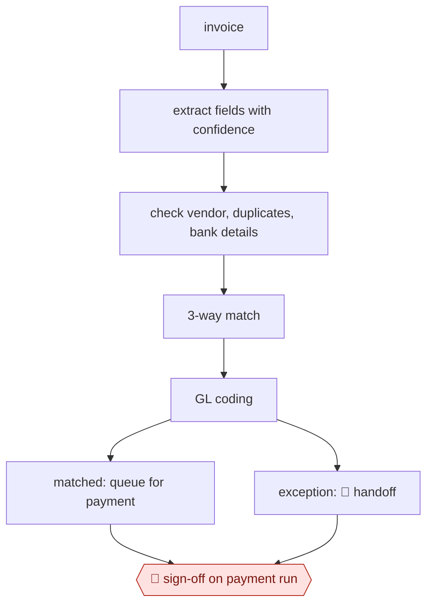

# Invoice extract-match-route

`PRO › FIN › AP` · sampled · evidence B · **draft: needs a reference example** ([how to add one](../../../../../CONTRIBUTING.md#1-add-an-example-run))

**Shape:** `invoice → extract fields with confidence → check vendor, duplicates, bank details → 3-way match → GL coding → matched: queue for payment | exception: 🛑 handoff → 🛑 sign-off on payment run`

<!-- shape diagram: generated by scripts/build_diagrams.py from `shape`; don't edit -->

<!-- end shape diagram -->

**Rules:** a bank-detail change *always* goes to a person, because it's a fraud signal. Payment approval follows the delegation-of-authority matrix. The full audit trail is kept for SOX.

## Public runs

Coverage as of 2026-11-06: **Partial**: first-hand runs that cover part of the shape or put checkpoints elsewhere. From [Where are the real runs?](../../../../../research/2026-11-real-runs.md); every number was re-checked against its page.

- [Subudhi, Vagvala, Jain Devichand, Uber Engineering](https://www.uber.com/blog/advancing-invoice-document-processing-using-genai) (2025-04-17). OCR → LLM extraction → rule checks → side-by-side human review → ERP. "overall accuracy rate of 90%"; handling time "by 70%"; "25-30% cost saving". *First-hand: yes; confidence: med.*

