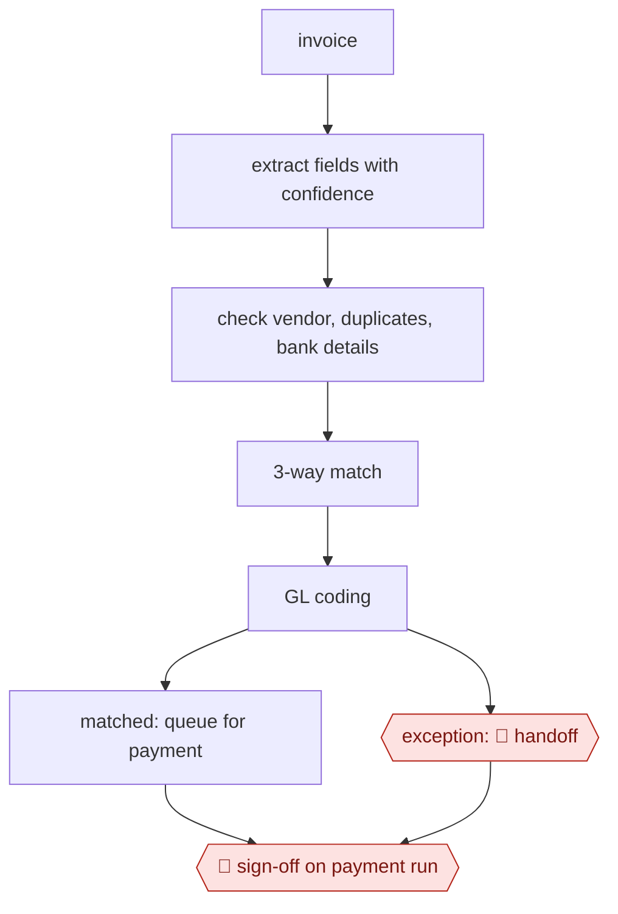

# Invoice extract-match-route

`PRO › FIN › AP` · sampled · evidence B · **draft: needs a reference example** ([how to add one](../../../../../CONTRIBUTING.md#1-add-an-example-run))

**Shape:** `invoice → extract fields with confidence → check vendor, duplicates, bank details → 3-way match → GL coding → matched: queue for payment | exception: 🛑 handoff → 🛑 sign-off on payment run`

<!-- shape diagram: generated by scripts/build_diagrams.py from `shape`; don't edit -->

<!-- end shape diagram -->

**Rules:** a bank-detail change *always* goes to a person, because it's a fraud signal. Payment approval follows the delegation-of-authority matrix. The full audit trail is kept for SOX.

## Steps
1. Take in invoices from a supplier portal (submitted against a PO) and from email, which creates tickets; an ingestion service pulls the attached PDFs. Pre-process low-resolution scans and handwriting, and standardize multi-page documents [[1]](#sources).
2. Extract fields: OCR (Uber's Vision Gateway), then an LLM for header fields and line items. Uber chose GPT-4 because fine-tuned models handled line items poorly. Track field-level accuracy, and send suppliers below a threshold for profiling and labeling [[1]](#sources).
3. Check vendor, duplicates and bank details: post-processing business rules cross-reference existing databases [[1]](#sources). A fraud agent flags "unverified bank details, mismatched vendor domains, or edited invoice copies" before approval, and payments above $5,000 to new or unverified accounts pause for human review [[2]](#sources). Any bank-detail change goes to a person (see Rules).
4. Run the 3-way match of invoice, PO and receipt. The agent clears small acceptable differences such as slight quantity changes, valid shipping fees and early deliveries. Anything unresolved becomes an exception with context and a suggested fix [[2]](#sources).
5. Apply GL codes line by line, learned from the organization's historical payment and accounting data [[2]](#sources). Matched invoices are queued for payment; exceptions are routed to a person.
6. 🛑 **Handoff**: an AP reviewer works each exception in a side-by-side view of the PDF and the extracted data, with alerts and soft warnings in one place [[1]](#sources), using the agent's context and suggested fix [[2]](#sources). Bank-detail changes always land here.
7. 🛑 **Sign-off**: approvers set by the delegation-of-authority matrix sign off on the payment run. Approval paths are configured by invoice size, vendor type or category, and the approval agent summarizes vendor history, contract terms, PO matches and prior invoices [[2]](#sources). Approved invoices go to the ERP for payment [[1]](#sources).

**Output:** Approved payables posted to the ERP for the payment run, with every action, decision and exception recorded in an audit trail [[2]](#sources).
**Failure modes → guards:** Hallucinated values, especially on line items → business-rule checks plus human review [[1]](#sources). New formats, 25+ languages, handwriting, and accuracy drift → pre-processing, labeling low-accuracy suppliers, accuracy tracking and periodic retraining [[1]](#sources). Messy vendor master or inconsistent coding history slows learning → clean them before rollout, with human review and corrections during the "30 to 90 days" learning period [[2]](#sources). Payment rerouted through a changed or unverified bank account → fraud signals and an automatic pause for human review [[2]](#sources); separation of duties through role-based access [[2]](#sources).

## Public runs

Coverage as of 2026-11-06: **Partial**: first-hand runs that cover part of the shape or put checkpoints elsewhere. From [Where are the real runs?](../../../../../research/2026-11-real-runs.md); every number was re-checked against its page.

- [Subudhi, Vagvala, Jain Devichand, Uber Engineering](https://www.uber.com/blog/advancing-invoice-document-processing-using-genai) (2025-04-17). OCR → LLM extraction → rule checks → side-by-side human review → ERP. "overall accuracy rate of 90%"; handling time "by 70%"; "25-30% cost saving". *First-hand: yes; confidence: med.*

## Sources

1. Rohit Subudhi, Rakesh Vagvala, Sushil Kumar Jain Devichand, Indrani Bose, Balaram Baral (Uber Engineering), Advancing Invoice Document Processing at Uber using GenAI, 2025-04-17. https://www.uber.com/blog/advancing-invoice-document-processing-using-genai
2. Ramp (vendor), What Is Agentic AI for Accounts Payable (AP) Automation?, 2025-11-03. https://ramp.com/blog/agentic-ai/agentic-ai-for-accounts-payable
