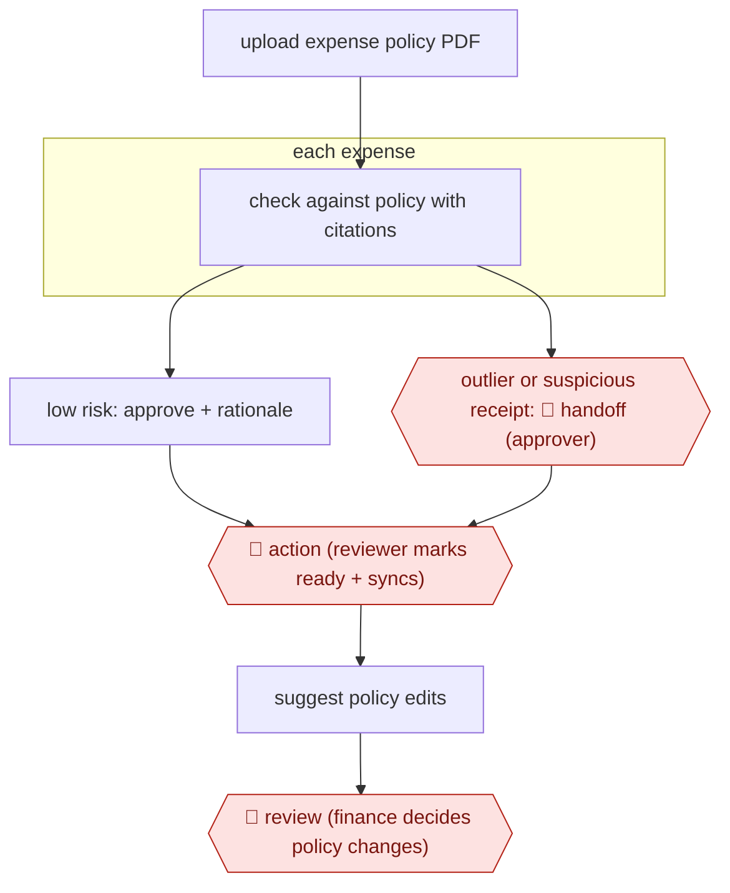

# Policy-cited expense review

`PRO › FIN › AP` · sampled · evidence B · **draft: needs a reference example** ([how to add one](../../../../../CONTRIBUTING.md#1-add-an-example-run))

**Shape:** `upload expense policy PDF → each expense: check against policy with citations → low risk: approve + rationale | outlier or suspicious receipt: 🛑 handoff (approver) → 🛑 action (reviewer marks ready + syncs) → suggest policy edits → 🛑 review (finance decides policy changes)`
**How it differs:** Closest is AWF-0022 Invoice extract-match-route (AP). That one extracts and 3-way-matches vendor invoices and ends in a payment-run sign-off. This one rules on employee expenses against a written policy. The agent approves low-risk items with no per-item human approval, and people see only escalations plus the ready/sync step, so deliverable and checkpoints differ.
**Variants:** `ramp-policy-agent`

<!-- shape diagram: generated by scripts/build_diagrams.py from `shape`; don't edit -->

<!-- end shape diagram -->

## Steps
1. Finance uploads the company's PDF expense policy, and the agent starts enforcing it [[2]](#sources).
2. The agent checks every employee expense around the clock, with the transaction details at hand, and flags suspicious receipts and invoices [[1]](#sources)[[2]](#sources).
3. Low-risk expenses are approved automatically. Each decision records a rationale and the policy clause it relied on, and every decision goes to an audit trail [[1]](#sources)[[2]](#sources).
4. 🛑 **Handoff**: true outliers go to a human approver with the agent's recommendation and rationale [[1]](#sources)[[2]](#sources).
5. 🛑 **Action**: the agent does not mark expenses ready or sync them to the ledger; a reviewer still does that by hand [[2]](#sources).
6. The agent answers employee policy questions over SMS and suggests policy edits based on usage and feedback [[1]](#sources)[[2]](#sources). 🛑 **Review**: finance decides whether to change the policy.

**Output:** Approved or escalated expense decisions with policy citations, ready for the reviewer to mark ready and sync to the GL.
**Failure modes → guards:** Neither source defines the low-risk and outlier thresholds → keep the human mark-ready/sync step and spot-check the audit trail. Accuracy claims are vendor-reported ("99% accuracy") → measure your own override rate before relying on auto-approval [[1]](#sources)[[2]](#sources).

## Public runs

Coverage as of 2026-11-06: **Weak**: only anonymous, vendor-linked or journalist-told accounts. Collected and re-checked in [Second collection pass](../../../../../research/2026-11-second-pass.md).

- [Ramp Community, New on Ramp | AI Agents](https://community.ramp.com/t/new-on-ramp-ai-agents/956) (2025-07-15). Vendor-reported early-adopter results; product lead confirms the agent doesn't auto-sync expenses. "85% reduction in manual reviews". *First-hand: vendor; confidence: low.*

## Sources

1. CPA Practice Advisor, Ramp Introduces AI Agents Suited for Controllers, 2025-07-10. https://www.cpapracticeadvisor.com/2025/07/10/ramp-introduces-ai-agents-suited-for-controllers/164684/
2. Ramp Community, New on Ramp | AI Agents, 2025-07-15 (replies to 2025-10-09). https://community.ramp.com/t/new-on-ramp-ai-agents/956
