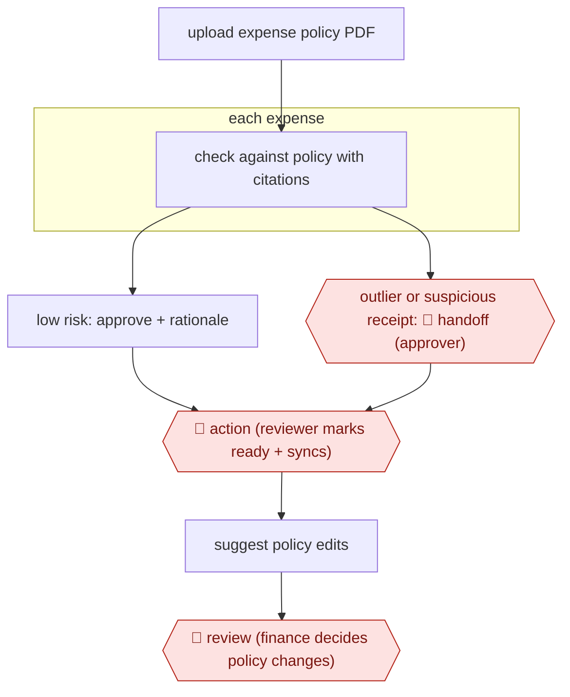

# Policy-cited expense review

`PRO › FIN › AP` · sampled · evidence B · **draft: needs a reference example** ([how to add one](../../../../../CONTRIBUTING.md#1-add-an-example-run))

**Shape:** `upload expense policy PDF → each expense: check against policy with citations → low risk: approve + rationale | outlier or suspicious receipt: 🛑 handoff (approver) → 🛑 action (reviewer marks ready + syncs) → suggest policy edits → 🛑 review (finance decides policy changes)`
**Variants:** `ramp-policy-agent`

<!-- shape diagram: generated by scripts/build_diagrams.py from `shape`; don't edit -->

<!-- end shape diagram -->

## Background

Employees spend company money on cards and claim it back through expense reports. Someone in finance must check each item against the company's written expense policy (what may be bought, up to what amount, with what receipt), approve it, and then release it into the accounting records. Most items are plainly within policy, and reading them all by hand is slow work that still lets a doctored receipt slip through. Here the agent reads every expense against the policy, approves the clearly low-risk ones and writes down which clause it relied on, and sends only the outliers to an approver. A person still decides each outlier, still marks approved expenses ready and syncs them to the ledger, and still decides whether the policy itself should change, because the policy is the company's rule and finance answers for what the books say.

**Terms:**
- **Expense policy**: the company's written rules on what employees may spend on, how much, and what proof they must keep.
- **Outlier**: an expense the agent cannot clearly approve under the policy.
- **Audit trail**: the record of each decision, who or what made it, and why.
- **GL (general ledger)**: the company's main accounting record. Syncing an expense posts it there.
- **Mark ready and sync**: the reviewer's final step that confirms an approved expense and sends it to the GL.

## Build it with an agent

**Form:** `service`. Expenses arrive all day as cards are used and claims are filed, nobody is at the keyboard when one is checked, and people see only outliers and the policy suggestions.

**You need:** the expense policy as a text or PDF reference file beside the skill; read access to the expense system's transactions, receipts, memos and employee details, through a script or MCP connector; a store outside the conversation for each decision, its rationale and the clause cited; a queue where outliers wait for an approver. Give the agent no tool that marks an expense ready, posts to the GL or edits the policy.

| Step | Built as |
|---|---|
| upload expense policy PDF | The policy file is stored beside the skill as a reference file; finance replaces it when the policy changes. |
| each expense: check against policy with citations | A cloud scheduled task, or your own scheduler starting `claude -p` or an Agent SDK program, takes each new expense. The skill has the agent compare it with the policy and return a decision, a rationale and the clause cited. |
| low risk: approve + rationale | The decision, rationale and clause are written to the state store as the audit trail. A script holds any dollar limit or category the agent may approve. |
| outlier or suspicious receipt: 🛑 handoff | The expense, the agent's recommendation and its rationale go to the approver's queue. |
| 🛑 action (reviewer marks ready + syncs) | The reviewer does this in the expense system; the agent has no tool for it. |
| suggest policy edits → 🛑 review | The skill collects clauses that caused escalations into a suggestion file for finance. |

**Checkpoints:** `handoff`: each outlier goes to the approver's queue with the recommendation and rationale, and the approver's decision is written back to the state store. `action`: the agent has no tool that marks an expense ready or posts to the GL, so a reviewer does it by hand. Dollar limits and categories that must never be auto-approved belong in the script or a `PreToolUse` hook, not only in the skill's text. `review`: the skill stops after writing suggested policy edits; it cannot change the policy file, and finance decides.

**Since the sources:** Sources date from 2025-07 (replies to 2025-10). Both describe Ramp's own agent product, so the steps are a vendor's account with no visible internals; the build above is an agent working from a policy file, not a copy of that product. A newer Ramp post (2026-01-13, [Policy Agent now available to all Ramp Plus customers](https://ramp.com/blog/ramp-policy-agent-ga-launch)) says the Policy Agent recommends approval, rejection or review, and that controllers choose which expenses it may approve automatically. The sources do not define the thresholds for low risk and outlier; the build leaves them to you. It leaves out the SMS question-answering and the learning from usage and feedback.

*A design based on this entry's steps and the tool documentation as of 2026-11, not a reported run.*

## Steps

*As reported by the sources.*

1. Finance uploads the company's PDF expense policy, and the agent starts enforcing it [[2]](#sources).
2. The agent checks every employee expense around the clock, with the transaction details at hand, and flags suspicious receipts and invoices [[1]](#sources)[[2]](#sources).
3. The agent approves low-risk expenses automatically. Each decision records a rationale and the policy clause it relied on, and every decision goes to an audit trail [[1]](#sources)[[2]](#sources).
4. 🛑 **Handoff**: the agent sends true outliers to a human approver with its recommendation and rationale [[1]](#sources)[[2]](#sources).
5. 🛑 **Action**: the agent does not mark expenses ready or sync them to the ledger; a reviewer still does that by hand [[2]](#sources).
6. The agent answers employee policy questions over SMS and suggests policy edits based on usage and feedback [[1]](#sources)[[2]](#sources). 🛑 **Review**: finance decides whether to change the policy.

**Output:** Approved or escalated expense decisions with policy citations, ready for the reviewer to mark ready and sync to the GL.
**Failure modes → guards:** Neither source defines the low-risk and outlier thresholds → keep the human mark-ready/sync step and spot-check the audit trail. Accuracy claims are vendor-reported ("99% accuracy") → measure your own override rate before relying on auto-approval [[1]](#sources)[[2]](#sources).
**How it differs:** Closest is AWF-0022 Invoice extract-match-route (AP). That one extracts and 3-way-matches vendor invoices and ends in a payment-run sign-off. This one rules on employee expenses against a written policy. The agent approves low-risk items with no per-item human approval, and people see only escalations plus the ready/sync step, so deliverable and checkpoints differ.

## Public runs

Coverage as of 2026-11-06: **Weak**: only anonymous, vendor-linked or journalist-told accounts. Collected and re-checked in [Second collection pass](../../../../../research/2026-11-second-pass.md).

- [Ramp Community, New on Ramp | AI Agents](https://community.ramp.com/t/new-on-ramp-ai-agents/956) (2025-07-15). Vendor-reported early-adopter results; product lead confirms the agent doesn't auto-sync expenses. "85% reduction in manual reviews". *First-hand: vendor; confidence: low.*

## Sources

1. CPA Practice Advisor, Ramp Introduces AI Agents Suited for Controllers, 2025-07-10. https://www.cpapracticeadvisor.com/2025/07/10/ramp-introduces-ai-agents-suited-for-controllers/164684/
2. Ramp Community, New on Ramp | AI Agents, 2025-07-15 (replies to 2025-10-09). https://community.ramp.com/t/new-on-ramp-ai-agents/956
