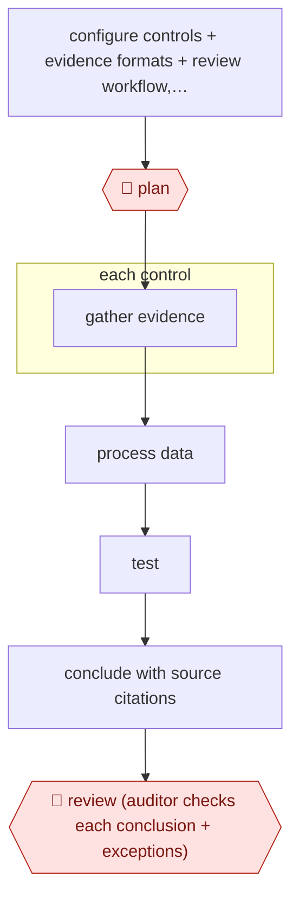

# Full-population control testing

`PRO › FIN › AUDIT` · checkpointed · evidence B · **draft: needs a reference example** ([how to add one](../../../../../CONTRIBUTING.md#1-add-an-example-run))

**Shape:** `configure controls + evidence formats + review workflow, agree KPI → 🛑 plan → each control: gather evidence → process data → test → conclude with source citations → 🛑 review (auditor checks each conclusion + exceptions)`
**Variants:** `kaption` · `kpmg-clara`

<!-- shape diagram: generated by scripts/build_diagrams.py from `shape`; don't edit -->

<!-- end shape diagram -->

## Background

A company keeps internal controls: checks built into its processes so that mistakes and fraud in its financial figures get caught, such as "every payment over a set amount needs a second approver". Internal auditors, and the external auditors who give an opinion on the accounts, test whether each control actually worked. Because there is never time to test every instance, they test a sample and assume the rest behaved like it. Each test also means requesting documents, reading them and writing up the result. Here the agent gathers the evidence for every control, tests the whole population instead of a sample, and cites the source document behind each conclusion. An auditor still reviews every conclusion and every exception, because the auditor signs the opinion and carries the professional liability for it.

**Terms:**
- **Control**: a step in a process that prevents or catches an error or fraud.
- **ICFR (internal control over financial reporting)**: the set of controls over how financial statements are produced. Management must assess them.
- **Population and sample**: all the instances a control applies to, and the few picked for testing. Full-population testing checks every instance.
- **Workpaper**: the auditor's file for one test: what was tested, the evidence, the conclusion and the exceptions.
- **Exception**: an instance where the control did not work, or the evidence does not support it.
- **Vouching**: checking a recorded item (an expense) against the document that proves it.
- **Unrecorded liabilities**: debts the company owes that are missing from the books. Auditors search for them.
- **Substantive procedures**: audit tests of the figures themselves, as opposed to tests of controls.
- **False negative**: a control failure the test reports as a pass.
- **Big Four**: the four largest accounting firms.
- **KPI**: a target measure agreed in advance. Here it is the agreed standard the testing must meet.

## Build it with an agent

**Form:** `project`. One skill can describe a single control test, but the work fans out over dozens to hundreds of controls between two checkpoints, each worker should return evidence and a cited conclusion without seeing the others, and a rule must hold every time: nothing is concluded without a citation, and client evidence is read, never changed. Those call for custom subagents and a hook.

**You need:** a list of the controls to test, each with its description, the test steps and what counts as a pass; read access to the evidence (ledger extracts, approval logs, documents) through MCP connectors or exported files; a `CLAUDE.md` with the workpaper format and the rule that every conclusion cites its source; a place for the workpapers to land. Use only a setup your firm or client has approved for confidential client data, and give the agent no write access to the systems it reads.

| Step | Built as |
|---|---|
| configure controls + evidence formats + review workflow, agree KPI → 🛑 plan | A skill holds one reference file per control and the workpaper template. It writes the test plan (controls, evidence per control, the KPI) to a file and stops. |
| each control: gather evidence → process data → test | A custom subagent per control, with read-only tools, runs the test steps from the reference file. For many controls a dynamic workflow runs one subagent per control and cross-checks results. |
| conclude with source citations | Each subagent returns a result, a conclusion and the file and location of every piece of evidence. A `Stop` hook or script rejects a workpaper whose conclusion has no citation. |
| 🛑 review | See Checkpoints. |

**Checkpoints:** `plan`: the skill ends after writing the test plan and does not start the workers until the audit lead marks the file approved. `review`: the agent has no tool to finalise a workpaper or file it in the audit file; it saves drafts, and the auditor opens each cited source, accepts or rejects each conclusion and decides what to do with each exception.

**Since the sources:** Sources date from 2025-04 to 2026, with one undated. The newest, source 4 (KPMG's 2025 Audit Quality Report, 2026), is a PDF whose text could not be read here, so it was not checked against the entry. Source 1 is a vendor case study of a pilot; sources 2 and 3 describe KPMG's platform in an announcement and an interview with few steps. The sources describe vendor platforms (`kaption`, `kpmg-clara`) with their own evidence connectors and review screens; the build above uses general agent tooling and your own connectors and does not replace those platforms. The pilot figures in source 1 are the vendor's, for its product, and do not carry over to this build. Client evidence is confidential and often privileged, so settle with the client where it may be processed before connecting anything.

*A design based on this entry's steps and the tool documentation as of 2026-11, not a reported run.*

## Steps

*As reported by the sources.*

1. The audit team configures the tool to the organization's controls, evidence formats and review workflow [[1]](#sources).
2. 🛑 **Plan**: audit leadership agrees a KPI before the first run [[1]](#sources).
3. Agents gather evidence, process the data and test each control, citing every conclusion to its source [[1]](#sources). At a Big Four firm, agents perform substantive procedures such as expense vouching and the search for unrecorded liabilities [[2]](#sources).
4. 🛑 **Review**: the audit team reviews each cited conclusion and the exceptions [[1]](#sources). The firm says it keeps 'a human-in-the-loop' [[2]](#sources).

**Output:** Tested-control workpapers with cited conclusions and exceptions, reviewed by auditors, feeding ICFR assessment or the audit file.
**Failure modes → guards:** False negatives (under 10% in pilot) → auditor review and a KPI agreed before rollout [[1]](#sources).

**How it differs:** AWF-0005 Alert enrich and adjudicate (SECOPS) adjudicates security alerts. This tests financial controls against evidence and produces audit workpapers.
**Recent practice (2026):**
- Plan step: at KPMG the auditor sets up the run by 'selecting the right data elements, combining the best methodology steps', and the agent then picks which expenses need testing, ingests the documentation, extracts dates and amounts, and writes the workpaper (CFO.com 2025-05-16). [[3]](#sources)

## Public runs

Coverage as of 2026-11-06: **Partial**: first-hand runs that cover part of the shape or put checkpoints elsewhere. Collected and re-checked in [New workflows for empty categories](../../../../../research/2026-11-new-workflows.md). More runs added in [Third collection pass](../../../../../research/2026-11-third-pass.md).

- [Kaption, Celsa Group pilot](https://www.kaption.io/case-studies/celsa) (n.d.). 60 ICFR controls tested by agents with cited conclusions for internal audit review. "Agent reasoning aligned with the auditors' own judgement in 85% of cases". *First-hand: vendor; confidence: med.*
- [KPMG, Clara AI agents](https://kpmg.com/us/en/media/news/kpmg-clara-smart-audit-platform.html) (2025-04-23). Firm-wide agents for vouching and unrecorded-liability search; few workflow details. "more than 95,000 auditors globally". *First-hand: yes (announcement, not a measured run); confidence: low.*
- [CFO.com, How KPMG is using AI to revamp their audit practice](https://www.cfo.com/news/how-kpmg-thomas-mackenzie-is-using-clara-ai-to-revamp-their-audit-practice-/748316/) (2025-05-16). KPMG audit leader describes the Clara expense-validation agent's steps and the auditor's guiding and review role. "If we can do 100% testing, it's like placing a filter across the river.". *First-hand: interview; confidence: med.*

## Sources

1. Kaption, How Celsa Group piloted AI-powered control testing with Kaption, n.d. https://www.kaption.io/case-studies/celsa
2. KPMG LLP, KPMG Advances AI Integration in KPMG Clara Smart Audit Platform, 2025-04-23. https://kpmg.com/us/en/media/news/kpmg-clara-smart-audit-platform.html
3. Adam Zaki, How KPMG is using AI to revamp their audit practice (interview with Thomas Mackenzie), CFO.com, 2025-05-16. https://www.cfo.com/news/how-kpmg-thomas-mackenzie-is-using-clara-ai-to-revamp-their-audit-practice-/748316/
4. KPMG LLP, 2025 Audit Quality Report, 2026. https://kpmg.com/kpmg-us/content/dam/kpmg/pdf/2026/2025-audit-quality-report.pdf
