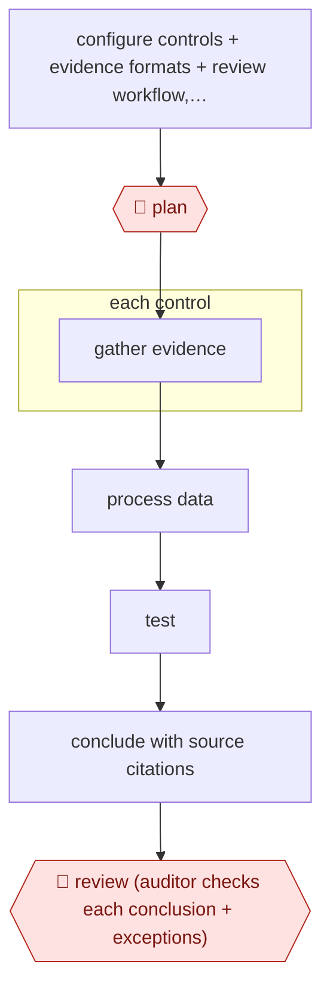

# Full-population control testing

`PRO › FIN › AUDIT` · checkpointed · evidence B · **draft: needs a reference example** ([how to add one](../../../../../CONTRIBUTING.md#1-add-an-example-run))

**Shape:** `configure controls + evidence formats + review workflow, agree KPI → 🛑 plan → each control: gather evidence → process data → test → conclude with source citations → 🛑 review (auditor checks each conclusion + exceptions)`
**How it differs:** AWF-0005 Alert enrich and adjudicate (SECOPS) adjudicates security alerts. This tests financial controls against evidence and produces audit workpapers.
**Variants:** `kaption` · `kpmg-clara`

<!-- shape diagram: generated by scripts/build_diagrams.py from `shape`; don't edit -->

<!-- end shape diagram -->

## Steps
1. Configure the tool to the organization's controls, evidence formats and review workflow [[1]](#sources).
2. 🛑 **Plan**: Audit leadership agrees a KPI before the first run [[1]](#sources).
3. Agents gather evidence, process the data and test each control, citing every conclusion to its source [[1]](#sources). At a Big Four firm, agents perform substantive procedures such as expense vouching and the search for unrecorded liabilities [[2]](#sources).
4. 🛑 **Review**: The audit team reviews each cited conclusion and the exceptions [[1]](#sources). The firm says it keeps 'a human-in-the-loop' [[2]](#sources).

**Output:** Tested-control workpapers with cited conclusions and exceptions, reviewed by auditors, feeding ICFR assessment or the audit file.
**Failure modes → guards:** False negatives (under 10% in pilot) → auditor review and a KPI agreed before rollout [[1]](#sources).

## Public runs

Coverage as of 2026-11-06: **Partial**: first-hand runs that cover part of the shape or put checkpoints elsewhere. Collected and re-checked in [New workflows for empty categories](../../../../../research/2026-11-new-workflows.md).

- [Kaption, Celsa Group pilot](https://www.kaption.io/case-studies/celsa) (n.d.). 60 ICFR controls tested by agents with cited conclusions for internal audit review. "Agent reasoning aligned with the auditors' own judgement in 85% of cases". *First-hand: vendor; confidence: med.*
- [KPMG, Clara AI agents](https://kpmg.com/us/en/media/news/kpmg-clara-smart-audit-platform.html) (2025-04-23). Firm-wide agents for vouching and unrecorded-liability search; few workflow details. "more than 95,000 auditors globally". *First-hand: yes (announcement, not a measured run); confidence: low.*

## Sources

1. Kaption, How Celsa Group piloted AI-powered control testing with Kaption, n.d. https://www.kaption.io/case-studies/celsa
2. KPMG LLP, KPMG Advances AI Integration in KPMG Clara Smart Audit Platform, 2025-04-23. https://kpmg.com/us/en/media/news/kpmg-clara-smart-audit-platform.html
