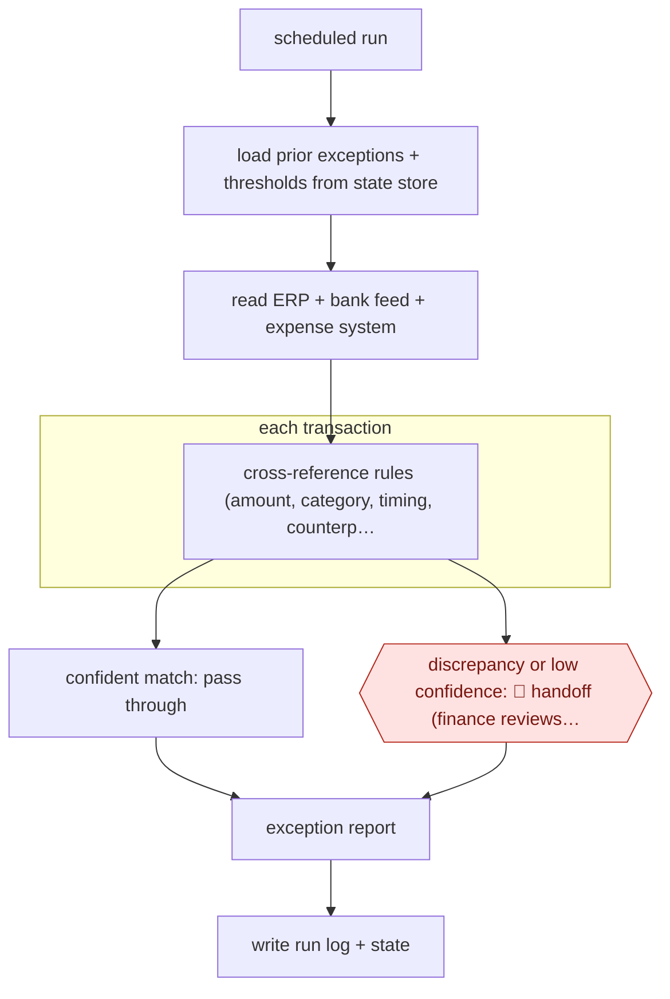

# Exception-only reconciliation run

`PRO › FIN › CLOSE` · sampled · evidence A · **draft: needs a reference example** ([how to add one](../../../../../CONTRIBUTING.md#1-add-an-example-run))

**Shape:** `scheduled run → load prior exceptions + thresholds from state store → read ERP + bank feed + expense system → each transaction: cross-reference rules (amount, category, timing, counterparty) → confident match: pass through | discrepancy or low confidence: 🛑 handoff (finance reviews exception) → exception report → write run log + state`
**How it differs:** AWF-0038 Workpaper-matched close agents: there the controller reviews everything before the books lock (checkpointed). Here routine items clear with no human review and only exceptions reach a person (sampled), and the deliverable is an exception report, not close workpapers and JEs.
**Variants:** `claude-code-skills` · `ledge`

<!-- shape diagram: generated by scripts/build_diagrams.py from `shape`; don't edit -->

<!-- end shape diagram -->

## Steps
1. Define the process before building: the inputs, the matching rules, the outputs, and which exceptions need a person. The Graph Digital build took under a day once this was fixed [[1]](#sources).
2. Each run loads its state from an explicit store (open exceptions, prior decisions, agreed thresholds, processing history) instead of relying on the conversation window [[1]](#sources).
3. Read the three source systems (ERP, bank feed, expense management) through single-purpose CLI wrappers that return clean structured data. The author reports that MCP connections in this job increased run time, cost and false-positive exceptions [[1]](#sources).
4. Cross-reference transactions against the defined rules (amounts, categories, timing, counterparties) and identify where systems disagree or data falls outside expected parameters [[1]](#sources).
5. Routine, confidently matched items pass through without anyone looking at them. 🛑 **Handoff**: items the agent cannot categorise with confidence go into a structured exception report for finance to resolve [[1]](#sources). In a vendor deployment, authority bounds limit what can be auto-cleared: a per-item dollar cap, no related-party or write-off items, and no restating closed periods. Below-threshold items go to a named senior reconciliation lead with a provenance packet [[2]](#sources).
6. Log every run: the decision, the context available, the tools called and the output. Update the state store for the next run [[1]](#sources). Reviewer resolutions can feed back into matching confidence, and thresholds are recalibrated against override rates [[2]](#sources).

**Output:** A structured exception report with the evidence for each flagged item. It replaces the BI dashboard and exception-management SaaS, and finance resolves the items before or during close.
**Failure modes → guards:** Too many false-positive exceptions (more manual work, not less) → lean tool interfaces, tuned thresholds. Context lost between runs → explicit state store. Auto-clearing items it should not → hard authority bounds (dollar cap, related-party exclusions) and quarterly recalibration against override rates [2].

## Public runs

Coverage as of 2026-11-13: **Partial**: first-hand runs that cover part of the shape or put checkpoints elsewhere. Collected and re-checked in [Third collection pass](../../../../../research/2026-11-third-pass.md).

- [Stefan Finch, Graph Digital reconciliation agent](https://graph.digital/guides/ai-agents/replace-saas-with-ai-skill) (2026-04-18). Founder's own production reconciliation agent across ERP, bank and expense data; exceptions only to humans. "Six months of continuous production. Zero failures.". *First-hand: yes; confidence: med.*
- [Grids and Guides, Autonomous reconciliation at the sub-ledger](https://gridsandguides.com/case-studies/autonomous-reconciliation) (n.d.). Unnamed client, four sub-ledgers; auto-clear inside authority bounds, rest to a named reviewer. "94% of monthly line items matched with zero human touch". *First-hand: vendor; confidence: low.*

## Sources

1. Stefan Finch (Graph Digital), Replace SaaS with AI: Graph Digital's finance reconciliation case study, 2026-04-18. https://graph.digital/guides/ai-agents/replace-saas-with-ai-skill
2. Grids and Guides Technologies, Autonomous Reconciliation at the Sub-Ledger — Case Study, n.d. https://gridsandguides.com/case-studies/autonomous-reconciliation
