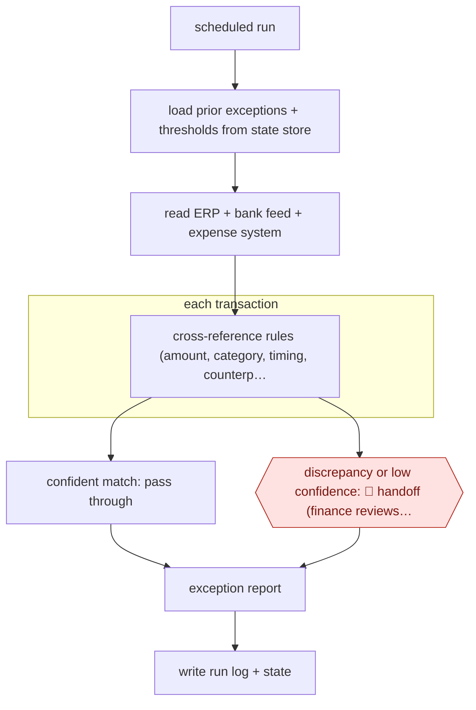

# Exception-only reconciliation run

`PRO › FIN › CLOSE` · sampled · evidence A · **draft: needs a reference example** ([how to add one](../../../../../CONTRIBUTING.md#1-add-an-example-run))

**Shape:** `scheduled run → load prior exceptions + thresholds from state store → read ERP + bank feed + expense system → each transaction: cross-reference rules (amount, category, timing, counterparty) → confident match: pass through | discrepancy or low confidence: 🛑 handoff (finance reviews exception) → exception report → write run log + state`
**Variants:** `claude-code-skills` · `ledge`

<!-- shape diagram: generated by scripts/build_diagrams.py from `shape`; don't edit -->

<!-- end shape diagram -->

## Background

Reconciliation is the bookkeeping check that one transaction appears, with the same amount, in every system that should hold it: the accounting system, the bank statement and the tool staff use to claim expenses. Finance teams do it before they close each month's books. Most of the effort goes on confirming the many items that agree in order to find the few that do not. Here the agent does the matching on a schedule and lets through everything it matches with confidence, so people see only the items that disagree or that it cannot classify. A person still resolves those. Deciding why two records differ (a timing gap, an error, something improper) and what entry corrects it is an accounting judgement that someone must be able to defend to an auditor.

**Terms:**
- **ERP**: the company's main accounting and operations system.
- **Close**: the month-end process of finalising the books; after it, the period's figures are fixed.
- **Exception**: a transaction the matching rules could not clear.
- **False positive**: an item flagged as an exception that was in fact fine.
- **State store**: a file or database outside the agent's conversation that holds what earlier runs decided.
- **CLI wrapper**: a small command-line script that does one job, such as fetching yesterday's bank lines, and prints structured data.
- **MCP**: a standard way of connecting an agent to an outside system's tools and data.
- **Authority bounds**: fixed limits on what the agent may clear by itself, such as a maximum amount per item.
- **Related-party item, write-off**: a transaction with a connected company or person; a decision to stop expecting payment. Both get extra scrutiny from auditors.

## Build it with an agent

**Form:** `service`. Each run starts on a schedule with nobody present, and people see only the exception report.

**You need:** read-only access to the ERP, the bank feed and the expense system, through one small script per system or through MCP connectors; a state store the run can read and write (a file in a repository or a database table) for open exceptions, earlier decisions and thresholds; a place where the exception report lands, such as a ticket queue or shared folder. Give the agent no way to post entries to the ledger.

| Step | Built as |
|---|---|
| scheduled run | A cloud scheduled task where the systems are reachable from it, or your own scheduler starting `claude -p` or an Agent SDK program. |
| load prior exceptions + thresholds from state store | The skill's first instruction: read the state file. Nothing is carried over from an earlier conversation. |
| read ERP + bank feed + expense system | One script per system beside the skill, each returning structured rows. |
| each transaction: cross-reference rules | The rules sit in a reference file beside the skill. A script clears exact matches; the agent works through what is left. |
| confident match: pass through | Written to the run log. No person is involved. |
| discrepancy or low confidence: 🛑 handoff | Added to the exception report with the records from each system and the rule that failed. |
| exception report → write run log + state | The skill's last step. The calling program, or a `Stop` hook, confirms the state file was written before the run counts as finished. |

**Checkpoints:** `handoff`: the exception report is the only thing the run sends to people, and the agent has no tool that changes the ledger, so a person resolves each exception in the ERP. Their decision goes into the state store for the next run. Limits on what may be cleared without a person (an amount cap, no related-party or write-off items) belong in the matching script or a hook, where they cannot be skipped, and not in the skill's text.

**Since the sources:** Source 1 dates from 2026-04; source 2 is undated. Source 1 is filed under the tool `claude-code-skills`, and this build follows the design it reports: an explicit state store, one script per system, and output limited to exceptions. Cloud scheduled tasks, in research preview as of 2026-11, can now supply the schedule without a scheduler of your own. Source 2 describes a vendor product; its recalibration of thresholds against how often reviewers overrule the agent is not part of this build.

*A design based on this entry's steps and the tool documentation as of 2026-11, not a reported run.*

## Steps

*As reported by the sources.*

1. Before building, the team defines the process: the inputs, the matching rules, the outputs, and which exceptions need a person. The Graph Digital build took under a day once this was fixed [[1]](#sources).
2. At the start of each run, the agent loads its state from an explicit store (open exceptions, prior decisions, agreed thresholds, processing history) instead of relying on the conversation window [[1]](#sources).
3. The agent reads the three source systems (ERP, bank feed, expense management) through single-purpose CLI wrappers that return clean structured data. The author reports that MCP connections in this job increased run time, cost and false-positive exceptions [[1]](#sources).
4. The agent cross-references transactions against the defined rules (amounts, categories, timing, counterparties) and identifies where systems disagree or data falls outside expected parameters [[1]](#sources).
5. Routine, confidently matched items pass through without anyone looking at them. 🛑 **Handoff**: items the agent cannot categorise with confidence go into a structured exception report for finance to resolve [[1]](#sources). In a vendor deployment, authority bounds limit what can be auto-cleared: a per-item dollar cap, no related-party or write-off items, and no restating closed periods. Below-threshold items go to a named senior reconciliation lead with a provenance packet [[2]](#sources).
6. The agent logs every run: the decision, the context available, the tools called and the output. It updates the state store for the next run [[1]](#sources). Reviewer resolutions can feed back into matching confidence, and thresholds are recalibrated against override rates [[2]](#sources).

**Output:** A structured exception report with the evidence for each flagged item. It replaces the BI dashboard and exception-management SaaS, and finance resolves the items before or during close.
**Failure modes → guards:** Too many false-positive exceptions (more manual work, not less) → lean tool interfaces, tuned thresholds. Context lost between runs → explicit state store. Auto-clearing items it should not → hard authority bounds (dollar cap, related-party exclusions) and quarterly recalibration against override rates [2].
**How it differs:** AWF-0038 Workpaper-matched close agents: there the controller reviews everything before the books lock (checkpointed). Here routine items clear with no human review and only exceptions reach a person (sampled), and the deliverable is an exception report, not close workpapers and JEs.

## Public runs

Coverage as of 2026-11-13: **Partial**: first-hand runs that cover part of the shape or put checkpoints elsewhere. Collected and re-checked in [Third collection pass](../../../../../research/2026-11-third-pass.md).

- [Stefan Finch, Graph Digital reconciliation agent](https://graph.digital/guides/ai-agents/replace-saas-with-ai-skill) (2026-04-18). Founder's own production reconciliation agent across ERP, bank and expense data; exceptions only to humans. "Six months of continuous production. Zero failures.". *First-hand: yes; confidence: med.*
- [Grids and Guides, Autonomous reconciliation at the sub-ledger](https://gridsandguides.com/case-studies/autonomous-reconciliation) (n.d.). Unnamed client, four sub-ledgers; auto-clear inside authority bounds, rest to a named reviewer. "94% of monthly line items matched with zero human touch". *First-hand: vendor; confidence: low.*

## Sources

1. Stefan Finch (Graph Digital), Replace SaaS with AI: Graph Digital's finance reconciliation case study, 2026-04-18. https://graph.digital/guides/ai-agents/replace-saas-with-ai-skill
2. Grids and Guides Technologies, Autonomous Reconciliation at the Sub-Ledger — Case Study, n.d. https://gridsandguides.com/case-studies/autonomous-reconciliation
