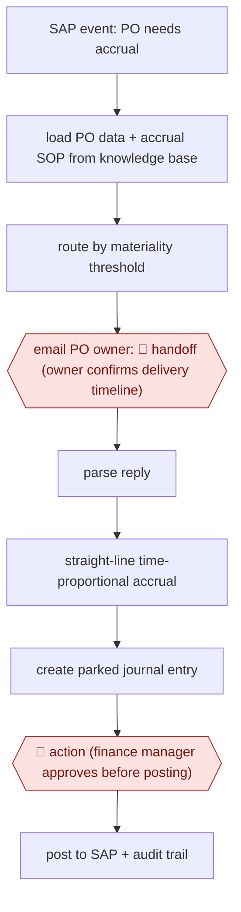

# Owner-confirmed PO accruals

`PRO › FIN › CLOSE` · checkpointed · evidence A · **draft: needs a reference example** ([how to add one](../../../../../CONTRIBUTING.md#1-add-an-example-run))

**Shape:** `SAP event: PO needs accrual → load PO data + accrual SOP from knowledge base → route by materiality threshold → email PO owner: 🛑 handoff (owner confirms delivery timeline) → parse reply → straight-line time-proportional accrual → create parked journal entry → 🛑 action (finance manager approves before posting) → post to SAP + audit trail`
**How it differs:** AWF-0038 (workpaper-matched close agents) prepares all close areas in a monthly batch with one controller review; AWF-0164 reconciles transactions and hands off exceptions. Here the agent runs per PO on events, asks the PO owner for facts, and needs per-entry approval before posting. Swap fails on deliverable (single accrual JE) and checkpoints (owner handoff + per-entry action).
**Variants:** `amazon-bedrock-agentcore` · `strands-agents` · `sap-s4hana`

<!-- shape diagram: generated by scripts/build_diagrams.py from `shape`; don't edit -->

<!-- end shape diagram -->

## Steps
1. Lambda jobs poll SAP S/4HANA (OData events) for custom-tooling purchase orders needing accrual; tooling runs 12–24 months and invoices can arrive 18+ months after the PO [[1]](#sources).
2. The agent retrieves the accrual SOPs (dollar thresholds, PO characteristics, delivery timelines, GAAP rules) from a knowledge base and routes each PO through a validation path by materiality [[1]](#sources).
3. Through an MCP server it sends emails via Amazon SES and parses the replies; the manual process it replaced required emailing PO owners to confirm delivery dates. 🛑 **Handoff**: the PO owner supplies the confirmation [[1]](#sources).
4. The agent calculates time-proportional accruals on a straight-line basis and creates parked journal entries in SAP; every step is logged with timestamps in DynamoDB [[1]](#sources).
5. 🛑 **Action**: finance managers keep final approval before any journal entry is posted; edge cases they find are fed back into the SOP documents [[1]](#sources).

**Output:** Approved, posted accrual journal entries per PO with a full audit trail for external auditors.
**Failure modes → guards:** Brittle hard-coded rules → business logic kept in editable SOPs; unreviewed postings → entries stay parked until manager approval; SOP gaps → manager review identifies edge cases for SOP refinement [1].

## Public runs

Coverage as of 2026-11-13: **Partial**: first-hand runs that cover part of the shape or put checkpoints elsewhere. Collected and re-checked in [Fourth collection pass](../../../../../research/2026-11-fourth-pass.md).

- [AWS + Rivian, How Rivian Accelerated Finance Operations with AI Agents on Amazon Bedrock](https://aws.amazon.com/blogs/awsforsap/how-rivian-accelerated-finance-operations-with-ai-agents-on-amazon-bedrock/) (2026-08-13). Production PO-accrual agent, parked JEs, finance-manager approval before posting. "eliminating over 15 days of manual work per cycle". *First-hand: yes; confidence: med.*

## Sources

1. Sagar Tallapragada, Ramkrishna Borhade, Matt Reed (AWS), co-authored by Arunkumar Malli and Sandeep Kodre (Rivian), How Rivian Accelerated Finance Operations with AI Agents on Amazon Bedrock, 2026-08-13. https://aws.amazon.com/blogs/awsforsap/how-rivian-accelerated-finance-operations-with-ai-agents-on-amazon-bedrock/
