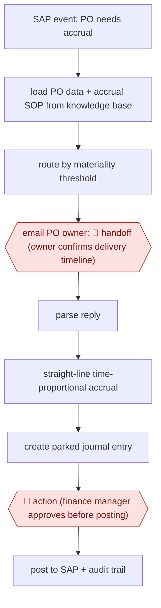

# Owner-confirmed PO accruals

`PRO › FIN › CLOSE` · checkpointed · evidence A · **draft: needs a reference example** ([how to add one](../../../../../CONTRIBUTING.md#1-add-an-example-run))

**Shape:** `SAP event: PO needs accrual → load PO data + accrual SOP from knowledge base → route by materiality threshold → email PO owner: 🛑 handoff (owner confirms delivery timeline) → parse reply → straight-line time-proportional accrual → create parked journal entry → 🛑 action (finance manager approves before posting) → post to SAP + audit trail`
**Variants:** `amazon-bedrock-agentcore` · `strands-agents` · `sap-s4hana`

<!-- shape diagram: generated by scripts/build_diagrams.py from `shape`; don't edit -->

<!-- end shape diagram -->

## Background

When a company has received goods or services but has not yet been billed, accounting rules still require the cost to be recorded in the month it was incurred. That entry is called an accrual. For a purchase order (PO) that covers long-running work, such as custom tooling that takes one to two years to build, finance must find out how far delivery has got, work out how much of the cost belongs to the current period, and book it. The facts sit with the person who ordered the work, so finance emails the PO owner, waits for a reply and builds a spreadsheet. Here the agent starts from each PO that needs an accrual, asks the PO owner, reads the reply, works out the amount by the company's written procedure and prepares the entry without posting it. The PO owner must confirm the facts because nobody else knows them, and a finance manager approves each entry before it is posted, because a posted entry changes the books that auditors examine.

**Terms:**
- **PO (purchase order)**: the company's order to a supplier, stating what is bought and the agreed price.
- **Accrual**: an expense recorded in the month it was incurred, before the invoice arrives.
- **Time-proportional, straight-line accrual**: spreading the cost evenly over the delivery period and booking the share that falls in the current month.
- **Journal entry (JE)**: a record in the books of what is debited and credited. A **parked** entry is saved in the ERP but not yet posted to the books.
- **ERP, SAP**: the company's main accounting system; SAP is one such product.
- **SOP (standard operating procedure)**: the company's written rules for a task, here when and how to accrue.
- **Materiality**: how large an amount must be before it deserves more care. Small items can follow a lighter path.
- **GAAP**: the accounting standards a company's books must follow.
- **Audit trail**: the record of each step, when it happened and who or what did it, which external auditors read.

## Build it with an agent

**Form:** `service`. Each run is triggered by an event, a PO that needs an accrual, with nobody at the keyboard, and it must wait days for an owner's reply, so state lives outside the conversation and people see only the owner's question and the parked entry.

**You need:** read access to purchase orders in the ERP, and permission to create parked entries but not post them; the accrual SOP and the materiality thresholds as reference files; a way to send and receive mail from a mailbox the company controls; a state store (a database table or file) for each PO's status, the owner's reply and the log of steps; a review queue for the finance manager.

| Step | Built as |
|---|---|
| SAP event: PO needs accrual | A scheduled job queries the ERP for POs that need an accrual and starts a run per PO, using a cloud scheduled task, or your own scheduler starting `claude -p` or an Agent SDK program. |
| load PO data + accrual SOP from knowledge base → route by materiality threshold | The skill's first instruction: read the PO and the SOP reference files. A script applies the thresholds; the agent handles what the rules do not settle. |
| email PO owner: 🛑 handoff | The agent drafts and sends the question through a mail connector and records "waiting for owner" in the state store. The run ends; the owner's reply starts the next run. |
| parse reply → straight-line time-proportional accrual | The agent reads the reply, extracts the delivery timeline and a script computes the straight-line amount. |
| create parked journal entry | A script creates the parked entry in the ERP, using credentials that cannot post. |
| 🛑 action (finance manager approves before posting) | The entry and its workings go to the finance manager's queue. |
| post to SAP + audit trail | The manager posts in the ERP. The run writes every step to the state store with a timestamp. |

**Checkpoints:** `handoff`: the run sends one question to the PO owner and stops; nothing proceeds until the reply is recorded, and an owner who does not reply stays visible in the state store. `action`: the agent's credentials can create parked entries and cannot post them, so the finance manager posts. This limit belongs in the ERP's permissions, not only in the skill's text.

**Since the sources:** Source 1 dates from 2026-08, and the public run is the same account. It is a customer story written with the cloud vendor and reports its own stack, so the build above is a design from its steps, not a copy of it. The source's agent runtime, serverless jobs, knowledge base and database are replaced here by a skill with reference files, a scheduler and a state store. Cloud scheduled tasks are in research preview as of 2026-11. The source's reported result (15 days of manual work eliminated per cycle) is not claimed for this build. The feedback of edge cases into the SOP is left to the finance manager editing the reference file.

*A design based on this entry's steps and the tool documentation as of 2026-11, not a reported run.*

## Steps

*As reported by the sources.*

1. Serverless jobs (AWS Lambda) poll SAP S/4HANA (OData events) for custom-tooling purchase orders needing accrual; tooling runs 12–24 months and invoices can arrive 18+ months after the PO [[1]](#sources).
2. The agent retrieves the accrual SOPs (dollar thresholds, PO characteristics, delivery timelines, GAAP rules) from a knowledge base and routes each PO through a validation path by materiality [[1]](#sources).
3. Through an MCP server the agent sends emails via Amazon SES and parses the replies; the manual process it replaced required emailing PO owners to confirm delivery dates. 🛑 **Handoff**: the PO owner supplies the confirmation [[1]](#sources).
4. The agent calculates time-proportional accruals on a straight-line basis and creates parked journal entries in SAP; every step is logged with timestamps in DynamoDB [[1]](#sources).
5. 🛑 **Action**: finance managers keep final approval before any journal entry is posted; edge cases they find are fed back into the SOP documents [[1]](#sources).

**Output:** Approved, posted accrual journal entries per PO with a full audit trail for external auditors.
**Failure modes → guards:** Brittle hard-coded rules → business logic kept in editable SOPs; unreviewed postings → entries stay parked until manager approval; SOP gaps → manager review identifies edge cases for SOP refinement [1].
**How it differs:** AWF-0038 (workpaper-matched close agents) prepares all close areas in a monthly batch with one controller review; AWF-0164 reconciles transactions and hands off exceptions. Here the agent runs per PO on events, asks the PO owner for facts, and needs per-entry approval before posting. Swap fails on deliverable (single accrual JE) and checkpoints (owner handoff + per-entry action).

## Public runs

Coverage as of 2026-11-13: **Partial**: first-hand runs that cover part of the shape or put checkpoints elsewhere. Collected and re-checked in [Fourth collection pass](../../../../../research/2026-11-fourth-pass.md).

- [AWS + Rivian, How Rivian Accelerated Finance Operations with AI Agents on Amazon Bedrock](https://aws.amazon.com/blogs/awsforsap/how-rivian-accelerated-finance-operations-with-ai-agents-on-amazon-bedrock/) (2026-08-13). Production PO-accrual agent, parked JEs, finance-manager approval before posting. "eliminating over 15 days of manual work per cycle". *First-hand: yes; confidence: med.*

## Sources

1. Sagar Tallapragada, Ramkrishna Borhade, Matt Reed (AWS), co-authored by Arunkumar Malli and Sandeep Kodre (Rivian), How Rivian Accelerated Finance Operations with AI Agents on Amazon Bedrock, 2026-08-13. https://aws.amazon.com/blogs/awsforsap/how-rivian-accelerated-finance-operations-with-ai-agents-on-amazon-bedrock/
