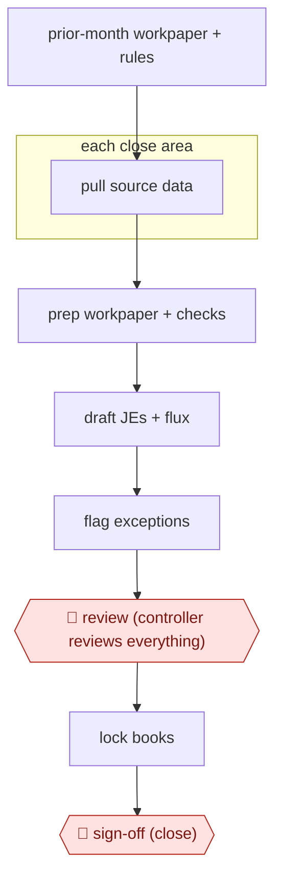

# Workpaper-matched close agents

`PRO › FIN › CLOSE` · checkpointed · evidence B · **draft: needs a reference example** ([how to add one](../../../../../CONTRIBUTING.md#1-add-an-example-run))

**Shape:** `prior-month workpaper + rules → each close area: pull source data → prep workpaper + checks → draft JEs + flux → flag exceptions → 🛑 review (controller reviews everything) → lock books → 🛑 sign-off (close)`
**Variants:** `promptql` · `puzzle-ai-close`

<!-- shape diagram: generated by scripts/build_diagrams.py from `shape`; don't edit -->

<!-- end shape diagram -->

## Background

At the end of every month a finance team closes the books: it makes sure the month's transactions are complete and correct, so that reports can be produced and the figures stop changing. The controller, who leads the accounting team, owns the close. The close is a long list of areas (accruals, leases, prepaid costs, fixed assets, payroll, bank reconciliations and more), and for each one an accountant pulls data from several systems, rebuilds a supporting spreadsheet, drafts correcting entries and explains what changed since last month. Much of this repeats the prior month's file with new numbers. Here agents prepare each area the way last month's file did, draft the entries and the change analysis, and flag anything that looks wrong. The controller still supplies context that is not in the systems, decides every judgement call, reviews everything before the books are locked and signs off the close, because the controller is accountable for the figures.

**Terms:**
- **Close (month-end close)**: the process of finalising a period's books; afterwards that period's figures are fixed.
- **Workpaper**: the supporting file for one area, showing the source data, the calculation and the checks, kept for review and audit.
- **Journal entry (JE)**: a record in the books of an amount debited and credited, used to correct or complete the figures.
- **Accrual, prepaid**: an expense recorded in the month it was incurred before the invoice arrives; a cost paid in advance and spread over later months.
- **Fixed assets, leases**: long-lived equipment, and rented property or equipment, each with a schedule of cost spread over time.
- **Reconciliation**: checking that two records of the same thing, such as a bank statement and the ledger, agree.
- **Allocation**: splitting a shared cost among departments or entities.
- **Flux (flux analysis)**: the explanation of why each account moved from the previous period.
- **Lock the books**: preventing further entries in a closed period.
- **Controller**: the senior accountant who owns the close and signs it off.

## Build it with an agent

**Form:** `project`. A skill can run one close area, but here a dozen areas run in parallel and each needs its own source data and workpaper format; two rules must hold every time (no agent touches the bank, and none locks the books or posts); and the controller's review should compare the output with last month's file. That calls for custom subagents, hooks and standing project files.

**You need:** read access to the accounting system, payroll and the files the team already uses, through MCP connectors or exports; last month's workpaper for each area as the model to match; the rules the accountants set, as one reference file per area; a `CLAUDE.md` with the close calendar, the workpaper layout and the rule that agents get no bank access; a folder where the draft workpapers and entries land. Give no agent a bank connection, a posting tool or a lock tool.

| Step | Built as |
|---|---|
| prior-month workpaper + rules | A skill per close area, with last month's workpaper and the accountant's rules as reference files beside it. |
| each close area: pull source data → prep workpaper + checks | A custom subagent per area with read-only tools builds the workpaper to match last month's and runs the area's checks. A dynamic workflow can run the areas at once. |
| draft JEs + flux | The same subagent writes draft entries to a file and a flux table with an explanation for each large move. |
| flag exceptions | Each subagent returns a list of items that do not fit, with the evidence. |
| 🛑 review (controller reviews everything) | See Checkpoints. |
| lock books → 🛑 sign-off (close) | The controller does both in the accounting system. |

**Checkpoints:** `review`: the project ends the run by presenting every workpaper, draft entry and exception area by area, then stops; the controller supplies missing context and decides each call. `sign-off`: the agents have no posting tool, no lock tool and no bank connection, set through permission rules that deny those tools, so the controller posts the entries, locks the books and signs the close.

**Since the sources:** Sources date from 2026-08 (a controller's LinkedIn post) and an undated vendor case study. Source 1 describes using a vendor tool (`promptql`) with agents per area; source 2 describes a vendor close product with human review of exceptions. Neither shows the agents' internals, so the build above is a design from the steps, not a copy of either. The build leaves out the continuous transaction matching that the sources say runs all month; run it as its own scheduled job if wanted ([AWF-0164](../exception-only-reconciliation/) is the exception-only version). Payroll timing variances still need a person to chase, as the sources report.

*A design based on this entry's steps and the tool documentation as of 2026-11, not a reported run.*

## Steps

*As reported by the sources.*

1. The accountant seeds each agent with last month's workpaper ('match this') and the accountant-set rules [[1]](#sources)[[2]](#sources).
2. Transaction matching runs all month. At close, separate agents handle accruals, leases, fixed assets, tax payables, prepaids, reconciliations, payroll, allocations, financials and P&L flux. Each has its own source data, workpaper, checks, journal entries and review points [[1]](#sources).
3. Agents prep workpapers and flag anything that looks off. The AI matches bank items and humans review only the exceptions [[1]](#sources)[[2]](#sources).
4. 🛑 **Review**: the controller feeds context, makes the calls, and reviews everything before close [[1]](#sources).
5. 🛑 **Sign-off**: the close is signed off after the AI has flagged anomalies [[2]](#sources).

**Output:** A closed period with completed workpapers and journal entries for each area, reviewed by the controller and ready for reporting and audit.
**Failure modes → guards:** Payroll timing variances still need chasing → human exception work [[1]](#sources). Agents with bank access → deliberately not granted [[1]](#sources). Bad automation scales errors → accountants set the rules and the AI executes them [[2]](#sources).
**How it differs:** AWF-0022 Invoice extract-match-route (AP) handles single invoices. This produces period-end workpapers and journal entries across many accounts, with controller close sign-off.

## Public runs

Coverage as of 2026-11-06: **Partial**: first-hand runs that cover part of the shape or put checkpoints elsewhere. Collected and re-checked in [New workflows for empty categories](../../../../../research/2026-11-new-workflows.md).

- [David Kats, PromptQL close agents](https://www.linkedin.com/posts/katsdavid_three-months-ago-i-handed-promptql-a-prior-activity-7498398271866880000-EiIe) (2026-08-26). Assistant controller runs per-area close agents and reviews all output before close. "Now I have 17 agents running different pieces of finance.". *First-hand: yes; confidence: med.*
- [Puzzle, Debit & Co.](https://puzzle.io/case-studies/debit-co) (n.d.). Bookkeeping firm with AI matching and human exception review across client closes. "15 / 15 Clients closed by Day 4". *First-hand: vendor; confidence: med.*

## Sources

1. Kats D. (Assistant Controller, PromptQL), Three months ago I handed PromptQL a prior month's workpaper..., LinkedIn, 2026-08-26. https://www.linkedin.com/posts/katsdavid_three-months-ago-i-handed-promptql-a-prior-activity-7498398271866880000-EiIe
2. Puzzle, How Debit & Co. Closed 15 Clients by the 4th Business Day with Puzzle, n.d. https://puzzle.io/case-studies/debit-co
