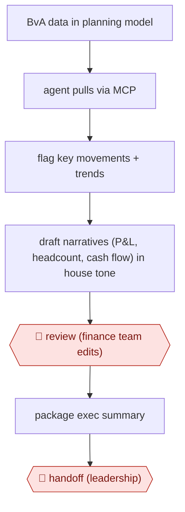

# Drafted variance narratives

`PRO › FIN › FPA` · checkpointed · evidence B · **draft: needs a reference example** ([how to add one](../../../../../CONTRIBUTING.md#1-add-an-example-run))

**Shape:** `BvA data in planning model → agent pulls via MCP → flag key movements + trends → draft narratives (P&L, headcount, cash flow) in house tone → 🛑 review (finance team edits) → package exec summary → 🛑 handoff (leadership)`
**How it differs:** Workpaper-matched close (CLOSE, this batch) produces reconciled workpapers and journal entries. This produces management narrative for executives. AWF-0006 Governed query answers ad-hoc data questions.
**Variants:** `pigment-analyst-agent-mcp`

<!-- shape diagram: generated by scripts/build_diagrams.py from `shape`; don't edit -->

<!-- end shape diagram -->

## Steps
1. Budget-vs-actuals data and context sit in the planning model. Claude reads them through the platform's Analyst Agent and MCP server [[1]](#sources).
2. The agent summarizes key variances, surfaces notable trends and flags key movements [[1]](#sources).
3. It drafts structured first-draft narratives across P&L, headcount and cash flow in the team's tone and format [[1]](#sources).
4. 🛑 **Review**: Finance team members apply judgment and audience context to refine each draft. People keep ownership of the insights [[1]](#sources).
5. 🛑 **Handoff**: Narratives are summarized and packaged for executive review [[1]](#sources).

**Output:** A monthly variance commentary pack across P&L, headcount and cash flow, delivered to executives.
**Failure modes → guards:** Generic or context-free commentary → human refinement for judgment and audience [[1]](#sources).

## Public runs

Coverage as of 2026-11-06: **Weak**: only anonymous, vendor-linked or journalist-told accounts. Collected and re-checked in [New workflows for empty categories](../../../../../research/2026-11-new-workflows.md).

- [Pigment, Docker FP&A](https://www.pigment.com/customer-stories/docker) (n.d.). Claude drafts monthly BvA commentary that finance refines before executive review. "~30–50%". *First-hand: vendor; confidence: med.*

## Sources

1. Pigment, How Docker puts AI agents to work in FP&A with Pigment, n.d. https://www.pigment.com/customer-stories/docker
