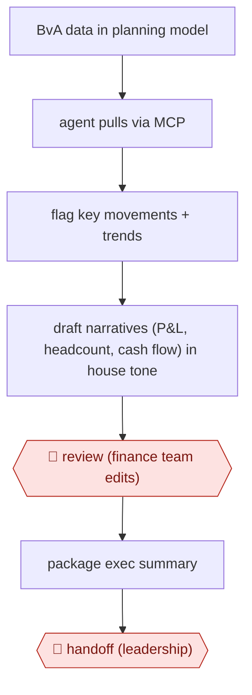

# Drafted variance narratives

`PRO › FIN › FPA` · checkpointed · evidence B · **draft: needs a reference example** ([how to add one](../../../../../CONTRIBUTING.md#1-add-an-example-run))

**Shape:** `BvA data in planning model → agent pulls via MCP → flag key movements + trends → draft narratives (P&L, headcount, cash flow) in house tone → 🛑 review (finance team edits) → package exec summary → 🛑 handoff (leadership)`
**Variants:** `pigment-analyst-agent-mcp`

<!-- shape diagram: generated by scripts/build_diagrams.py from `shape`; don't edit -->

<!-- end shape diagram -->

## Background

Each month a company compares what it planned to earn and spend (the budget) with what actually happened. The gaps are called variances. The finance planning team (FP&A, financial planning and analysis) must then explain each important gap in words for executives: revenue came in under plan because of X, hiring ran ahead because of Y. Writing these explanations is slow because the numbers sit in a planning system, the reasons sit in people's heads, and the same findings are rewritten for each audience at the busiest point of the month. Here the agent reads the budget and actuals, picks out the key movements and drafts the commentary in the team's usual tone. The finance team still checks every figure, adds the business reasons only they know, and decides what the executives are told, because the commentary is management's account of the results and the team answers for it.

**Terms:**
- **BvA (budget versus actuals)**: the comparison of planned figures with real ones, by account and period.
- **Variance**: the difference between budget and actual.
- **Variance narrative (commentary)**: the written explanation of a variance.
- **P&L (profit and loss)**: the statement of revenue and costs for a period.
- **Headcount**: the number of employees, against the number planned.
- **Cash flow**: the money coming in and going out.
- **Planning model**: the finance team's planning system, which holds the budget, actuals and notes.
- **House tone**: the wording and format the team already uses in its commentary.
- **MCP**: a standard way of connecting an agent to an outside system's tools and data.

## Build it with an agent

**Form:** `skill`. One finance team member runs the monthly commentary, stays in the conversation and edits the drafts, so one skill that holds the procedure, the house tone and the format is enough.

**You need:** a connection to the planning model that can read the budget-versus-actuals figures and their context notes (the planning platform's MCP server, if it has one, or an export file); two or three past commentaries as examples of the house tone, kept beside the skill; the commentary template for P&L, headcount and cash flow. The connection should be read-only: the agent has no reason to write to the planning model.

| Step | Built as |
|---|---|
| BvA data in planning model → agent pulls via MCP | An MCP connector to the planning model, or an exported file, gives the skill the budget, actuals and notes for the month. |
| flag key movements + trends | The skill has the agent compute each variance, rank them and list the largest, with the trend over recent months. |
| draft narratives (P&L, headcount, cash flow) in house tone | The agent drafts each section from the template and the example commentaries, and states the figures it used. |
| 🛑 review (finance team edits) | See Checkpoints. |
| package exec summary → 🛑 handoff (leadership) | After the edits, the skill condenses the approved narratives into one executive summary file. |

**Checkpoints:** `review`: the skill ends the draft stage by presenting every narrative with the figures behind it, then stops; the finance team member corrects, adds reasons and approves. `handoff`: the skill packages the summary only after the narratives are marked approved, and it has no mail or publish tool, so a person delivers it to leadership.

**Since the sources:** The single source and the one public run are the same undated vendor customer story, so its age cannot be given. It describes a planning-platform vendor's analyst feature together with Claude reading the data through the platform's MCP server. The vendor's current documentation (undated; [MCP Server](https://kb.pigment.com/docs/mcp-server-1), read 2026-11) says the MCP server is available once the vendor's AI features are activated, applies each user's existing access rights, and that its tools in default mode are read-only. The build above uses a general agent and a connector or export in place of the vendor's analyst feature, so it does not flag movements the way that feature does. The source reports the reduced time as the company's own estimate, which this build does not claim.

*A design based on this entry's steps and the tool documentation as of 2026-11, not a reported run.*

## Steps

*As reported by the sources.*

1. Budget-vs-actuals data and context sit in the planning model. The agent (Claude) reads them through the platform's Analyst Agent and MCP server [[1]](#sources).
2. The agent summarizes key variances, surfaces notable trends and flags key movements [[1]](#sources).
3. The agent drafts structured first-draft narratives across P&L, headcount and cash flow in the team's tone and format [[1]](#sources).
4. 🛑 **Review**: finance team members apply judgment and audience context to refine each draft. People keep ownership of the insights [[1]](#sources).
5. 🛑 **Handoff**: the narratives are summarized and packaged for executive review [[1]](#sources).

**Output:** A monthly variance commentary pack across P&L, headcount and cash flow, delivered to executives.
**Failure modes → guards:** Generic or context-free commentary → human refinement for judgment and audience [[1]](#sources).
**How it differs:** Workpaper-matched close (CLOSE, this batch) produces reconciled workpapers and journal entries. This produces management narrative for executives. AWF-0006 Governed query answers ad-hoc data questions.

## Public runs

Coverage as of 2026-11-06: **Weak**: only anonymous, vendor-linked or journalist-told accounts. Collected and re-checked in [New workflows for empty categories](../../../../../research/2026-11-new-workflows.md).

- [Pigment, Docker FP&A](https://www.pigment.com/customer-stories/docker) (n.d.). Claude drafts monthly BvA commentary that finance refines before executive review. "~30–50%". *First-hand: vendor; confidence: med.*

## Sources

1. Pigment, How Docker puts AI agents to work in FP&A with Pigment, n.d. https://www.pigment.com/customer-stories/docker
