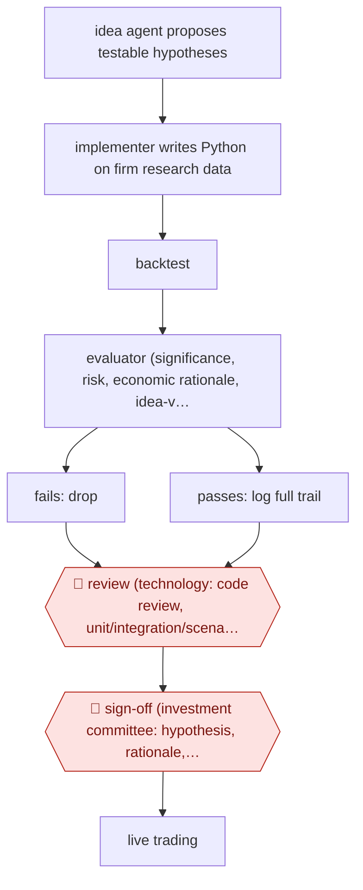

# Agent-researched trading signals

`PRO › FIN › INVEST` · checkpointed · evidence A · **draft: needs a reference example** ([how to add one](../../../../../CONTRIBUTING.md#1-add-an-example-run))

**Shape:** `idea agent proposes testable hypotheses → implementer writes Python on firm research data → backtest → evaluator (significance, risk, economic rationale, idea-vs-code consistency) → fails: drop | passes: log full trail → 🛑 review (technology: code review, unit/integration/scenario tests) → 🛑 sign-off (investment committee: hypothesis, rationale, results) → live trading`
**Variants:** `alphagpt` · `claude-code-skills`

<!-- shape diagram: generated by scripts/build_diagrams.py from `shape`; don't edit -->

<!-- end shape diagram -->

## Background

Quantitative investing firms run funds by rules written as computer code instead of by individual stock picks. Each rule is a trading signal: a measurable pattern, such as "stocks with more buy orders than sell orders tend to rise", that the fund bets on. A researcher proposes a pattern, writes code to test it on years of historical data (a backtest), and checks that the result is not luck and makes economic sense. The supply of possible patterns is far larger than the number of researchers, and each one takes days of coding and checking. Here three agent roles propose the patterns, write the code and test the results, and keep a complete log. People still gate every signal before it trades real money: technologists review the code and test it, and the investment committee decides whether the signal's rationale and results justify risking capital. Trading real money is a decision the firm's people must own.

**Terms:**
- **Signal**: a rule or pattern in market data that a fund trades on.
- **Hypothesis**: a testable statement about why a pattern should hold.
- **Backtest**: running a rule on historical data to see how it would have performed.
- **Statistical significance, p-hacking**: whether a result is unlikely to be chance; testing so many variations that some look significant by chance. Also called the multiple-testing problem.
- **Economic rationale**: the reason a pattern should keep working, beyond the numbers.
- **Drift**: the agent states one idea but its code tests something else.
- **Investment committee**: the senior group that approves what the fund may trade.
- **Live trading**: using real capital, as opposed to testing on past data.
- **Alpha**: return a fund earns beyond what the overall market gives it.

## Build it with an agent

**Form:** `project`. One skill cannot hold this: the work fans out over many hypotheses, the evaluator must judge the code without having written it, and three rules must hold every time (no signal is deployed without both approvals, every step is logged, and the data stays inside the firm). Those need custom subagents, hooks and a standing project file.

**You need:** the firm's research data and research code libraries, readable from a sandboxed environment with no connection to the trading systems; a `CLAUDE.md` with the research methodology (significance thresholds, risk limits, what counts as an economic rationale); a place to keep the log and each signal's code, backtest and report; a setup your firm has approved for proprietary data. Give the agents no credentials for the production trading or signal-deployment systems.

| Step | Built as |
|---|---|
| idea agent proposes testable hypotheses | A skill or subagent writes each hypothesis to its own file with the data it needs and the expected direction. |
| implementer writes Python on firm research data → backtest | A custom subagent writes the code against the firm's libraries in a sandbox and runs the backtest. A dynamic workflow can run many hypotheses at once. |
| evaluator (significance, risk, economic rationale, idea-vs-code consistency) | A separate read-only subagent that gets the hypothesis file, the code and the results. It applies the thresholds in `CLAUDE.md` and compares what the code does with what the hypothesis says. |
| fails: drop \| passes: log full trail | A script moves failures to an archive and writes each passing signal's hypothesis, code, results and decisions to the log. |
| 🛑 review (technology) | See Checkpoints. |
| 🛑 sign-off (investment committee) → live trading | The committee decides, and the firm's own deployment process does the rest. |

**Checkpoints:** `review`: the project stops with a review package for each passing signal (code, tests, backtest, log); technologists review it and run their own unit, integration and scenario tests. `sign-off`: the agents have no credentials for deployment or trading, and a `PreToolUse` hook blocks any write to the production signal directory, so only the firm's own process, after committee approval, can promote a signal. The agent can prepare the committee's pack (hypothesis, rationale, results) but not the decision.

**Since the sources:** Sources date from 2025-07 to 2026-05. They describe one firm's proprietary system (`alphagpt`) with three agents, an orchestrator, internal research tools and databases; none of that can be copied from the public material, and the build above uses general agent tooling on your own research environment. Source 2, a conference talk, could not be read here, so the later work it reports (signals produced with Claude Code, reported as 750 in the public run) rests on the entry's description of it. The sources report no performance data that this build can claim. Multiple testing grows with idea volume, so the significance thresholds in `CLAUDE.md` must account for how many hypotheses were tried, not only the last one.

*A design based on this entry's steps and the tool documentation as of 2026-11, not a reported run.*

## Steps

*As reported by the sources.*

1. An 'idea person' agent brainstorms testable investment hypotheses (e.g. order imbalance, hiring efficiency); Man Group reports it 'produce[s] dozens of viable concepts within minutes rather than days' [[1]](#sources).
2. An 'implementer' agent turns each idea into production-grade Python using Man Group's research tools and proprietary databases, and runs the backtest [[1]](#sources)[[2]](#sources).
3. An 'evaluator' agent applies the same thresholds as human research: statistical significance tests, risk assessment and economic-reasoning checks; built-in consistency checks compare the stated idea with the implemented code to catch drift and p-hacking [[1]](#sources).
4. A workflow orchestrator coordinates the three roles; a logging system records every hypothesis, assumption and decision for review [[1]](#sources).
5. 🛑 **Review**: technology teams code-review the signal and run unit, integration and scenario tests and assess implementation risk [[1]](#sources).
6. 🛑 **Sign-off**: the Investment Committee reviews hypothesis, economic rationale and research outcomes with the same framework used for human signals; only approved signals enter live trading [[1]](#sources)[[3]](#sources).

**Output:** A signal approved for live trading, with its code, backtest and decision log; it joins the systematic portfolio like a human-researched signal.
**Failure modes → guards:** Multiple-testing / p-hacking from high idea volume → same research methodology thresholds plus monitoring; idea-to-code drift or hallucination → automated and manual consistency checks between idea, implementation and evaluation; ungoverned local skills giving inconsistent backtests → shared, owner-reviewed, eval-tested skill library [1][2].
**How it differs:** AWF-0166 (challenger-agent IC memo) and AWF-0023 (event-driven model update) both produce documents for a human decision on an existing deal or model; here the deliverable is a new, coded and backtested trading signal, with a technology code-review gate plus investment-committee sign-off before it trades. Swap fails on deliverable and checkpoints.

## Public runs

Coverage as of 2026-11-13: **Strong**: a first-hand, detailed run that matches most of the shape. Collected and re-checked in [Fourth collection pass](../../../../../research/2026-11-fourth-pass.md).

- [Man Group, What AI Can (and Can't Yet) Do for Alpha](https://www.man.com/insights/what-ai-can-do-for-alpha) (2025-11-12). Firm's own description of three-agent research loop, dual-track human validation. "It has been observed to produce dozens of viable concepts within minutes rather than days.". *First-hand: yes; confidence: high.*
- [Hedgeweek / Bloomberg, Man Group deploys agentic AI for quant signal discovery](https://hedgeweek.com/news/man-group-deploys-agentic-ai-for-quant-signal-discovery) (2025-07-11). Senior PM reports AI-generated signals approved for live trading, with checkpoints. "AlphaGPT has already produced several dozen investment signals that have been approved for live trading". *First-hand: interview; confidence: high.*
- [Man Group, Building signals that trade themselves](https://www.youtube.com/watch?v=EOg4gY0Yln0) (2026-05-21). Signals proposed, backtested and productionized by AI now trade real capital; humans review all output. "we now have 750 of them using Claude Code". *First-hand: yes; confidence: med.*

## Sources

1. Ziang Fang, Jason Moore (Man Group), What AI Can (and Can't Yet) Do for Alpha, 2025-11-12. https://www.man.com/insights/what-ai-can-do-for-alpha
2. Man Group head of data and AI, Building signals that trade themselves (conference talk), 2026-05-21. https://www.youtube.com/watch?v=EOg4gY0Yln0
3. Hedgeweek (reporting Bloomberg interview with Ziang Fang), Man Group deploys agentic AI for quant signal discovery, 2025-07-11. https://hedgeweek.com/news/man-group-deploys-agentic-ai-for-quant-signal-discovery
