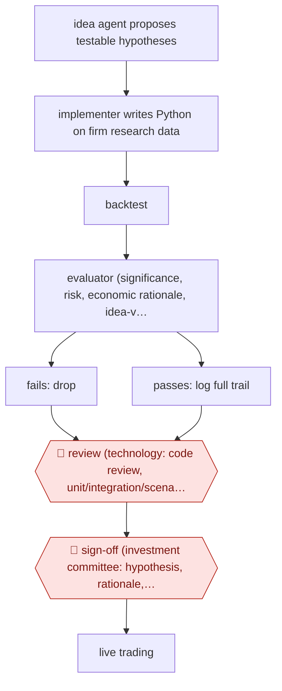

# Agent-researched trading signals

`PRO › FIN › INVEST` · checkpointed · evidence A · **draft: needs a reference example** ([how to add one](../../../../../CONTRIBUTING.md#1-add-an-example-run))

**Shape:** `idea agent proposes testable hypotheses → implementer writes Python on firm research data → backtest → evaluator (significance, risk, economic rationale, idea-vs-code consistency) → fails: drop | passes: log full trail → 🛑 review (technology: code review, unit/integration/scenario tests) → 🛑 sign-off (investment committee: hypothesis, rationale, results) → live trading`
**How it differs:** AWF-0166 (challenger-agent IC memo) and AWF-0023 (event-driven model update) both produce documents for a human decision on an existing deal or model; here the deliverable is a new, coded and backtested trading signal, with a technology code-review gate plus investment-committee sign-off before it trades. Swap fails on deliverable and checkpoints.
**Variants:** `alphagpt` · `claude-code-skills`

<!-- shape diagram: generated by scripts/build_diagrams.py from `shape`; don't edit -->

<!-- end shape diagram -->

## Steps
1. An 'idea person' agent brainstorms testable investment hypotheses (e.g. order imbalance, hiring efficiency); Man Group reports it 'produce[s] dozens of viable concepts within minutes rather than days' [[1]](#sources).
2. An 'implementer' agent turns each idea into production-grade Python using Man Group's research tools and proprietary databases, and runs the backtest [[1]](#sources)[[2]](#sources).
3. An 'evaluator' agent applies the same thresholds as human research: statistical significance tests, risk assessment and economic-reasoning checks; built-in consistency checks compare the stated idea with the implemented code to catch drift and p-hacking [[1]](#sources).
4. A workflow orchestrator coordinates the three roles; a logging system records every hypothesis, assumption and decision for review [[1]](#sources).
5. 🛑 **Review**: technology teams code-review the signal and run unit, integration and scenario tests and assess implementation risk [[1]](#sources).
6. 🛑 **Sign-off**: the Investment Committee reviews hypothesis, economic rationale and research outcomes with the same framework used for human signals; only approved signals enter live trading [[1]](#sources)[[3]](#sources).

**Output:** A signal approved for live trading, with its code, backtest and decision log; it joins the systematic portfolio like a human-researched signal.
**Failure modes → guards:** Multiple-testing / p-hacking from high idea volume → same research methodology thresholds plus monitoring; idea-to-code drift or hallucination → automated and manual consistency checks between idea, implementation and evaluation; ungoverned local skills giving inconsistent backtests → shared, owner-reviewed, eval-tested skill library [1][2].

## Public runs

Coverage as of 2026-11-13: **Strong**: a first-hand, detailed run that matches most of the shape. Collected and re-checked in [Fourth collection pass](../../../../../research/2026-11-fourth-pass.md).

- [Man Group, What AI Can (and Can't Yet) Do for Alpha](https://www.man.com/insights/what-ai-can-do-for-alpha) (2025-11-12). Firm's own description of three-agent research loop, dual-track human validation. "It has been observed to produce dozens of viable concepts within minutes rather than days.". *First-hand: yes; confidence: high.*
- [Hedgeweek / Bloomberg, Man Group deploys agentic AI for quant signal discovery](https://hedgeweek.com/news/man-group-deploys-agentic-ai-for-quant-signal-discovery) (2025-07-11). Senior PM reports AI-generated signals approved for live trading, with checkpoints. "AlphaGPT has already produced several dozen investment signals that have been approved for live trading". *First-hand: interview; confidence: high.*
- [Man Group, Building signals that trade themselves](https://www.youtube.com/watch?v=EOg4gY0Yln0) (2026-05-21). Signals proposed, backtested and productionized by AI now trade real capital; humans review all output. "we now have 750 of them using Claude Code". *First-hand: yes; confidence: med.*

## Sources

1. Ziang Fang, Jason Moore (Man Group), What AI Can (and Can't Yet) Do for Alpha, 2025-11-12. https://www.man.com/insights/what-ai-can-do-for-alpha
2. Man Group head of data and AI, Building signals that trade themselves (conference talk), 2026-05-21. https://www.youtube.com/watch?v=EOg4gY0Yln0
3. Hedgeweek (reporting Bloomberg interview with Ziang Fang), Man Group deploys agentic AI for quant signal discovery, 2025-07-11. https://hedgeweek.com/news/man-group-deploys-agentic-ai-for-quant-signal-discovery
