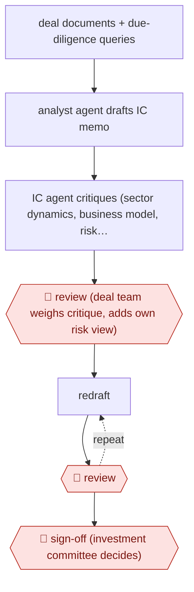

# Challenger-agent IC memo

`PRO › FIN › INVEST` · checkpointed · evidence A · **draft: needs a reference example** ([how to add one](../../../../../CONTRIBUTING.md#1-add-an-example-run))

**Shape:** `deal documents + due-diligence queries → analyst agent drafts IC memo → IC agent critiques (sector dynamics, business model, risk factors from firm's historic deals) → 🛑 review (deal team weighs critique, adds own risk view) → (redraft ⟲ 🛑 review) → 🛑 sign-off (investment committee decides)`
**How it differs:** AWF-0098 Underwriter-finalized credit memo: one drafting pass that the underwriter edits, then bank credit approval. Here a second AI 'challenger' agent critiques the draft before people review it, and the redraft loop repeats under team review. The deliverable is an equity IC memo, not a credit memo.
**Variants:** `schroders-gaiia` · `v7-go`

<!-- shape diagram: generated by scripts/build_diagrams.py from `shape`; don't edit -->

<!-- end shape diagram -->

## Steps
1. The analyst agent (GAiiA) screens large amounts of deal data during direct and co-investment due diligence, answers investment-specific questions, and drafts first versions of investment committee memoranda [[1]](#sources).
2. A separate virtual investment committee agent reviews the draft and adds points on sector dynamics, business model considerations and risk factors, based on the firm's historic investment data [[1]](#sources).
3. 🛑 **Review**: investment team members evaluate and build on the IC agent's feedback, add their own assessment of risks and opportunities, and can ask the analyst agent for an improved version [[1]](#sources).
4. Each redraft again goes to 🛑 **Review** by the investment team before the documentation is finalised [[1]](#sources).
5. 🛑 **Sign-off**: every investment decision is made only by investment professionals [[1]](#sources). A VC variant: drop a whole data room into the tool, get a memo in the firm's template with each claim linked to its source, and the team checks it [[2]](#sources).

**Output:** A finalised investment committee memo in the firm's own format, which goes to the investment decision.
**Failure modes → guards:** Draft echoes the target's own pitch → a separate challenger agent grounded in the firm's past deals. Fabricated figure reaches IC → source-linked claims checked by analysts [2]. Over-reliance on AI view → professionals keep full responsibility for the final documentation and decision [1].

## Public runs

Coverage as of 2026-11-13: **Partial**: first-hand runs that cover part of the shape or put checkpoints elsewhere. Collected and re-checked in [Third collection pass](../../../../../research/2026-11-third-pass.md).

- [Schroders Capital, virtual investment committee agent](https://schroders-capital.prezly.com/schroders-capital-expands-pioneering-ai-toolkit-with-virtual-investment-committee-agent) (2025-06-30). Private-markets firm's own analyst agent plus challenger IC agent; humans review every version. "GAiiA has already assisted with more than 40 investment cases". *First-hand: yes; confidence: med.*
- [V7 Labs, Moderne Ventures](https://www.v7labs.com/news/moderne-ventures-accelerates-due-diligence-with-v7-go) (n.d.). VC firm turns a data room into a templated, source-cited memo that partners check. "makes the process go from weeks to a day". *First-hand: vendor; confidence: med.*

## Sources

1. Schroders Capital, Schroders Capital expands pioneering AI toolkit with virtual 'investment committee agent', news release, 2025-06-30. https://schroders-capital.prezly.com/schroders-capital-expands-pioneering-ai-toolkit-with-virtual-investment-committee-agent
2. V7 Labs, Moderne Ventures accelerates due diligence with V7 Go, n.d. https://www.v7labs.com/news/moderne-ventures-accelerates-due-diligence-with-v7-go
