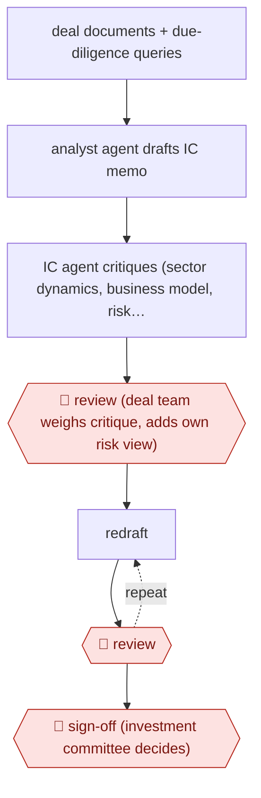

# Challenger-agent IC memo

`PRO › FIN › INVEST` · checkpointed · evidence A · **draft: needs a reference example** ([how to add one](../../../../../CONTRIBUTING.md#1-add-an-example-run))

**Shape:** `deal documents + due-diligence queries → analyst agent drafts IC memo → IC agent critiques (sector dynamics, business model, risk factors from firm's historic deals) → 🛑 review (deal team weighs critique, adds own risk view) → (redraft ⟲ 🛑 review) → 🛑 sign-off (investment committee decides)`
**Variants:** `schroders-gaiia` · `v7-go`

<!-- shape diagram: generated by scripts/build_diagrams.py from `shape`; don't edit -->

<!-- end shape diagram -->

## Background

Before an investment firm commits money to a company, the deal team studies it (this is called due diligence) and writes a memo for the investment committee, the senior group that approves or rejects the deal. The memo summarises the company, the market and the risks, and the committee decides on it. Writing a first draft from a large pile of deal documents takes days, and a draft written from the target's own pitch tends to repeat the pitch. Here an analyst agent drafts the memo and a second agent, the challenger, critiques it using the firm's record of past deals. The deal team then weighs that critique and adds its own view of the risks. People still own the memo and the decision, because the firm and its investment professionals answer to their clients for every investment.

**Terms:**
- **IC memo**: the investment committee memorandum, the document the committee reads before deciding.
- **Due diligence**: the checking of a company's finances, business and legal position before investing.
- **Data room**: the shared folder of documents a company opens to a prospective investor.
- **Co-investment**: investing alongside another firm that leads the deal.
- **Challenger**: a second reviewer whose job is to argue against the draft, so that weaknesses surface before the committee meets.
- **Deal team**: the investment professionals responsible for one deal.

## Build it with an agent

**Form:** `project`. The challenger must be a reviewer that has not seen how the draft was written, and it works from standing project knowledge (the firm's past deals), so one skill is not enough.

**You need:** the deal documents and due-diligence questions as files; the firm's memo template; the firm's past deal records as reference files the challenger may read; a setup your firm has approved for confidential deal documents. Give no agent a tool that sends, files or records an investment decision.

| Step | Built as |
|---|---|
| deal documents + due-diligence queries → analyst agent drafts IC memo | A skill reads the files, answers the queries and writes the memo in the firm's template, with each claim linked to its source file. |
| IC agent critiques | A custom read-only subagent that receives only the draft and the past-deal reference files and returns a critique: sector dynamics, business model, risk factors. |
| 🛑 review (deal team weighs critique, adds own risk view) | See Checkpoints. |
| (redraft ⟲ 🛑 review) | The skill redrafts from the deal team's notes and the critique, then stops again. |
| 🛑 sign-off (investment committee decides) | See Checkpoints. |

**Checkpoints:** `review`: the skill stops after the draft and the critique are written to files, and the deal team edits and adds its own risk view; a redraft stops again at the same place. `sign-off`: the committee decides outside the agent, which has no tool to record or send a decision.

**Since the sources:** Sources date from 2025-06 to 2026-07 (the second page shows 2026-07-22, though the entry lists it as undated). Source 1 is a firm's announcement of its own in-house tools, and source 2 is a vendor's account of its product, so neither shows the steps inside. This build is one reading of them. The sources do not say how the challenger is made to draw on the firm's historic data; here it reads reference files. The V7 variant's traceable citations are a product feature, and in this build they are only a rule written into the skill.

*A design based on this entry's steps and the tool documentation as of 2026-11, not a reported run.*

## Steps

*As reported by the sources.*

1. An analyst agent (GAiiA) screens large amounts of deal data during due diligence on direct and co-investment deals, answers investment-specific questions, and drafts first versions of IC memos [[1]](#sources).
2. A separate virtual investment committee agent reviews the draft and adds points on sector dynamics, business model considerations and risk factors, based on the firm's historic investment data [[1]](#sources).
3. 🛑 **Review**: deal team members evaluate and build on the investment committee agent's feedback, add their own assessment of risks and opportunities, and can ask the analyst agent for an improved version [[1]](#sources).
4. Each redraft again goes to 🛑 **Review** by the deal team before the documentation is finalised [[1]](#sources).
5. 🛑 **Sign-off**: every investment decision is made only by investment professionals [[1]](#sources). A venture capital variant: the team puts a whole data room into the tool, gets a memo in the firm's template with each claim linked to its source, and checks it [[2]](#sources).

**Output:** A finalised investment committee memo in the firm's own format, which goes to the investment decision.
**Failure modes → guards:** Draft echoes the target's own pitch → a separate challenger agent grounded in the firm's past deals. Fabricated figure reaches IC → source-linked claims checked by analysts [2]. Over-reliance on AI view → professionals keep full responsibility for the final documentation and decision [1].
**How it differs:** AWF-0098 Underwriter-finalized credit memo: one drafting pass that the underwriter edits, then bank credit approval. Here a second AI 'challenger' agent critiques the draft before people review it, and the redraft loop repeats under team review. The deliverable is an equity IC memo, not a credit memo.

## Public runs

Coverage as of 2026-11-13: **Partial**: first-hand runs that cover part of the shape or put checkpoints elsewhere. Collected and re-checked in [Third collection pass](../../../../../research/2026-11-third-pass.md).

- [Schroders Capital, virtual investment committee agent](https://schroders-capital.prezly.com/schroders-capital-expands-pioneering-ai-toolkit-with-virtual-investment-committee-agent) (2025-06-30). Private-markets firm's own analyst agent plus challenger IC agent; humans review every version. "GAiiA has already assisted with more than 40 investment cases". *First-hand: yes; confidence: med.*
- [V7 Labs, Moderne Ventures](https://www.v7labs.com/news/moderne-ventures-accelerates-due-diligence-with-v7-go) (n.d.). VC firm turns a data room into a templated, source-cited memo that partners check. "makes the process go from weeks to a day". *First-hand: vendor; confidence: med.*

## Sources

1. Schroders Capital, Schroders Capital expands pioneering AI toolkit with virtual 'investment committee agent', news release, 2025-06-30. https://schroders-capital.prezly.com/schroders-capital-expands-pioneering-ai-toolkit-with-virtual-investment-committee-agent
2. V7 Labs, Moderne Ventures accelerates due diligence with V7 Go, n.d. https://www.v7labs.com/news/moderne-ventures-accelerates-due-diligence-with-v7-go
