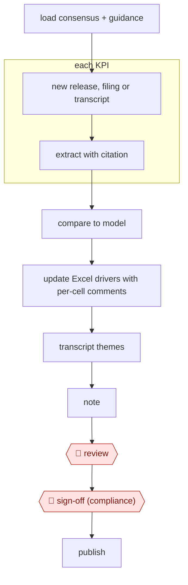

# Event-driven model update

`PRO › FIN › INVEST` · checkpointed · evidence A · **draft: needs a reference example** ([how to add one](../../../../../CONTRIBUTING.md#1-add-an-example-run))

**Shape:** `load consensus + guidance → new release, filing or transcript → each KPI: extract with citation → compare to model → update Excel drivers with per-cell comments → transcript themes → note → 🛑 review → 🛑 sign-off (compliance) → publish`
**Variants:** `claude-excel` (Claude for Excel beta since October 2025 [[23]](#sources)) · `hebbia` · `alphasense` · `rogo`

<!-- shape diagram: generated by scripts/build_diagrams.py from `shape`; don't edit -->

<!-- end shape diagram -->

## Public runs

Coverage as of 2026-11-06: **None found**: no public first-hand run yet. A real example run would be the first. From [Where are the real runs?](../../../../../research/2026-11-real-runs.md); every number was re-checked against its page.

- [Financial Datasets, *EarningsBench*](https://financialdatasets.ai/blogs/earningsbench) (2026-06-29). KPI extraction from 60 releases, checked by hand: a benchmark, not a model update. "Opus 4.6 with Extended Thinking hit 99.3% accuracy". *First-hand: no (benchmark); confidence: low.*

## Sources

23. VentureBeat, Claude for Financial Services (July 2025). https://venturebeat.com/ai/anthropic-rolls-out-claude-ai-for-finance-integrates-with-excel-to-rival · Anthropic, *Advancing Claude for Financial Services*. https://anthropic.com/news/advancing-claude-for-financial-services
