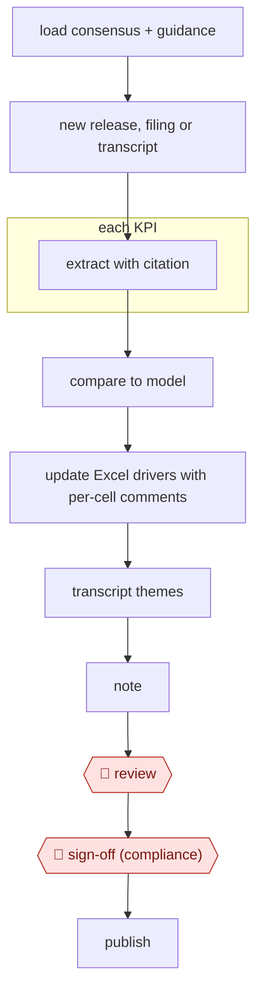

# Event-driven model update

`PRO › FIN › INVEST` · checkpointed · evidence A · **draft: needs a reference example** ([how to add one](../../../../../CONTRIBUTING.md#1-add-an-example-run))

**Shape:** `load consensus + guidance → new release, filing or transcript → each KPI: extract with citation → compare to model → update Excel drivers with per-cell comments → transcript themes → note → 🛑 review → 🛑 sign-off (compliance) → publish`
**Variants:** `claude-excel` (Claude for Excel beta since October 2025 [[23]](#sources)) · `hebbia` · `alphasense` · `rogo`

<!-- shape diagram: generated by scripts/build_diagrams.py from `shape`; don't edit -->

<!-- end shape diagram -->

## Background

Analysts who follow a listed company keep a spreadsheet model of its finances, built on a set of assumptions called drivers. When the company publishes quarterly results, a filing or an earnings call transcript, the analyst has to find the new figures, compare them with the model and with what the market expected, change the drivers that no longer hold, and write a short research note. Doing this by hand during results season is slow, and one wrong figure (a monthly number taken for a quarterly one, a subtotal for a total) can flow into a note that clients act on. Here the agent extracts each figure with a citation, updates the model's drivers with a comment on each change, and drafts the note. The analyst checks every changed cell against the source, and the firm's compliance staff approve the note before anyone outside sees it, because published research is regulated and the analyst is accountable for it.

**Terms:**
- **Consensus**: the average of other analysts' forecasts for a figure, used as the market's expectation.
- **Guidance**: the company's own forecast for its coming results.
- **KPI**: a key performance indicator, an operating measure the company reports, such as same-store sales.
- **Driver**: an input assumption in the model, such as growth rate or margin, from which the other figures are calculated.
- **Earnings release, filing, transcript**: the company's results announcement, its formal report to the regulator, and the written record of the call where management discusses the results.
- **Research note**: the short written update the analyst publishes to clients.
- **Compliance**: the staff who check that a note meets the firm's and the regulator's rules before it is distributed.
- **Segment, basis, GAAP vs adjusted**: a segment is one part of the business reported separately; the basis is how figures are added up (consolidated, or by ownership share); GAAP figures follow the official accounting rules, adjusted ones leave out items the company chooses.
- **REIT**: a company that owns property and passes most of its income to shareholders.
- **Extended Thinking**: a setting that lets the model reason for longer before it answers.

## Build it with an agent

**Form:** `skill`. One analyst handles one company event at a time and stays in the conversation, so one skill holding the procedure and the sector rules is enough.

**You need:** read access to the consensus and guidance data (connectors to your data providers, or exported files); the release, filing or transcript as text; the model as an Excel file, with a way to change cells and add cell comments, such as a spreadsheet-editing skill or a script beside the skill; the sector's KPI list and disambiguation rules as reference files beside the skill; the firm's note template. Do not connect a publishing or mail tool.

| Step | Built as |
|---|---|
| load consensus + guidance | Connectors (MCP servers) to the firm's data providers, or files the analyst drops in; the skill reads them first. |
| new release, filing or transcript | The analyst gives the skill the document; the skill reads it. |
| each KPI: extract with citation | For many KPIs, built-in subagents each take a group of KPIs and return a table: KPI, value, quoted source passage. The sector rules file says which segment, period and basis to use. |
| compare to model | The main conversation compares each actual and any change in guidance with the model and with consensus, and lists the gaps. |
| update Excel drivers with per-cell comments | A script or spreadsheet skill writes the new values into a copy of the model, never the original, with one comment per changed driver giving the source and the reason. |
| transcript themes → note | The skill pulls the themes from the transcript and fills the firm's note template. |
| 🛑 review → 🛑 sign-off (compliance) → publish | See Checkpoints. |

**Checkpoints:** `review`: the skill ends by listing every changed cell and every cited KPI with its source passage, starting with values where the extractions disagreed, and stops; the analyst checks them against the source documents. `sign-off`: compliance approve the note outside the agent, which has no publish or mail tool, so a person distributes the note.

**Since the sources:** Sources date from 2025-07 to 2026-06; the Claude documentation page on financial services plugins is undated. The VentureBeat article could not be opened, so what it reported is taken from the entry text and Anthropic's own announcement of 2025-10-27, which does describe Claude for Excel, then a beta research preview, tracking and explaining its changes. The same documentation page now lists an open-source financial services plugin set that supplies data connectors and an `/earnings` command, so the skill need not be written from nothing. The only public run is a benchmark of KPI extraction from 60 earnings releases, not a model update, so no source shows the whole procedure being run. The note and the sign-off steps cite no source.

*A design based on this entry's steps and the tool documentation as of 2026-11, not a reported run.*

## Steps

*As reported by the sources.*

1. Before the event, the agent loads consensus and guidance through data connectors: LSEG analyst estimates, S&P Capital IQ, Daloopa, FactSet and others in the financial-analysis plugin [[23]](#sources) [[25]](#sources).
2. When the release, filing or transcript lands, the agent pulls it in; Aiera supplies real-time earnings call transcripts [[23]](#sources).
3. For each KPI, the agent extracts the value with a citation to the source document, using a sector taxonomy with extraction rules. The team writes disambiguation rules that apply across the whole sector, covering segment, period (monthly vs quarterly), basis (consolidated vs pro-rata), regulatory framework and GAAP vs adjusted [[24]](#sources).
4. The agent compares each actual and any guidance change with the model and with consensus; the earnings-analysis skill covers "metrics, guidance changes" [[23]](#sources).
5. The agent updates the Excel drivers in place. Claude for Excel preserves formula dependencies, "tracks and explains its changes" and links to the cells it references [[23]](#sources). Each changed driver gets a cell comment with the source and reason.
6. The agent pulls themes from the transcript and drafts the note; `/earnings [company] [quarter]` generates a post-earnings update report [[25]](#sources).
7. 🛑 **Review**: the analyst checks every changed cell and every cited KPI against the source. They start with values where models or rules disagree, since consensus is a prioritization signal, not proof [[24]](#sources). Raw model output shouldn't ship even at 99.3% extraction accuracy [[24]](#sources), and AI-generated analysis "should always be reviewed by a qualified professional" [[25]](#sources).
8. 🛑 **Sign-off (compliance)**: compliance approves the note before distribution.
9. The note is published and the updated model saved.

**Output:** An updated model whose changed drivers each carry a source and reason, plus a research note ready for distribution after compliance sign-off.
**Failure modes → guards:** Wrong segment chosen for multi-segment companies, monthly figures taken for quarterly, subtotals or the wrong basis for REITs, bank ratios under the wrong framework → sector-wide disambiguation rules and Extended Thinking [[24]](#sources). Lower accuracy in some sectors (Insurance, Industrials, REITs, Retail) → closer review there [[24]](#sources). Silent edits that break the model → change tracking and links to referenced cells [[23]](#sources).

## Public runs

Coverage as of 2026-11-06: **None found**: no public first-hand run yet. A real example run would be the first. From [Where are the real runs?](../../../../../research/2026-11-real-runs.md); every number was re-checked against its page.

- [Financial Datasets, *EarningsBench*](https://financialdatasets.ai/blogs/earningsbench) (2026-06-29). KPI extraction from 60 releases, checked by hand: a benchmark, not a model update. "Opus 4.6 with Extended Thinking hit 99.3% accuracy". *First-hand: no (benchmark); confidence: low.*

## Sources

23. VentureBeat, Claude for Financial Services (July 2025). https://venturebeat.com/ai/anthropic-rolls-out-claude-ai-for-finance-integrates-with-excel-to-rival · Anthropic, *Advancing Claude for Financial Services*. https://anthropic.com/news/advancing-claude-for-financial-services
24. Financial Datasets, EarningsBench, 2026-06-29. https://financialdatasets.ai/blogs/earningsbench
25. Anthropic, Install financial services plugins for Cowork (Claude docs), undated. https://claude.com/docs/office-agents/fsi-plugins.md
