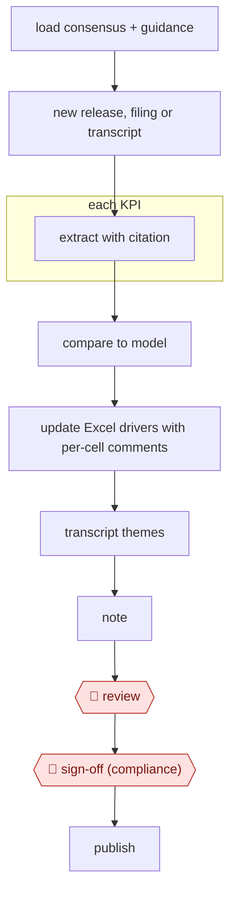

# Event-driven model update

`PRO › FIN › INVEST` · checkpointed · evidence A · **draft: needs a reference example** ([how to add one](../../../../../CONTRIBUTING.md#1-add-an-example-run))

**Shape:** `load consensus + guidance → new release, filing or transcript → each KPI: extract with citation → compare to model → update Excel drivers with per-cell comments → transcript themes → note → 🛑 review → 🛑 sign-off (compliance) → publish`
**Variants:** `claude-excel` (Claude for Excel beta since October 2025 [[23]](#sources)) · `hebbia` · `alphasense` · `rogo`

<!-- shape diagram: generated by scripts/build_diagrams.py from `shape`; don't edit -->

<!-- end shape diagram -->

## Steps
1. Load consensus and guidance before the event through data connectors: LSEG analyst estimates, S&P Capital IQ, Daloopa, FactSet and others in the financial-analysis plugin [[23]](#sources) [[25]](#sources).
2. When the release, filing or transcript lands, pull it in; Aiera supplies real-time earnings call transcripts [[23]](#sources).
3. For each KPI, extract the value with a citation to the source document, using a sector taxonomy with extraction rules. Write disambiguation rules that apply across the whole sector, covering segment, period (monthly vs quarterly), basis (consolidated vs pro-rata), regulatory framework and GAAP vs adjusted [[24]](#sources).
4. Compare each actual and any guidance change with the model and with consensus; the earnings-analysis skill covers "metrics, guidance changes" [[23]](#sources).
5. Update the Excel drivers in place. Claude for Excel preserves formula dependencies, "tracks and explains its changes" and links to the cells it references [[23]](#sources). Each changed driver gets a cell comment with the source and reason.
6. Pull themes from the transcript and draft the note; `/earnings [company] [quarter]` generates a post-earnings update report [[25]](#sources).
7. 🛑 **Review**: the analyst checks every changed cell and every cited KPI against the source. Start with values where models or rules disagree, since consensus is a prioritization signal, not proof [[24]](#sources). Raw model output shouldn't ship even at 99.3% extraction accuracy [[24]](#sources), and AI-generated analysis "should always be reviewed by a qualified professional" [[25]](#sources).
8. 🛑 **Sign-off (compliance)**: compliance approves the note before distribution.
9. Publish the note and save the updated model.

**Output:** An updated model whose changed drivers each carry a source and reason, plus a research note ready for distribution after compliance sign-off.
**Failure modes → guards:** Wrong segment chosen for multi-segment companies, monthly figures taken for quarterly, subtotals or the wrong basis for REITs, bank ratios under the wrong framework → sector-wide disambiguation rules and Extended Thinking [[24]](#sources). Lower accuracy in some sectors (Insurance, Industrials, REITs, Retail) → closer review there [[24]](#sources). Silent edits that break the model → change tracking and links to referenced cells [[23]](#sources).

## Public runs

Coverage as of 2026-11-06: **None found**: no public first-hand run yet. A real example run would be the first. From [Where are the real runs?](../../../../../research/2026-11-real-runs.md); every number was re-checked against its page.

- [Financial Datasets, *EarningsBench*](https://financialdatasets.ai/blogs/earningsbench) (2026-06-29). KPI extraction from 60 releases, checked by hand: a benchmark, not a model update. "Opus 4.6 with Extended Thinking hit 99.3% accuracy". *First-hand: no (benchmark); confidence: low.*

## Sources

23. VentureBeat, Claude for Financial Services (July 2025). https://venturebeat.com/ai/anthropic-rolls-out-claude-ai-for-finance-integrates-with-excel-to-rival · Anthropic, *Advancing Claude for Financial Services*. https://anthropic.com/news/advancing-claude-for-financial-services
24. Financial Datasets, EarningsBench, 2026-06-29. https://financialdatasets.ai/blogs/earningsbench
25. Anthropic, Install financial services plugins for Cowork (Claude docs), undated. https://claude.com/docs/office-agents/fsi-plugins.md
