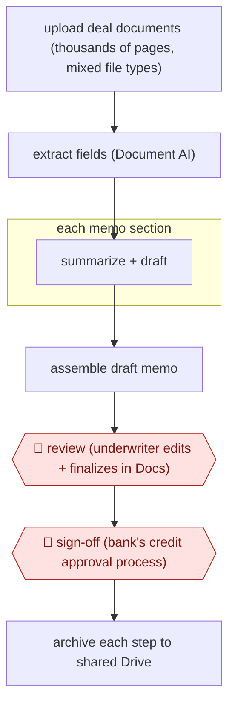

# Underwriter-finalized credit memo

`PRO › FIN › INVEST` · checkpointed · evidence B · **draft: needs a reference example** ([how to add one](../../../../../CONTRIBUTING.md#1-add-an-example-run))

**Shape:** `upload deal documents (thousands of pages, mixed file types) → extract fields (Document AI) → each memo section: summarize + draft → assemble draft memo → 🛑 review (underwriter edits + finalizes in Docs) → 🛑 sign-off (bank's credit approval process) → archive each step to shared Drive`
**Variants:** `gemini-vertex-docai` · `moodys-credit-memo` · `ncino-banking-advisor`

<!-- shape diagram: generated by scripts/build_diagrams.py from `shape`; don't edit -->

<!-- end shape diagram -->

## Background

When a business asks a bank for a loan, a bank employee called an underwriter assesses whether it will be repaid and writes up the finding as a credit memo: who the borrower is, what the numbers show, what the risks are and what the underwriter recommends. The memo goes into the bank's credit approval process, where others decide whether to lend. The underwriter first has to read the loan file, which can run to thousands of pages in several formats (financial statements, tax returns, contracts, scans), and pull the facts out section by section, so a single memo can take about a week. Here the agent extracts the details and drafts each section. The underwriter reviews, edits and finalizes the memo, and the bank's own credit process makes the lending decision, because the bank answers to regulators and to its depositors for every loan and the agent never makes that decision.

**Terms:**
- **Underwriter**: the bank employee who assesses a loan request and writes the credit memo.
- **Credit memo**: the document that sets out a borrower's finances and risks and the underwriter's recommendation.
- **Loan file**: all the documents a borrower supplies and the bank gathers for one loan request.
- **Credit approval process**: the bank's formal review, outside the underwriter's own work, that decides whether a loan is granted.
- **Document AI**: a Google service that pulls fields and text out of unstructured documents such as scans and PDFs.
- **Firmographics**: basic facts about a company such as its industry, size and location.

## Build it with an agent

**Form:** `skill`. One underwriter works on one loan file at a time and stays in the conversation, so one skill holding the memo template and the procedure is enough.

**You need:** the loan file as files; the bank's memo template; a way to read scanned and mixed-format documents (a document-extraction script or service beside the skill); access to the credit data the memo draws on, if any, through connectors; a setup your bank has approved for borrowers' financial records and personal data. Give the agent no tool that records or sends a credit decision, and do not connect a mail tool.

| Step | Built as |
|---|---|
| upload deal documents | The underwriter puts the loan file in a folder; the skill lists what is there and what looks missing. |
| extract fields (Document AI) | A script or extraction service beside the skill turns each document into text and fields, with the page each came from. |
| each memo section: summarize + draft | Built-in subagents take one section or one group of documents each and return a draft section with its source pages. |
| assemble draft memo | The main conversation puts the sections into the bank's template and flags gaps and conflicting figures. |
| 🛑 review → 🛑 sign-off | See Checkpoints. |
| archive each step to shared Drive | The skill writes its extraction tables and drafts into a folder for the deal, one file per step. |

**Checkpoints:** `review`: the skill ends by presenting the draft memo with the figures that conflict or lack a source, and stops; the underwriter edits and finalizes the memo. `sign-off`: the agent has no tool that records a credit decision or sends the memo on, so the bank's credit approval process takes it from the underwriter's own system.

**Since the sources:** Sources date from 2025 (the Banesco page is undated and the entry places it after 2024-10) to 2026-04. Both are vendor accounts: one of Google's own product and one of a bank using Moody's. Neither shows the steps in detail, and neither describes the credit approval step. The build above uses general tooling in place of the products named, and the sources say nothing on whether that gives the same result. The Moody's account also reports that a generic template did not fit the bank's portfolio, so a template for each kind of borrower may be needed.

*A design based on this entry's steps and the tool documentation as of 2026-11, not a reported run.*

## Steps

*As reported by the sources.*

1. The underwriter uploads the loan file for a deal. At Banesco USA this is thousands of pages per deal across several file types [[1]](#sources).
2. A document-extraction service (Google's Document AI) pulls details out of the unstructured documents. A language model (Gemini, deployed on Vertex AI, Google's platform for running models at scale) summarizes the material and drafts it section by section, the work underwriters used to do by hand one section at a time [[1]](#sources).
3. The agent assembles a draft credit memo in minutes; the manual process took about a week [[1]](#sources). Moody's describes the same pattern built from its ratings, firmographics, ownership, financials and filings, using bank templates [[2]](#sources).
4. 🛑 **Review**: the underwriter reviews, edits and finalizes the draft in Google Docs [[1]](#sources).
5. 🛑 **Sign-off**: the finalized memo goes through the bank's established credit review and approval process. Neither source describes this step in detail; the agent never makes the credit decision.
6. Underwriters talk to stakeholders over Gmail, and shared Drive folders keep a record of each step [[1]](#sources).

**Output:** A finalized credit memo for each loan request, handed to credit approval and kept with the deal record.
**Failure modes → guards:** Generic templates miss what each portfolio segment needs → the European bank built a custom template for a priority segment and plans sector-specific ones [[2]](#sources). Summaries can carry extraction errors into the credit file → the underwriter edits and finalizes every memo before approval [[1]](#sources).
**How it differs:** Closest is AWF-0023 Event-driven model update (INVEST). That one updates an equity model and publishes a research note after compliance sign-off. This one produces a loan-level credit memo that an underwriter finalizes and that feeds a regulated credit decision, so deliverable, checkpoint owner and risk all differ. Class fit note: FIN has no lending/credit class, so INVEST is the nearest.

## Public runs

Coverage as of 2026-11-06: **Weak**: only anonymous, vendor-linked or journalist-told accounts. Collected and re-checked in [Second collection pass](../../../../../research/2026-11-second-pass.md).

- [Google Workspace, Banesco USA customer story](https://workspace.google.com/customers/banescousa) (undated). $5B community bank drafts credit memos with Gemini; underwriters finalize in Docs. "280 credit memos we annually process". *First-hand: vendor; confidence: med.*
- [Moody's, Major European bank transforms credit analysis](https://www.moodys.com/web/en/us/insights/ai/major-european-bank-transforms-credit-analysis-with-moodys-agentic-solutions.html) (2026-04-20). Unnamed European bank replaced outsourced memo drafting with an agentic draft from templates. "first drafts in less than 15 minutes". *First-hand: vendor; confidence: med.*

## Sources

1. Google Workspace, Banesco USA customer story (undated, after Oct 2024). https://workspace.google.com/customers/banescousa
2. Moody's, Major European bank transforms credit analysis with Moody's agentic solutions, 2026-04-20. https://www.moodys.com/web/en/us/insights/ai/major-european-bank-transforms-credit-analysis-with-moodys-agentic-solutions.html
