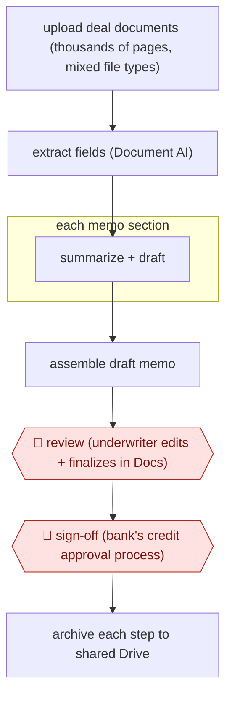

# Underwriter-finalized credit memo

`PRO › FIN › INVEST` · checkpointed · evidence B · **draft: needs a reference example** ([how to add one](../../../../../CONTRIBUTING.md#1-add-an-example-run))

**Shape:** `upload deal documents (thousands of pages, mixed file types) → extract fields (Document AI) → each memo section: summarize + draft → assemble draft memo → 🛑 review (underwriter edits + finalizes in Docs) → 🛑 sign-off (bank's credit approval process) → archive each step to shared Drive`
**How it differs:** Closest is AWF-0023 Event-driven model update (INVEST). That one updates an equity model and publishes a research note after compliance sign-off. This one produces a loan-level credit memo that an underwriter finalizes and that feeds a regulated credit decision, so deliverable, checkpoint owner and risk all differ. Class fit note: FIN has no lending/credit class, so INVEST is the nearest.
**Variants:** `gemini-vertex-docai` · `moodys-credit-memo` · `ncino-banking-advisor`

<!-- shape diagram: generated by scripts/build_diagrams.py from `shape`; don't edit -->

<!-- end shape diagram -->

## Steps
1. Underwriter uploads the loan file for a deal. At Banesco USA this is thousands of pages per deal across several file types [[1]](#sources).
2. Document AI pulls details out of the unstructured documents. Gemini, deployed on Vertex AI, summarizes the material and drafts it section by section, the work underwriters used to do by hand one section at a time [[1]](#sources).
3. The agent assembles a draft credit memo in minutes; the manual process took about a week [[1]](#sources). Moody's describes the same pattern built from its ratings, firmographics, ownership, financials and filings, using bank templates [[2]](#sources).
4. 🛑 **Review**: the underwriter reviews, edits and finalizes the draft in Google Docs [[1]](#sources).
5. 🛑 **Sign-off**: the finalized memo goes through the bank's established credit review and approval process. Neither source describes this step in detail; the agent never makes the credit decision.
6. Underwriters talk to stakeholders over Gmail, and shared Drive folders keep a record of each step [[1]](#sources).

**Output:** A finalized credit memo for each loan request, handed to credit approval and kept with the deal record.
**Failure modes → guards:** Generic templates miss what each portfolio segment needs → the European bank built a custom template for a priority segment and plans sector-specific ones [[2]](#sources). Summaries can carry extraction errors into the credit file → the underwriter edits and finalizes every memo before approval [[1]](#sources).

## Public runs

Coverage as of 2026-11-06: **Weak**: only anonymous, vendor-linked or journalist-told accounts. Collected and re-checked in [Second collection pass](../../../../../research/2026-11-second-pass.md).

- [Google Workspace, Banesco USA customer story](https://workspace.google.com/customers/banescousa) (undated). $5B community bank drafts credit memos with Gemini; underwriters finalize in Docs. "280 credit memos we annually process". *First-hand: vendor; confidence: med.*
- [Moody's, Major European bank transforms credit analysis](https://www.moodys.com/web/en/us/insights/ai/major-european-bank-transforms-credit-analysis-with-moodys-agentic-solutions.html) (2026-04-20). Unnamed European bank replaced outsourced memo drafting with an agentic draft from templates. "first drafts in less than 15 minutes". *First-hand: vendor; confidence: med.*

## Sources

1. Google Workspace, Banesco USA customer story (undated, after Oct 2024). https://workspace.google.com/customers/banescousa
2. Moody's, Major European bank transforms credit analysis with Moody's agentic solutions, 2026-04-20. https://www.moodys.com/web/en/us/insights/ai/major-european-bank-transforms-credit-analysis-with-moodys-agentic-solutions.html
