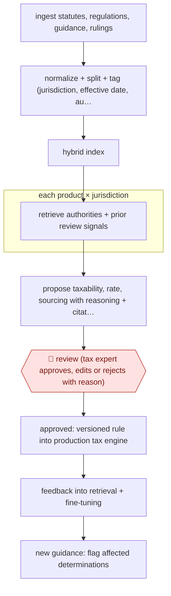

# Expert-approved taxability rules

`PRO › FIN › TAX` · checkpointed · evidence A · **draft: needs a reference example** ([how to add one](../../../../../CONTRIBUTING.md#1-add-an-example-run))

**Shape:** `ingest statutes, regulations, guidance, rulings → normalize + split + tag (jurisdiction, effective date, authority type) → hybrid index → each product × jurisdiction: retrieve authorities + prior review signals → propose taxability, rate, sourcing with reasoning + citations → 🛑 review (tax expert approves, edits or rejects with reason) → approved: versioned rule into production tax engine → feedback into retrieval + fine-tuning → new guidance: flag affected determinations`
**How it differs:** AWF-0165 (issue-split notice reply) drafts a client letter; AWF-0041 (1040 prep) prepares one return. Here the deliverable is a reusable tax rule per product × jurisdiction, every item expert-reviewed before it goes into a production engine, with a feedback loop. Swap fails on deliverable.
**Variants:** `openai-rft`

<!-- shape diagram: generated by scripts/build_diagrams.py from `shape`; don't edit -->

<!-- end shape diagram -->

## Steps
1. Web automation continuously ingests and monitors statute law, regulations, guidance, bulletins, case law and private letter rulings [[1]](#sources).
2. Materials are normalized, split into sections (rules plus LLM splitting) and tagged with jurisdiction, authority type, effective dates and hierarchy, then indexed dense + sparse [[1]](#sources).
3. For each task (a product in a jurisdiction, or a product taxonomy) the system gets the objective, how the jurisdiction imposes tax, known ambiguities, existing treatment, retrieved authorities and signals from prior expert reviews [[1]](#sources).
4. A fine-tuned reasoning model proposes a structured determination (taxability, rates, abatements, sourcing/apportionment) with a reasoning summary and citations [[1]](#sources).
5. 🛑 **Review**: an internal tax expert sees the proposal, reasoning and authorities in a review dashboard and approves, modifies or rejects it, giving a short explanation for any change [[1]](#sources).
6. Approved results become versioned rules promoted to the production tax engine; reviewer explanations feed retrieval and fine-tuning datasets; the dashboard also alerts on existing determinations affected by new guidance [[1]](#sources).

**Output:** Versioned, machine-readable taxability/rate/sourcing rules with citations, live in the tax calculation engine.
**Failure modes → guards:** Off-the-shelf RAG gave under 65% edit-free accuracy and ~2-minute reviews → fine-tuning on expert feedback and passing prior review signals; stale rules when guidance changes → monitoring flags affected determinations for re-review [1].

## Public runs

Coverage as of 2026-11-13: **Strong**: a first-hand, detailed run that matches most of the shape. Collected and re-checked in [Fourth collection pass](../../../../../research/2026-11-fourth-pass.md).

- [Sphere, Building TRAM](https://www.getsphere.com/blog/building-tram) (2025-11-23). Own production pipeline; edit-free accuracy and expert review time per determination over time. "median review time has dropped by ~92 percent, from nearly 120 seconds to under 10 seconds per determination". *First-hand: yes; confidence: high.*

## Sources

1. Sphere, Building TRAM: The World's First Tax Review and Assessment Model, 2025-11-23. https://www.getsphere.com/blog/building-tram
