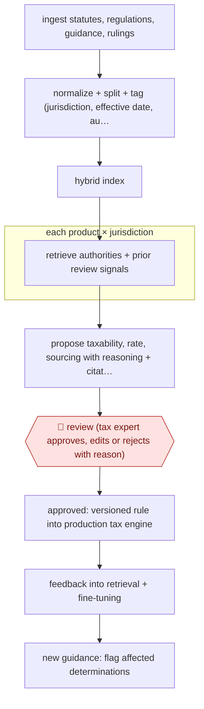

# Expert-approved taxability rules

`PRO › FIN › TAX` · checkpointed · evidence A · **draft: needs a reference example** ([how to add one](../../../../../CONTRIBUTING.md#1-add-an-example-run))

**Shape:** `ingest statutes, regulations, guidance, rulings → normalize + split + tag (jurisdiction, effective date, authority type) → hybrid index → each product × jurisdiction: retrieve authorities + prior review signals → propose taxability, rate, sourcing with reasoning + citations → 🛑 review (tax expert approves, edits or rejects with reason) → approved: versioned rule into production tax engine → feedback into retrieval + fine-tuning → new guidance: flag affected determinations`
**Variants:** `openai-rft`

<!-- shape diagram: generated by scripts/build_diagrams.py from `shape`; don't edit -->

<!-- end shape diagram -->

## Background

A company that sells goods or services must charge the right sales or value-added tax in every place it sells. Whether a product is taxable, at what rate and where the tax is owed depends on that place's laws, and those laws and the official guidance on them keep changing. Software that calculates tax at checkout (a tax engine) therefore needs a rule for every product type in every jurisdiction, and tax experts have traditionally read the law and written each rule by hand. Here an agent reads the sources and proposes each rule with its reasoning and citations, and watches for new guidance that affects rules already in use. A tax expert approves, edits or rejects every proposal before it reaches the engine, because a wrong rule is applied to every transaction and the company is liable for the tax collected or missed.

**Terms:**
- **Taxability**: whether a given product is taxed in a given place, and at what rate.
- **Jurisdiction**: a state, country or other authority with its own tax law.
- **Statute, regulation, guidance, private letter ruling**: the law itself; detailed rules made under it; the tax authority's published explanations; and a ruling the authority gives one taxpayer on a specific question.
- **Sourcing, apportionment**: deciding which jurisdiction a sale belongs to, and how the tax splits when more than one is involved.
- **Abatement**: a reduction or exemption from the tax that would otherwise apply.
- **Tax engine**: the software that applies the rules to each transaction and returns the tax due.
- **Hybrid index (dense and sparse)**: a search index that matches both by meaning and by exact words, so that a query finds the right passage of law.
- **Fine-tuning**: training a model further on a firm's own examples, here the experts' corrections.
- **Edit-free accuracy**: the share of proposals the expert approved without changing.

## Build it with an agent

**Form:** `service`. New guidance arrives with nobody at the keyboard, so the monitoring and the proposals run on a schedule, and people see only a queue of proposals and alerts to review.

**You need:** a store of the authorities (statutes, regulations, guidance, rulings), each tagged with jurisdiction, effective date and authority type, and a search index over it that finds passages by meaning and by exact words; a list of product and jurisdiction tasks with the objective, how the jurisdiction taxes, known ambiguities and current treatment; a state store (a file or database table) holding past expert decisions and their reasons; a review queue the tax experts work from. Give the agent no write access to the production tax engine.

| Step | Built as |
|---|---|
| ingest statutes, regulations, guidance, rulings | A cloud scheduled task, or your own scheduler starting `claude -p` or an Agent SDK program, runs one script per authority site that fetches new or changed documents. |
| normalize + split + tag → hybrid index | Scripts split each document at its own headings and tag it with jurisdiction, effective date and authority type, then load the index. The agent reaches the index through an MCP server. |
| each product × jurisdiction: retrieve authorities + prior review signals | A skill beside the scripts starts each run by reading the task and the past expert decisions for that jurisdiction from the state store. |
| propose taxability, rate, sourcing with reasoning + citations | The skill writes one structured proposal per task: the determination, a reasoning summary and a citation for each point. A script rejects any proposal with a missing citation. |
| 🛑 review | See Checkpoints. |
| approved: versioned rule into production tax engine | A separate script, not the agent, turns each approved proposal into a versioned rule file and loads it. |
| feedback into retrieval + fine-tuning → new guidance: flag affected determinations | Expert decisions and reasons are saved to the state store for the next runs to read. When the ingest step finds a changed authority, a run re-checks the rules that cite it and adds an alert to the queue. |

**Checkpoints:** `review`: every proposal and alert goes to the review queue with its reasoning and the cited passages, and the expert approves, edits or rejects it with a short reason. The agent has no tool that writes to the tax engine, and the promotion script reads only items marked approved, so an unreviewed proposal cannot go live.

**Since the sources:** The one source and its public run date from 2025-11-23; it is the vendor's own account of its pipeline, so no other account was compared. The source reports a model fine-tuned on expert feedback, and a standard retrieval setup with off-the-shelf models that did worse (under 65 percent edit-free accuracy). This build has no fine-tuning step, because the building blocks above contain none; it passes the experts' past decisions into each run instead, so the source's accuracy figures should not be assumed for it. The source builds its own crawler and review dashboard, which here are scripts and a queue.

*A design based on this entry's steps and the tool documentation as of 2026-11, not a reported run.*

## Steps

*As reported by the sources.*

1. A web-automation system continuously ingests and monitors statute law, regulations, guidance, bulletins, case law and private letter rulings [[1]](#sources).
2. The materials are normalized, split into sections (rules plus LLM splitting) and tagged with jurisdiction, authority type, effective dates and hierarchy, then indexed dense + sparse [[1]](#sources).
3. For each task (a product in a jurisdiction, or a product taxonomy) the system gets the objective, how the jurisdiction imposes tax, known ambiguities, existing treatment, retrieved authorities and signals from prior expert reviews [[1]](#sources).
4. A fine-tuned reasoning model proposes a structured determination (taxability, rates, abatements, sourcing/apportionment) with a reasoning summary and citations [[1]](#sources).
5. 🛑 **Review**: an internal tax expert sees the proposal, reasoning and authorities in a review dashboard and approves, modifies or rejects it, giving a short explanation for any change [[1]](#sources).
6. Approved results become versioned rules promoted to the production tax engine; reviewer explanations feed retrieval and fine-tuning datasets; the dashboard also alerts on existing determinations affected by new guidance [[1]](#sources).

**Output:** Versioned, machine-readable taxability/rate/sourcing rules with citations, live in the tax calculation engine.
**Failure modes → guards:** Off-the-shelf RAG gave under 65% edit-free accuracy and ~2-minute reviews → fine-tuning on expert feedback and passing prior review signals; stale rules when guidance changes → monitoring flags affected determinations for re-review [1].
**How it differs:** AWF-0165 (issue-split notice reply) drafts a client letter; AWF-0041 (1040 prep) prepares one return. Here the deliverable is a reusable tax rule per product × jurisdiction, every item expert-reviewed before it goes into a production engine, with a feedback loop. Swap fails on deliverable.

## Public runs

Coverage as of 2026-11-13: **Strong**: a first-hand, detailed run that matches most of the shape. Collected and re-checked in [Fourth collection pass](../../../../../research/2026-11-fourth-pass.md).

- [Sphere, Building TRAM](https://www.getsphere.com/blog/building-tram) (2025-11-23). Own production pipeline; edit-free accuracy and expert review time per determination over time. "median review time has dropped by ~92 percent, from nearly 120 seconds to under 10 seconds per determination". *First-hand: yes; confidence: high.*

## Sources

1. Sphere, Building TRAM: The World's First Tax Review and Assessment Model, 2025-11-23. https://www.getsphere.com/blog/building-tram
