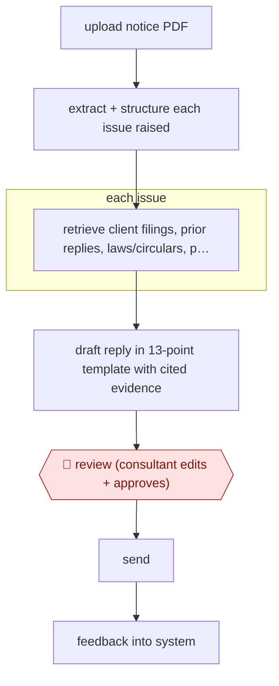

# Issue-split notice reply

`PRO › FIN › TAX` · assist · evidence B · **draft: needs a reference example** ([how to add one](../../../../../CONTRIBUTING.md#1-add-an-example-run))

**Shape:** `upload notice PDF → extract + structure each issue raised → each issue: retrieve client filings, prior replies, laws/circulars, precedents → draft reply in 13-point template with cited evidence → 🛑 review (consultant edits + approves) → send → feedback into system`
**How it differs:** AWF-0041 Review-ready 1040 prep: that prepares and files a return from client source documents, with field-validation and second-pass review. Here the deliverable is a reply to an authority's notice, drafted per issue with legal citations and approved once by the consultant. Different deliverable and a single checkpoint.
**Variants:** `shorthills-copilot`

<!-- shape diagram: generated by scripts/build_diagrams.py from `shape`; don't edit -->

<!-- end shape diagram -->

## Steps
1. Upload the government tax notice as a PDF. LLMs identify each issue the authority raised and structure it for separate research and drafting [[1]](#sources).
2. Each issue: retrieve the client's filings, prior replies, internal laws/acts/circulars, precedents and templates, so every argument is grounded in cited evidence [[1]](#sources).
3. Draft the reply in a fixed 13-point template that organises arguments and references [[1]](#sources).
4. 🛑 **Review**: consultants review, edit and approve the draft before it goes out; everything is tracked as an audit trail [[1]](#sources).
5. Reviewer feedback is used to improve the system and keep it current with rule changes [[1]](#sources).

**Output:** An approved reply to the tax authority, with citations to client records and law, filed with the engagement's audit trail.
**Failure modes → guards:** Multi-issue notices with large evidence sets get a point missed → split into issues first, then a per-issue template. Laws change → retrieval over a maintained internal knowledge base. Wrong citation → consultant approval before sending.

## Public runs

Coverage as of 2026-11-13: **Weak**: only anonymous, vendor-linked or journalist-told accounts. Collected and re-checked in [Third collection pass](../../../../../research/2026-11-third-pass.md).

- [Shorthills AI, Reply to Notice](https://www.shorthills.ai/replytonotice) (n.d.). Unnamed global professional services firm; per-issue drafting with consultant approval. "cut first-draft creation to 10–15 minutes with ~90% initial accuracy". *First-hand: vendor; confidence: med.*

## Sources

1. Shorthills AI, Case Study: Reply to Notice, n.d. https://www.shorthills.ai/replytonotice
