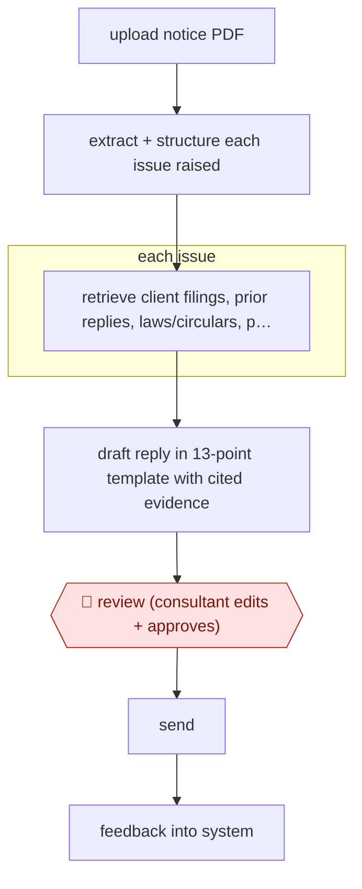

# Issue-split notice reply

`PRO › FIN › TAX` · assist · evidence B · **draft: needs a reference example** ([how to add one](../../../../../CONTRIBUTING.md#1-add-an-example-run))

**Shape:** `upload notice PDF → extract + structure each issue raised → each issue: retrieve client filings, prior replies, laws/circulars, precedents → draft reply in 13-point template with cited evidence → 🛑 review (consultant edits + approves) → send → feedback into system`
**Variants:** `shorthills-copilot`

<!-- shape diagram: generated by scripts/build_diagrams.py from `shape`; don't edit -->

<!-- end shape diagram -->

## Background

Tax authorities send businesses written notices that question a return or demand more information, and the business must reply by a deadline. A notice often raises several separate issues. Advisers at an accounting or consulting firm, called consultants here, read the notice, search the client's past filings, earlier replies and the relevant laws and precedents, and write a reply that answers each issue with evidence. Doing this by hand is slow, and with many issues and a large evidence set a point can be missed. Here the agent splits the notice into issues, gathers the evidence for each and drafts the reply in the firm's template with citations. A consultant edits and approves it before it goes out, because the firm is professionally responsible for what it tells the authority on the client's behalf.

**Terms:**
- **Tax notice**: a written communication from a tax authority that questions a filing, asks for information or proposes an adjustment.
- **Issue**: one separate question or claim in a notice, answered on its own.
- **Consultant**: the adviser at the firm who prepares and approves the client's reply.
- **Client filings**: the returns and supporting records the firm holds for the client.
- **Circular**: an official explanation or instruction issued by a tax authority.
- **Precedent**: an earlier ruling or court decision on a similar question.
- **Audit trail**: a record of what was drafted, by whom, and who approved it.

## Build it with an agent

**Form:** `skill`. One consultant answers one notice at a time and stays in the conversation, so one skill holding the reply template and the research procedure is enough.

**You need:** the notice as a PDF; the client's filings and past replies as files; the firm's knowledge base of laws, circulars, precedents and templates, as reference files or through a connector; the firm's reply template; a setup the firm has approved for client tax records, which are confidential. Do not connect a mail tool.

| Step | Built as |
|---|---|
| upload notice PDF → extract + structure each issue raised | The skill reads the PDF and writes a numbered list of issues, each with the notice's own wording and the amount or period it concerns. |
| each issue: retrieve client filings, prior replies, laws/circulars, precedents | Built-in subagents take one issue each and return the matching passages from the client's files and the knowledge base, each with its file and location. |
| draft reply in 13-point template with cited evidence | The main conversation fills the firm's template from the subagents' tables. A claim with no cited passage is marked as open and not argued. |
| 🛑 review (consultant edits + approves) | See Checkpoints. |
| send | Done by the consultant outside the agent. |
| feedback into system | The consultant's edits are saved as a note for the skill's reference files, for the consultant to accept or drop. |

**Checkpoints:** `review`: the skill ends by presenting the draft with every issue, its evidence and its citations, and stops; the consultant edits and approves. The agent has no mail tool, so the consultant sends the reply from their own system.

**Since the sources:** The only source is a vendor's case study with no date, and its public run is the same page. It names a stack on Azure with GPT-4 and a custom retrieval pipeline, which this build replaces with a skill and subagents over files. The source states a first-draft time and an accuracy figure for its own system; neither is a claim about this build. How the source's feedback step improves the system is not described, so the last row of the table is only a suggestion.

*A design based on this entry's steps and the tool documentation as of 2026-11, not a reported run.*

## Steps

*As reported by the sources.*

1. A person uploads the government tax notice as a PDF. LLMs identify each issue the authority raised and structure it for separate research and drafting [[1]](#sources).
2. For each issue, the system retrieves the client's filings, prior replies, internal laws/acts/circulars, precedents and templates, so every argument is grounded in cited evidence [[1]](#sources).
3. The system drafts the reply in a fixed 13-point template that organises arguments and references [[1]](#sources).
4. 🛑 **Review**: consultants review, edit and approve the draft before it goes out; everything is tracked as an audit trail [[1]](#sources).
5. Reviewer feedback is used to improve the system and keep it current with rule changes [[1]](#sources).

**Output:** An approved reply to the tax authority, with citations to client records and law, filed with the engagement's audit trail.
**Failure modes → guards:** Multi-issue notices with large evidence sets get a point missed → split into issues first, then a per-issue template. Laws change → retrieval over a maintained internal knowledge base. Wrong citation → consultant approval before sending.
**How it differs:** AWF-0041 Review-ready 1040 prep: that prepares and files a return from client source documents, with field-validation and second-pass review. Here the deliverable is a reply to an authority's notice, drafted per issue with legal citations and approved once by the consultant. Different deliverable and a single checkpoint.

## Public runs

Coverage as of 2026-11-13: **Weak**: only anonymous, vendor-linked or journalist-told accounts. Collected and re-checked in [Third collection pass](../../../../../research/2026-11-third-pass.md).

- [Shorthills AI, Reply to Notice](https://www.shorthills.ai/replytonotice) (n.d.). Unnamed global professional services firm; per-issue drafting with consultant approval. "cut first-draft creation to 10–15 minutes with ~90% initial accuracy". *First-hand: vendor; confidence: med.*

## Sources

1. Shorthills AI, Case Study: Reply to Notice, n.d. https://www.shorthills.ai/replytonotice
