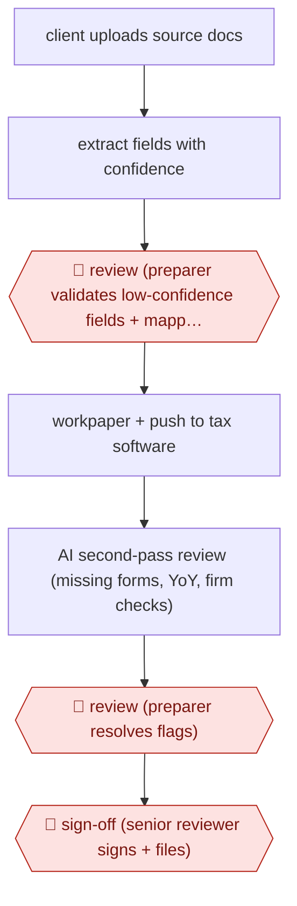

# Review-ready 1040 prep

`PRO › FIN › TAX` · checkpointed · evidence B · **draft: needs a reference example** ([how to add one](../../../../../CONTRIBUTING.md#1-add-an-example-run))

**Shape:** `client uploads source docs → extract fields with confidence → 🛑 review (preparer validates low-confidence fields + mapping) → workpaper + push to tax software → AI second-pass review (missing forms, YoY, firm checks) → 🛑 review (preparer resolves flags) → 🛑 sign-off (senior reviewer signs + files)`
**Variants:** `juno` · `filed`

<!-- shape diagram: generated by scripts/build_diagrams.py from `shape`; don't edit -->

<!-- end shape diagram -->

## Background

Every year an accounting firm prepares income tax returns for its clients. The 1040 is the US individual income tax return. The preparer collects the client's source documents (wage statements, interest and investment reports, partnership statements), types the figures into tax software, builds a workpaper that records where each figure came from, and passes the return to a senior reviewer who checks it, signs it and files it. Keying and cross-checking take most of the preparer's time, and a misread figure or a missing form is easy to overlook when volumes peak. Here the agent reads the documents, scores its confidence in each field, builds the workpaper and then re-reads the draft return for missing forms and large changes from last year. People still validate the low-confidence fields and resolve every flag, and the senior reviewer signs and files, because a CPA (certified public accountant) or other signing preparer is legally responsible for the return.

**Terms:**
- **W-2, 1099, K-1**: US tax forms reporting wages (W-2), other income such as interest or investment sales (1099), and a share of a partnership's or S corporation's income (K-1).
- **Source documents**: the client's own papers a return is built from.
- **Preparer / senior reviewer**: the staff member who prepares the return, and the more experienced one (often a CPA) who reviews, signs and files it.
- **Workpaper**: the working file that ties each figure on the return to its source document.
- **Chart-of-accounts mapping**: for a business return, assigning each account in the client's books to the matching line category on the tax return.
- **YoY (year over year)**: comparison with the same figure on last year's return.
- **Diagnostics**: the tax software's own built-in checks for errors and missing data.
- **Tax software**: the professional program in which the return is calculated and filed electronically.

## Build it with an agent

**Form:** `project`. A skill can run the extraction and the workpaper, but the second-pass review must be done by a reviewer that has not seen how the data was entered, and the firm's own checks must run on every return, so a custom subagent and standing project files are needed. Whether this needs more than a `skill` depends on how heavily the firm relies on those two points.

**You need:** the client's source documents as files; the prior-year return; the firm's list of its own checks (state quirks, elections and other things it looks for every season) as a reference file; a way to produce the file or export your tax software accepts, if it accepts one; a setup the firm has approved for taxpayers' identity numbers and financial records, which are confidential. Give the agent no tool that signs, files or transmits a return.

| Step | Built as |
|---|---|
| client uploads source docs | The client uses the firm's portal; staff put the files in a folder for the return. |
| extract fields with confidence | A skill reads each document and writes a table: field, value, source page, confidence (high, medium or low) with the reason. |
| 🛑 review (preparer validates low-confidence fields + mapping) | See Checkpoints. |
| workpaper + push to tax software | The skill builds the workpaper from the validated table, one line per figure with its source. Loading the figures into the tax software depends on what it offers: an import file or interface the agent can write to, or the preparer enters them from the workpaper. |
| AI second-pass review (missing forms, YoY, firm checks) | A custom read-only subagent receives the draft return, the prior-year return and the firm's check list, and returns a review plan of flagged items. A `PreToolUse` hook can keep it from changing the files it reads. |
| 🛑 review (preparer resolves flags) | See Checkpoints. |
| 🛑 sign-off (senior reviewer signs + files) | See Checkpoints. |

**Checkpoints:** `review` (fields): the skill stops after the extraction table and lists the low-confidence fields first; the preparer checks them against the source pages and confirms the mapping. `review` (flags): the review plan is presented as a checklist and the preparer resolves each item before the return moves on. `sign-off`: the agent has no tool that files or transmits a return, and a permission rule denies any command that would, so the senior reviewer signs and files in the tax software.

**Since the sources:** Sources date from 2026 to 2026-03. Both are vendor accounts: Juno's founder describing his own product, and a case study published by Filed. Neither shows how the steps are built inside, and both rely on products that read documents and connect to named tax programs. A general agent can do the reading, the workpaper and the second pass; the push into tax software depends on what each program offers, which this entry did not check. The sources' figures on accuracy and time saved are not claims about this build.

*A design based on this entry's steps and the tool documentation as of 2026-11, not a reported run.*

## Steps

*As reported by the sources.*

1. The client uploads W-2s, 1099s, K-1s and brokerage statements to the firm's portal [[1]](#sources).
2. The AI extracts fields and gives a confidence score for each [[1]](#sources).
3. 🛑 **Review**: the preparer checks extracted values against the source PDF, low-confidence fields first. For business returns, the preparer confirms the chart-of-accounts mapping [[1]](#sources).
4. The system builds the workpaper and pushes data into the tax software. The AI runs data entry and diagnostics [[1]](#sources)[[2]](#sources).
5. The draft return goes back to the AI reviewer, which flags missing forms, year-over-year swings and firm-specific checks into a review plan [[1]](#sources).
6. 🛑 **Review**: the preparer works through and resolves the flagged items [[1]](#sources).
7. 🛑 **Sign-off**: the senior reviewer or CPA reviews everything, corrects, signs and files [[1]](#sources)[[2]](#sources).

**Output:** A CPA-signed, e-filed return with an evidence-linked workpaper and a resolved review checklist.
**Failure modes → guards:** Misread source fields → confidence scores with human validation [[1]](#sources). Missed forms → prior-year comparison checks [[1]](#sources). Treat the AI like a junior preparer: review everything [[2]](#sources).
**How it differs:** AWF-0022 Invoice extract-match-route (AP) extracts invoices for payment. This prepares a regulated filing with preparer and CPA sign-off.

## Public runs

Coverage as of 2026-11-06: **Weak**: only anonymous, vendor-linked or journalist-told accounts. Collected and re-checked in [New workflows for empty categories](../../../../../research/2026-11-new-workflows.md).

- [Filed, Teel Accounting](https://www.filed.com/cases/teel-accounting) (2026). Solo CPA ran returns through AI data entry and diagnostics, reviewing each in ProConnect. "processing 50% of all returns through Filed for data entry and diagnostics". *First-hand: vendor; confidence: med.*
- [Juno, How AI tax preparation works](https://juno.tax/blog/how-ai-tax-preparation-works) (2026-03-06). Vendor founder's step-by-step workflow as used inside firms. *First-hand: vendor; confidence: low.*

## Sources

1. Haase D., How AI tax preparation works: step-by-step, Juno, 2026-03-06. https://juno.tax/blog/how-ai-tax-preparation-works
2. Filed, Teel Accounting Case Study: 1,100 returns. A 5 p.m. finish., 2026. https://www.filed.com/cases/teel-accounting
