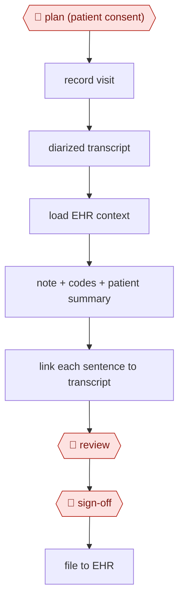

# Ambient scribe

`PRO › HLT › CLINDOC` · checkpointed · evidence A · **draft: needs a reference example** ([how to add one](../../../../../CONTRIBUTING.md#1-add-an-example-run))

**Shape:** `🛑 plan (patient consent) → record visit → diarized transcript → load EHR context → note + codes + patient summary → link each sentence to transcript → 🛑 review → 🛑 sign-off → file to EHR`
**Variants:** `abridge-epic` [[26]](#sources) · `dragon-copilot` (launched March 2025; combines Dragon Medical One dictation with DAX ambient [[25]](#sources)) · `nabla` · `ambience`

<!-- shape diagram: generated by scripts/build_diagrams.py from `shape`; don't edit -->

<!-- end shape diagram -->

## Background

After every visit a doctor writes a clinical note: what the patient reported, what was examined and what was decided. The doctor also picks the codes that describe the visit and often writes a plain-language summary for the patient. Done by hand, this takes time during and after clinic, and doctors end up typing while the patient talks or finishing notes in the evening. An ambient scribe records the conversation, with the patient's agreement, turns it into a transcript that shows who said what, and drafts the note, the codes and the summary, linking each sentence to the part of the conversation it came from. The doctor still reads and corrects the draft and signs it, because the signed note is a legal medical record with the doctor as its author, and an omission or an invented detail in it can harm the patient.

**Terms:**
- **Ambient capture**: recording the visit in the background, on a room device or a phone, instead of the doctor dictating.
- **Diarized transcript**: a transcript that labels which speaker said each line.
- **EHR (electronic health record)**: the hospital or clinic system that holds each patient's chart; Epic is one such product.
- **Codes**: standard diagnosis and billing codes attached to the visit.
- **Specialty template**: the section layout of a note in a given medical specialty.
- **Linked Evidence**: Abridge's name for linking each phrase of the note to its source audio or transcript.
- **Epic Haiku, Hyperdrive**: Epic's mobile app for clinicians and its desktop application.
- **HIPAA, BAA**: the US law protecting patient health information, and the business associate agreement a vendor must sign before it may handle that information.
- **Hallucination**: content in the draft that was never said and is not in the record.

## Build it with an agent

**Form:** `platform`. Recording the room and turning speech into a transcript that tells the speakers apart needs a speech model, and the note must be filed in the EHR; a general agent replaces neither. Once a transcript exists, the drafting stages fit a `skill`: one clinician, one visit, with the clinician present to review.

**You need:** an ambient capture and speech-to-text product approved by the organisation; the visit transcript as a file with timestamps and speaker labels; the specialty template and the code list as reference files beside the skill; the patient's chart context, either through a read-only MCP server the organisation provides or as an extract the clinician supplies; a setup covered by a HIPAA business associate agreement, since the transcript and chart are patient records. Give the agent no tool that writes to the EHR.

| Step | Built as |
|---|---|
| 🛑 plan (patient consent) | The clinician, before recording starts, in the capture product. The skill's first instruction asks the clinician to confirm consent was recorded and stops if it was not. |
| record visit → diarized transcript | The capture and speech-to-text platform. |
| load EHR context | A read-only MCP server for the EHR, or the clinician's extract. |
| note + codes + patient summary | The skill, with the specialty template and the code list beside it. |
| link each sentence to transcript | The skill's rule: every sentence carries the timestamps of the transcript lines it rests on, and a sentence with no source is listed for the clinician. A built-in subagent can re-check each sentence against its cited lines. |
| 🛑 review → 🛑 sign-off → file to EHR | See Checkpoints. |

**Checkpoints:** `plan`: consent is taken by the clinician in the capture product; the agent never starts a recording, and the skill stops if consent is not confirmed. `review`: the skill stops and presents the draft with its links, listing unsupported sentences first; the clinician edits. `sign-off`: the agent has no EHR write tool, so the clinician signs the note and files it in the EHR as its legal author.

**Since the sources:** Sources date from 2024-02 to 2025-10; the public run is a pilot from 2024-07 to 2024-08, published in 2026. In 2026-02 Epic released its own ambient note-drafting feature, AI Charting, inside the EHR ([HIT Consultant, 2026-02-05](https://hitconsultant.net/2026/02/05/epic-releases-ai-charting-ambient-ai-market-implications/)), so the EHR vendor now offers these steps alongside the products in `variants`. `dragon-copilot` is still the product's name. The sources are vendor announcements and a health system's quality study of one vendor's scribe; none reports a general agent running these steps, so the build above is a proposal for the drafting stages only, after a specialist product has made the transcript.

*A design based on this entry's steps and the tool documentation as of 2026-11, not a reported run.*

## Steps

*As reported by the sources.*

1. 🛑 **Plan**: the clinician obtains the patient's consent to recording.
2. The scribe product records the visit by ambient capture, in the room or on a phone.
3. The product makes a diarized transcript, then a structured note in the specialty template.
4. The product links each note phrase to its source audio or transcript. Abridge calls this "Linked Evidence," inside Epic Haiku → Hyperdrive [[26]](#sources).
5. 🛑 **Review**: the clinician edits the note.
6. 🛑 **Sign-off**: the clinician signs and is the legal author.

## Public runs

Coverage as of 2026-11-06: **Strong**: a first-hand, detailed run that matches most of the shape. From [Where are the real runs?](../../../../../research/2026-11-real-runs.md); every number was re-checked against its page.

- [Taylor … Adams, UC Davis Health, JMIR Med Inform 2026;14:e86474](https://escholarship.org/content/qt9r89g3sp/qt9r89g3sp.pdf) (pilot Jul–Aug 2024). 31 physicians, 7,545 notes; 356 rated for omissions and hallucinations; physicians approve each note. "94.7% (337/356) free from significant errors"; "hallucinations (n=41, 11.5%)". *First-hand: yes; confidence: high.*

## Sources

25. Fierce Healthcare / Maginative on Dragon Copilot. https://www.maginative.com/article/microsoft-unveils-dragon-copilot-an-ai-assistant-for-clinicians/ · https://www.fiercehealthcare.com/ai-and-machine-learning/microsoft-debuts-dragon-copilot-ai-clinical-assistant-nurses-expands-access
26. Business Wire, *Abridge Inside with Epic Integration* (February 2024). https://www.businesswire.com/news/home/20240213503774/en
