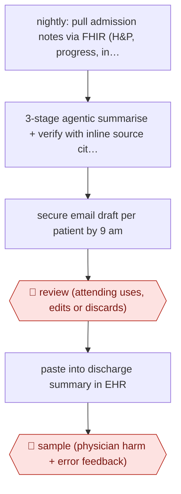

# Nightly hospital-course drafts

`PRO › HLT › CLINDOC` · assist · evidence A · **draft: needs a reference example** ([how to add one](../../../../../CONTRIBUTING.md#1-add-an-example-run))

**Shape:** `nightly: pull admission notes via FHIR (H&P, progress, interdisciplinary) → 3-stage agentic summarise + verify with inline source citations → secure email draft per patient by 9 am → 🛑 review (attending uses, edits or discards) → paste into discharge summary in EHR → 🛑 sample (physician harm + error feedback)`
**How it differs:** AWF-0088 Pre-drafted radiograph reports drafts a single-study report inside the dictation template; AWF-0026 Ambient scribe drafts a visit note from a recording. Here the deliverable is a whole-stay hospital course synthesised from many authors' notes, generated nightly in batch and offered optionally, with source citations per sentence. Different deliverable and inputs; swap fails.
**Variants:** `gemini-2-5-pro` · `epic-fhir` · `gpt-4-1-ehr-template`

<!-- shape diagram: generated by scripts/build_diagrams.py from `shape`; don't edit -->

<!-- end shape diagram -->

## Steps
1. Each night the pipeline retrieves the admission's clinical documentation from the EHR via FHIR, including physician, pharmacy, nursing, therapy, dietitian, case management and spiritual care notes [[1]](#sources).
2. A 3-stage agentic workflow (Gemini 2.5 Pro) iteratively builds and verifies the summary instead of a single-pass prompt, keeping grounding in source notes at each stage [[1]](#sources).
3. Output format designed with hospitalists: patient one-liner, narrative hospital course, problem-based summary, each statement with an inline citation to its source note [[1]](#sources).
4. By 9:00 am each attending receives one secure email per patient with the draft as an interactive HTML file and a copy button that strips citations for pasting into Epic [[1]](#sources).
5. 🛑 **Review**: physicians are 'free to use, edit, or discard summaries at their discretion'; the physician signs the discharge summary [[1]](#sources)[[2]](#sources).
6. 🛑 **Sample**: a feedback form rates harm potential (AHRQ Common Format Harm Scale) and error types (omission, inaccuracy, hallucination, incorrect citation) on a subset of summaries [[1]](#sources)[[2]](#sources).

**Output:** Hospital course section of the discharge summary, physician-edited and signed in the EHR.
**Failure modes → guards:** Omissions (25% of rated summaries) and inaccuracies (20%) → physician review against cited sources before use; long stays exceed context → staged decomposition; adoption without time savings → track EHR time logs and burnout, not just use rate.

## Public runs

Coverage as of 2026-11-13: **Strong**: a first-hand, detailed run that matches most of the shape. Collected and re-checked in [Third collection pass](../../../../../research/2026-11-third-pass.md).

- [Grolleau et al., Stanford, JAMA Netw Open](https://jamanetwork.com/journals/jamanetworkopen/fullarticle/2848785) (2026-05-08). 10-week prospective pilot, 384 discharges, physicians optionally used drafts; 100 rated for harm. "Physicians used artificial intelligence (AI) content in 219 cases (57.0%)"; "Physicians rated 88 unedited summaries (88.0%) as having no harm potential". *First-hand: yes; confidence: high.*
- [Suarez et al., ACI](https://doi.org/10.1055/a-2962-8004) (2026-08-01). GPT-4.1 hospital course draft inside mandatory discharge template; 8,298 adults; edit time measured. "the AI tool was associated with a 32% increase in edit time". *First-hand: yes; confidence: high.*

## Sources

1. Grolleau F., Liang A.S., Keyes T., Ma S.P., Lew T. et al. (Stanford), Physician-Reported Safety Outcomes of AI-Generated Hospital Course Summaries, JAMA Network Open, 2026-05-08. https://jamanetwork.com/journals/jamanetworkopen/fullarticle/2848785
2. Society of Hospital Medicine abstract, MedAgentBrief: development and prospective real-world evaluation of an LLM-based hospital course summarizer, 2026-04-30. https://shmabstracts.org/abstract/medagentbrief-development-and-prospective-real-world-evaluation-of-an-llm-based-hospital-course-summarizer-2/
3. Suarez M. et al., Evaluation of a Large Language Model Discharge Summary Hospital Course Tool: Improved Quality but Longer Documentation Time, Applied Clinical Informatics, 2026. https://doi.org/10.1055/a-2962-8004
