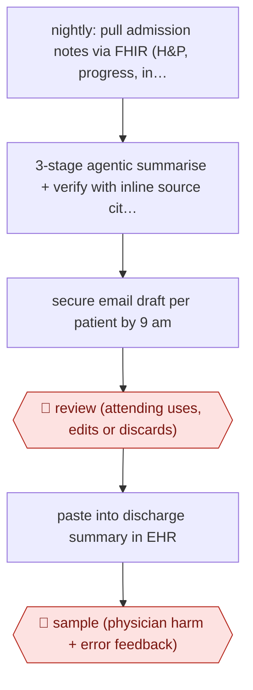

# Nightly hospital-course drafts

`PRO › HLT › CLINDOC` · assist · evidence A · **draft: needs a reference example** ([how to add one](../../../../../CONTRIBUTING.md#1-add-an-example-run))

**Shape:** `nightly: pull admission notes via FHIR (H&P, progress, interdisciplinary) → 3-stage agentic summarise + verify with inline source citations → secure email draft per patient by 9 am → 🛑 review (attending uses, edits or discards) → paste into discharge summary in EHR → 🛑 sample (physician harm + error feedback)`
**Variants:** `gemini-2-5-pro` · `epic-fhir` · `gpt-4-1-ehr-template`

<!-- shape diagram: generated by scripts/build_diagrams.py from `shape`; don't edit -->

<!-- end shape diagram -->

## Background

When a patient leaves hospital, the attending physician writes a discharge summary for the doctors who take over. Its hospital course section tells the story of the stay: why the patient came in, what was found, what was done and what is still open. For a long stay this means reading many notes by doctors, nurses, pharmacists, therapists and others, often in a rush on the day of discharge, and something important is easily left out. Here a job runs every night, reads each inpatient's notes and drafts the hospital course with a citation to the source note for every statement, so the physician has a draft by morning. The physician decides whether to use it, checks it against the cited notes and signs the discharge summary, because the signed summary is the medical record the next clinician acts on, and an omission or a wrong statement in it can harm the patient. Physicians also rate a share of the drafts for harm, so the team can see whether the tool is safe to keep.

**Terms:**
- **Attending, hospitalist**: the senior doctor responsible for a patient's care; a hospitalist is an attending who works only on hospital wards.
- **Discharge summary, hospital course**: the document written when a patient leaves hospital, and its section that narrates the stay.
- **EHR (electronic health record)**: the hospital system that holds each patient's chart; Epic is the one used here.
- **FHIR**: a standard interface through which other programs read health records from an EHR.
- **H&P, progress notes, interdisciplinary notes**: the admission history and physical examination; the daily notes; notes by nurses, pharmacists, therapists, dietitians, case managers and spiritual care staff.
- **Agentic workflow**: here, a model run in several stages that build the summary and check it, instead of one prompt.
- **Inline citation**: a reference after each statement to the note it came from.
- **One-liner, problem-based summary**: a one-sentence description of the patient; a summary organised by medical problem.
- **AHRQ Common Format Harm Scale**: a standard scale from a US federal agency for rating how much harm an error could cause.
- **Omission, inaccuracy, hallucination**: something important left out; something stated wrongly; something stated that is in no note.

## Build it with an agent

**Form:** `service`. The drafts are made overnight with nobody at the keyboard, and physicians see only the finished draft for each of their patients in the morning.

**You need:** read-only FHIR access to the notes of the unit's admitted patients, through an MCP server or one small script, approved by the hospital; the output format agreed with the hospitalists as a reference file beside the skill; a state store recording which patients were drafted and sent; a secure internal channel the hospital allows for patient information; a feedback form whose answers land in a store the team can read. The notes are patient records: run the service only in a setup the hospital has approved for them (in the US, one covered by a business associate agreement). Give the agent no tool that writes to the EHR.

| Step | Built as |
|---|---|
| nightly: pull admission notes via FHIR (H&P, progress, interdisciplinary) | A cloud scheduled task if the FHIR endpoint is reachable from it; otherwise the hospital's own scheduler starting `claude -p` or an Agent SDK program inside its network. A script fetches each admission's notes. |
| 3-stage agentic summarise + verify with inline source citations | A skill holding the output format. Each patient goes to a subagent that drafts from the notes; a second subagent, which has not seen the draft being written, checks every statement against the note it cites and marks those it cannot find. |
| secure email draft per patient by 9 am | A script sends one message per patient to the attending through the approved channel and records it in the state store. The run ends there. |
| 🛑 review (attending uses, edits or discards) → paste into discharge summary in EHR | The physician, in the EHR. |
| 🛑 sample (physician harm + error feedback) | The feedback form sent with each draft. A later run summarises the answers for the team. |

**Checkpoints:** `review`: the draft reaches the physician as a message, not as an entry in the chart. The agent has no tool that writes to the EHR, so nothing enters the record unless the physician pastes it in and signs the discharge summary. `sample`: physicians rate harm potential and error types on the drafts they choose through the form; the answers go to the team's store, and the agent has no way to change a draft after it is sent.

**Since the sources:** Sources and public runs date from 2026-04 to 2026-08. The Stanford team built a custom three-stage pipeline around one model and mailed the drafts; the build above keeps the delivery by message and does the per-statement check with a separate subagent. The paper describes its three stages in a supplement this entry does not restate, so the split into a drafting pass and a checking pass is the catalog's design, not the source's. The second public run put the draft inside the EHR's own discharge template through the EHR's integration; that route needs the EHR vendor's tools and is not part of this build.

*A design based on this entry's steps and the tool documentation as of 2026-11, not a reported run.*

## Steps

*As reported by the sources.*

1. Each night the pipeline retrieves the admission's clinical documentation from the EHR via FHIR, including physician, pharmacy, nursing, therapy, dietitian, case management and spiritual care notes [[1]](#sources).
2. A 3-stage agentic workflow (Gemini 2.5 Pro) iteratively builds and verifies the summary instead of a single-pass prompt, keeping grounding in source notes at each stage [[1]](#sources).
3. The team designed the output format with hospitalists: a patient one-liner, a narrative hospital course and a problem-based summary, each statement with an inline citation to its source note [[1]](#sources).
4. By 9:00 am the pipeline sends each attending one secure email per patient with the draft as an interactive HTML file and a copy button that strips citations for pasting into Epic [[1]](#sources).
5. 🛑 **Review**: physicians are 'free to use, edit, or discard summaries at their discretion'; the physician signs the discharge summary [[1]](#sources)[[2]](#sources).
6. 🛑 **Sample**: physicians fill in a feedback form that rates harm potential (AHRQ Common Format Harm Scale) and error types (omission, inaccuracy, hallucination, incorrect citation) on a subset of summaries [[1]](#sources)[[2]](#sources).

**Output:** Hospital course section of the discharge summary, physician-edited and signed in the EHR.
**Failure modes → guards:** Omissions (25% of rated summaries) and inaccuracies (20%) → physician review against cited sources before use; long stays exceed context → staged decomposition; adoption without time savings → track EHR time logs and burnout, not just use rate.
**How it differs:** AWF-0088 Pre-drafted radiograph reports drafts a single-study report inside the dictation template; AWF-0026 Ambient scribe drafts a visit note from a recording. Here the deliverable is a whole-stay hospital course synthesised from many authors' notes, generated nightly in batch and offered optionally, with source citations per sentence. Different deliverable and inputs; swap fails.

## Public runs

Coverage as of 2026-11-13: **Strong**: a first-hand, detailed run that matches most of the shape. Collected and re-checked in [Third collection pass](../../../../../research/2026-11-third-pass.md).

- [Grolleau et al., Stanford, JAMA Netw Open](https://jamanetwork.com/journals/jamanetworkopen/fullarticle/2848785) (2026-05-08). 10-week prospective pilot, 384 discharges, physicians optionally used drafts; 100 rated for harm. "Physicians used artificial intelligence (AI) content in 219 cases (57.0%)"; "Physicians rated 88 unedited summaries (88.0%) as having no harm potential". *First-hand: yes; confidence: high.*
- [Suarez et al., ACI](https://doi.org/10.1055/a-2962-8004) (2026-08-01). GPT-4.1 hospital course draft inside mandatory discharge template; 8,298 adults; edit time measured. "the AI tool was associated with a 32% increase in edit time". *First-hand: yes; confidence: high.*

## Sources

1. Grolleau F., Liang A.S., Keyes T., Ma S.P., Lew T. et al. (Stanford), Physician-Reported Safety Outcomes of AI-Generated Hospital Course Summaries, JAMA Network Open, 2026-05-08. https://jamanetwork.com/journals/jamanetworkopen/fullarticle/2848785
2. Society of Hospital Medicine abstract, MedAgentBrief: development and prospective real-world evaluation of an LLM-based hospital course summarizer, 2026-04-30. https://shmabstracts.org/abstract/medagentbrief-development-and-prospective-real-world-evaluation-of-an-llm-based-hospital-course-summarizer-2/
3. Suarez M. et al., Evaluation of a Large Language Model Discharge Summary Hospital Course Tool: Improved Quality but Longer Documentation Time, Applied Clinical Informatics, 2026. https://doi.org/10.1055/a-2962-8004
