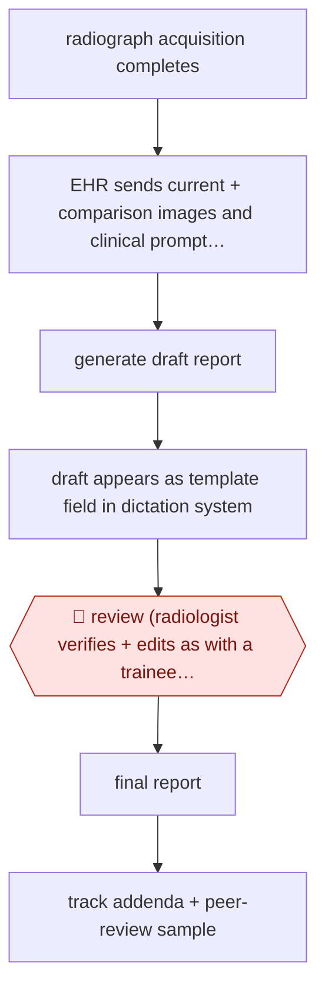

# Pre-drafted radiograph reports

`PRO › HLT › CLINDOC` · assist · evidence A · **draft: needs a reference example** ([how to add one](../../../../../CONTRIBUTING.md#1-add-an-example-run))

**Shape:** `radiograph acquisition completes → EHR sends current + comparison images and clinical prompt (radiologist, procedure, reason, comparison) → generate draft report → draft appears as template field in dictation system → 🛑 review (radiologist verifies + edits as with a trainee draft) → final report → track addenda + peer-review sample`
**Variants:** `in-house-vit-opt-powerscribe`

<!-- shape diagram: generated by scripts/build_diagrams.py from `shape`; don't edit -->

<!-- end shape diagram -->

## Background

When an X-ray is taken, a radiologist looks at the images and writes a report, and the doctor who ordered the X-ray acts on that report. Radiologists read many studies a day, usually by dictating into a reporting system, and much of each report is routine wording that has to be produced again for every study. Here a model that the hospital trained on its own past X-rays and reports drafts the report as soon as the images are taken and places it in the radiologist's dictation template. The radiologist still looks at the images, checks and edits the draft as they would a trainee's, and finalises it, because the report goes out under their name as a medical record, and a missed or invented finding can harm the patient.

**Terms:**
- **Radiograph, study**: a plain X-ray image; a study is the set of images taken together for one request.
- **Comparison study**: an earlier radiograph of the same patient, read alongside the new one to see what changed.
- **Clinical prompt**: here, the details given to the model with the images: the radiologist's name, the procedure, the reason for the exam and the comparison interval.
- **Dictation system, template**: the software in which the radiologist speaks or types the report (PowerScribe here), and the preset report layout in it.
- **Trainee draft**: in teaching hospitals, a resident drafts the report and a senior radiologist corrects it.
- **EHR (electronic health record)**: the hospital system that holds each patient's chart; Epic here.
- **Inference time**: how long the model takes to produce a draft.
- **Addendum**: a correction or addition made to a report after it was finalised; the addenda rate is used as a quality signal.
- **Peer review**: other radiologists rating a sample of reports for accuracy and quality.
- **Word error rate**: here, the share of the draft's words the radiologist changed.
- **Pneumothorax; shadow run**: a collapsed lung, an urgent finding; running a tool on live data without showing its output to clinicians.

## Build it with an agent

**Form:** `platform`. The draft comes from an image-to-text model trained on the hospital's own radiographs and reports, and it appears inside the EHR's dictation workflow; a general agent replaces neither. A general agent can take on the monitoring step as a `service`.

**You need:** the report-generation model and its connection to the EHR and the dictation system, built and run by the hospital; for the monitoring service, a read-only export of finalised reports, addenda and peer-review scores, with patient identifiers removed where possible, kept in a setup the hospital has approved for patient data. Give the monitoring agent no tool that changes a report.

| Step | Built as |
|---|---|
| radiograph acquisition completes → EHR sends current + comparison images and clinical prompt (radiologist, procedure, reason, comparison) | The EHR and the hospital's integration with the model server. |
| generate draft report | The image-to-text model. |
| draft appears as template field in dictation system | The dictation system. |
| 🛑 review (radiologist verifies + edits as with a trainee draft) → final report | The radiologist, in the dictation system. |
| track addenda + peer-review sample | A cloud scheduled task or `claude -p` run on a schedule over the export: a script compares addenda rates for drafted and undrafted studies by imaging section and draws the peer-review sample; the agent writes the summary for the radiology quality lead. |

**Checkpoints:** `review`: the draft is only a field in the template the radiologist chooses; the radiologist finalises the report in the dictation system, and no agent in this build has access to it. The monitoring service reads an export and cannot change a report.

**Since the sources:** The source and the public run date from 2025-06. No newer account found as of 2026-11. The source describes a custom vision model that one health system built and wired into its EHR and dictation system; no agent runs these steps, so a general agent's part is limited to the monitoring step.

*A design based on this entry's steps and the tool documentation as of 2026-11, not a reported run.*

## Steps

*As reported by the sources.*

1. When an acquisition completes, the EHR (Epic) sends the images and clinical data to an in-house server. The model sees the current and comparison images tiled together, plus the radiologist's name, the procedure, the reason for exam and the comparison interval [[1]](#sources).
2. The model writes a draft report. Median inference time is 3 seconds [[1]](#sources).
3. The dictation system shows the draft in custom fields of a PowerScribe template, which the radiologist selects [[1]](#sources).
4. 🛑 **Review**: the radiologist verifies and edits the draft in the normal workflow, the same way they would edit a trainee's draft [[1]](#sources).
5. The hospital rolls out in phases by practice location and imaging section. It monitors addenda rates and peer-reviews a sample of reports for accuracy and quality [[1]](#sources).
6. Optional: a shadow run screens the generated text for unexpected pneumothorax. Its alerts were not shown to clinicians during the study [[1]](#sources).

**Output:** A radiologist-finalised radiograph report in the EHR.
**Failure modes → guards:** Nonchest studies need heavier edits (median word error rate 0.63 vs 0.31 for chest) → phased rollout by section. Quality could drift without anyone noticing → compare addenda rates (0.14% vs 0.13%) and peer-review 800 studies.
**How it differs:** AWF-0026 Ambient scribe is the nearest. It drafts a visit note from consented audio. This workflow drafts from images, has no consent or recording step, and puts the draft inside the reader's dictation template for one review per study.

## Public runs

Coverage as of 2026-11-06: **Strong**: a first-hand, detailed run that matches most of the shape. Collected and re-checked in [Second collection pass](../../../../../research/2026-11-second-pass.md).

- [Huang et al., Northwestern Medicine, JAMA Netw Open](https://jamanetwork.com/journals/jamanetworkopen/fullarticle/10.1001/jamanetworkopen.2025.13921) (2025-06-05). Prospective cohort study at a 12-hospital system, 11,980 model-assisted radiographs vs matched controls. "a 15.5% increase in per-study documentation efficiency". *First-hand: yes; confidence: high.*

## Sources

1. Huang J. et al., Efficiency and Quality of Generative AI-Assisted Radiograph Reporting, JAMA Network Open, 2025-06-05. https://jamanetwork.com/journals/jamanetworkopen/fullarticle/10.1001/jamanetworkopen.2025.13921
