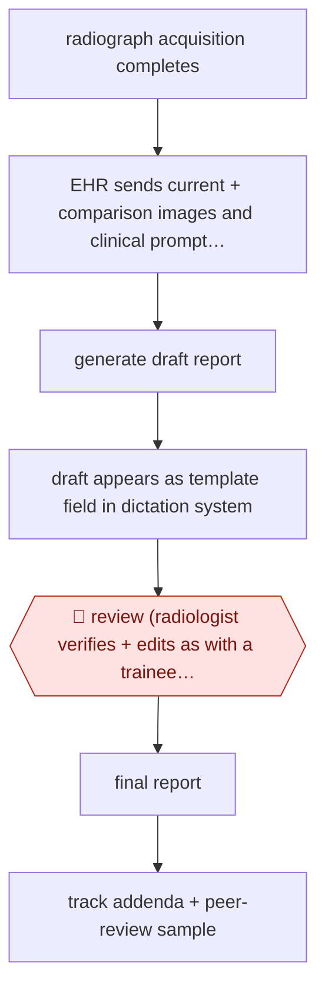

# Pre-drafted radiograph reports

`PRO › HLT › CLINDOC` · assist · evidence A · **draft: needs a reference example** ([how to add one](../../../../../CONTRIBUTING.md#1-add-an-example-run))

**Shape:** `radiograph acquisition completes → EHR sends current + comparison images and clinical prompt (radiologist, procedure, reason, comparison) → generate draft report → draft appears as template field in dictation system → 🛑 review (radiologist verifies + edits as with a trainee draft) → final report → track addenda + peer-review sample`
**How it differs:** AWF-0026 Ambient scribe is the nearest. It drafts a visit note from consented audio. This workflow drafts from images, has no consent or recording step, and puts the draft inside the reader's dictation template for one review per study.
**Variants:** `in-house-vit-opt-powerscribe`

<!-- shape diagram: generated by scripts/build_diagrams.py from `shape`; don't edit -->

<!-- end shape diagram -->

## Steps
1. When an acquisition completes, the EHR (Epic) sends the images and clinical data to an in-house server. The model sees the current and comparison images tiled together, plus the radiologist's name, the procedure, the reason for exam and the comparison interval [[1]](#sources).
2. The model writes a draft report. Median inference time is 3 seconds [[1]](#sources).
3. The draft appears in custom fields of a PowerScribe template, which the radiologist selects [[1]](#sources).
4. 🛑 **Review**: the radiologist verifies and edits the draft in the normal workflow, the same way they would edit a trainee's draft [[1]](#sources).
5. Roll out in phases by practice location and imaging section. Monitor addenda rates and peer-review a sample of reports for accuracy and quality [[1]](#sources).
6. Optional: a shadow run screens the generated text for unexpected pneumothorax. Its alerts were not shown to clinicians during the study [[1]](#sources).

**Output:** A radiologist-finalised radiograph report in the EHR.
**Failure modes → guards:** Nonchest studies need heavier edits (median word error rate 0.63 vs 0.31 for chest) → phased rollout by section. Quality could drift without anyone noticing → compare addenda rates (0.14% vs 0.13%) and peer-review 800 studies.

## Public runs

Coverage as of 2026-11-06: **Strong**: a first-hand, detailed run that matches most of the shape. Collected and re-checked in [Second collection pass](../../../../../research/2026-11-second-pass.md).

- [Huang et al., Northwestern Medicine, JAMA Netw Open](https://jamanetwork.com/journals/jamanetworkopen/fullarticle/10.1001/jamanetworkopen.2025.13921) (2025-06-05). Prospective cohort study at a 12-hospital system, 11,980 model-assisted radiographs vs matched controls. "a 15.5% increase in per-study documentation efficiency". *First-hand: yes; confidence: high.*

## Sources

1. Huang J. et al., Efficiency and Quality of Generative AI-Assisted Radiograph Reporting, JAMA Network Open, 2025-06-05. https://jamanetwork.com/journals/jamanetworkopen/fullarticle/10.1001/jamanetworkopen.2025.13921
