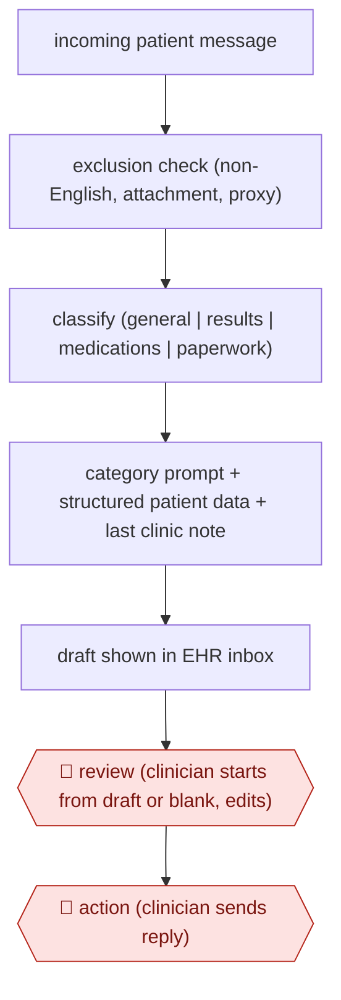

# Routed inbox reply drafts

`PRO › HLT › CLINDOC` · assist · evidence A · **draft: needs a reference example** ([how to add one](../../../../../CONTRIBUTING.md#1-add-an-example-run))

**Shape:** `incoming patient message → exclusion check (non-English, attachment, proxy) → classify (general | results | medications | paperwork) → category prompt + structured patient data + last clinic note → draft shown in EHR inbox → 🛑 review (clinician starts from draft or blank, edits) → 🛑 action (clinician sends reply)`
**How it differs:** AWF-0026 Ambient scribe is the nearest. Its deliverable is a visit note built from a consented recording and signed into the chart. This workflow writes a patient-facing written reply, routes on message type, has no recording or consent step, and puts a send-action checkpoint on every message.
**Variants:** `epic-in-basket-gpt4`

<!-- shape diagram: generated by scripts/build_diagrams.py from `shape`; don't edit -->

<!-- end shape diagram -->

## Steps
1. Select incoming patient portal messages are sent to the EHR. Non-English messages, messages with attachments and messages sent by a proxy get no draft [[1]](#sources).
2. GPT-3.5 Turbo sorts each message into one of four categories: general, results, medications or paperwork [[1]](#sources).
3. Each category triggers its own prompt. The prompt holds the patient message, selected structured data (name, age, department, allergies) and the last clinic note. GPT-4 writes the draft [[1]](#sources).
4. The draft appears in the clinician's EHR inbox, next to the choices 'start with draft' and 'start blank reply' [[1]](#sources).
5. 🛑 **Review**: the clinician (physician, APP, nurse or clinical pharmacist) decides whether to use the draft and edits it [[1]](#sources).
6. 🛑 **Action**: the clinician sends the reply. Nothing reaches the patient without a person sending it [[1]](#sources).
7. Track how often drafts are used, by role, plus read, write and reply-action time from EHR audit logs, and run pre/post burnout surveys [[1]](#sources).

**Output:** A clinician-sent reply to a patient portal message, filed in the EHR conversation.
**Failure modes → guards:** Clinicians may use few drafts (20% mean) and the time saved may not show up → measure by role, where pharmacists and nurses used drafts more. Some messages are out of scope (25% got no draft) → exclusion rules plus a 'start blank' path.

## Public runs

Coverage as of 2026-11-06: **Strong**: a first-hand, detailed run that matches most of the shape. Collected and re-checked in [Second collection pass](../../../../../research/2026-11-second-pass.md).

- [Garcia et al., Stanford Health Care, JAMA Netw Open](https://jamanetwork.com/journals/jamanetworkopen/fullarticle/2816494) (2024-03-20). 5-week pilot, 162 primary care and GI clinicians; drafts in 75% of 12,844 replies. "The overall mean utilization rate per clinician was 20%". *First-hand: yes; confidence: high.*

## Sources

1. Garcia P. et al., Artificial Intelligence-Generated Draft Replies to Patient Inbox Messages, JAMA Network Open 7(3):e243201, 2024-03-20. https://jamanetwork.com/journals/jamanetworkopen/fullarticle/2816494
