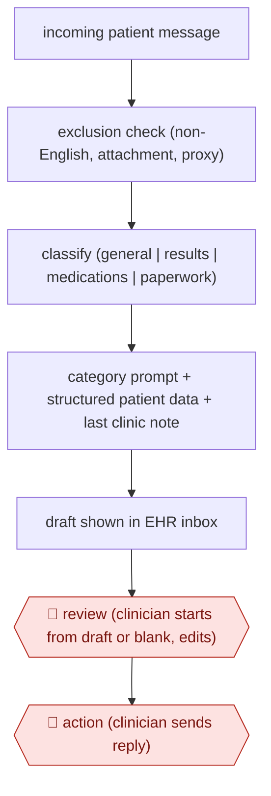

# Routed inbox reply drafts

`PRO › HLT › CLINDOC` · assist · evidence A · **draft: needs a reference example** ([how to add one](../../../../../CONTRIBUTING.md#1-add-an-example-run))

**Shape:** `incoming patient message → exclusion check (non-English, attachment, proxy) → classify (general | results | medications | paperwork) → category prompt + structured patient data + last clinic note → draft shown in EHR inbox → 🛑 review (clinician starts from draft or blank, edits) → 🛑 action (clinician sends reply)`
**Variants:** `epic-in-basket-gpt4`

<!-- shape diagram: generated by scripts/build_diagrams.py from `shape`; don't edit -->

<!-- end shape diagram -->

## Background

Patients write to their clinic through an online portal: questions about test results, medicines, forms and symptoms. Doctors, nurses and pharmacists answer these messages from an inbox inside the clinic's records system, often between visits or after hours, and the number of messages is large. Each good reply needs the patient's details and the latest clinic note, so even a short answer takes looking up. Here the system sorts each message by type and drafts a reply from the message, basic patient data and the last clinic note, and the draft waits in the clinician's inbox. The clinician decides whether to start from it, edits it and sends it, because the reply is medical advice to a patient from a named clinician, and a wrong answer about a result or a medicine can harm the patient.

**Terms:**
- **Patient portal**: the website or app through which patients message their clinic and see their records.
- **EHR (electronic health record)**: the system that holds each patient's chart; its inbox is where clinicians receive portal messages.
- **Proxy**: a person, such as a parent or carer, who sends messages on the patient's behalf.
- **Structured patient data**: fixed fields in the record, such as name, age, department and allergies, as opposed to free-text notes.
- **APP (advanced practice provider)**: a nurse practitioner or physician assistant who sees patients.
- **Clinical pharmacist**: a pharmacist who works in the clinic team and manages patients' medicines.
- **GI**: gastroenterology, the specialty for the digestive system.
- **Audit log**: the EHR's record of every action a user takes, with its time.
- **Utilization rate**: the share of replies in which the clinician started from the draft.

## Build it with an agent

**Form:** `service`. Each draft is made when a message arrives, before any clinician opens it, and clinicians see only the drafts beside their messages.

**You need:** a feed of new portal messages and a way to save a draft beside a message, through the EHR's interface for outside programs or an MCP server the organisation approves; read-only access to the structured fields and the last clinic note; the four category prompts as reference files beside the skill; a setup the organisation has approved for patient records (in the US, one covered by a business associate agreement). Give the agent no tool that sends a message to a patient.

| Step | Built as |
|---|---|
| incoming patient message → exclusion check (non-English, attachment, proxy) | An Agent SDK program reads new messages from the feed or a queue. A script applies the exclusion rules before any model call, and excluded messages get no draft. |
| classify (general \| results \| medications \| paperwork) | The skill's first step: pick one category, or none, which also means no draft. |
| category prompt + structured patient data + last clinic note | The skill opens the reference file for the category and reads the patient fields and the last note through the connector. |
| draft shown in EHR inbox | The program saves the draft beside the message through the connector. |
| 🛑 review (clinician starts from draft or blank, edits) → 🛑 action (clinician sends reply) | See Checkpoints. |

**Checkpoints:** `review`: the draft exists only as a draft beside the message; the clinician chooses to start from it or from a blank reply, and edits in the EHR. `action`: sending reaches the patient, so the agent is given no send tool, and the program's `canUseTool` denies every call except reading the message and patient data and saving the draft. Only the clinician's send in the EHR delivers a reply.

**Since the sources:** The source and the public run date from 2024-03. A newer study of the same EHR feature at Columbia University Irving Medical Center, in JAMA Network Open, found replies were faster when drafts were used but after-hours inbox work did not fall ([TechTarget, 2026-11-02](https://www.techtarget.com/searchhealthit/news/366653298/AI-drafted-patient-portal-messages-do-little-for-provider-burnout)). The source describes a feature built into the EHR, with prompts written by the health system: a fixed sequence of model calls, not an agent. The build above depends on the EHR letting an outside program read messages and save drafts; where it does not, the drafting stays with the EHR vendor and the entry is a `platform` case.

*A design based on this entry's steps and the tool documentation as of 2026-11, not a reported run.*

## Steps

*As reported by the sources.*

1. The EHR passes selected incoming patient portal messages to the drafting tool. Non-English messages, messages with attachments and messages sent by a proxy get no draft [[1]](#sources).
2. GPT-3.5 Turbo sorts each message into one of four categories: general, results, medications or paperwork [[1]](#sources).
3. The tool uses a separate prompt for each category. The prompt holds the patient message, selected structured data (name, age, department, allergies) and the last clinic note. GPT-4 writes the draft [[1]](#sources).
4. The EHR shows the draft in the clinician's inbox, next to the choices 'start with draft' and 'start blank reply' [[1]](#sources).
5. 🛑 **Review**: the clinician (physician, APP, nurse or clinical pharmacist) decides whether to use the draft and edits it [[1]](#sources).
6. 🛑 **Action**: the clinician sends the reply. Nothing reaches the patient without a person sending it [[1]](#sources).
7. The study team tracks how often drafts are used, by role, plus read, write and reply-action time from EHR audit logs, and runs pre/post burnout surveys [[1]](#sources).

**Output:** A clinician-sent reply to a patient portal message, filed in the EHR conversation.
**Failure modes → guards:** Clinicians may use few drafts (20% mean) and the time saved may not show up → measure by role, where pharmacists and nurses used drafts more. Some messages are out of scope (25% got no draft) → exclusion rules plus a 'start blank' path.
**How it differs:** AWF-0026 Ambient scribe is the nearest. Its deliverable is a visit note built from a consented recording and signed into the chart. This workflow writes a patient-facing written reply, routes on message type, has no recording or consent step, and puts a send-action checkpoint on every message.

## Public runs

Coverage as of 2026-11-06: **Strong**: a first-hand, detailed run that matches most of the shape. Collected and re-checked in [Second collection pass](../../../../../research/2026-11-second-pass.md).

- [Garcia et al., Stanford Health Care, JAMA Netw Open](https://jamanetwork.com/journals/jamanetworkopen/fullarticle/2816494) (2024-03-20). 5-week pilot, 162 primary care and GI clinicians; drafts in 75% of 12,844 replies. "The overall mean utilization rate per clinician was 20%". *First-hand: yes; confidence: high.*

## Sources

1. Garcia P. et al., Artificial Intelligence-Generated Draft Replies to Patient Inbox Messages, JAMA Network Open 7(3):e243201, 2024-03-20. https://jamanetwork.com/journals/jamanetworkopen/fullarticle/2816494
