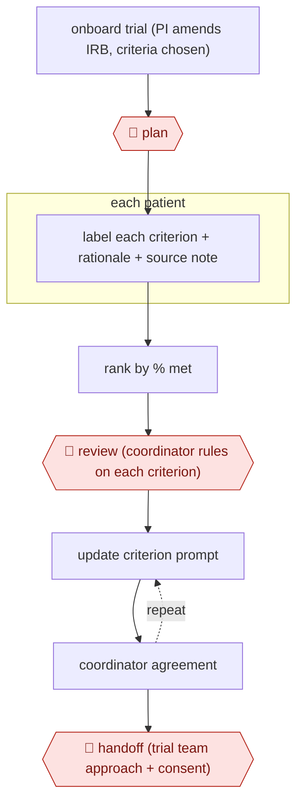

# Coordinator-reviewed prescreen

`PRO › HLT › CLINTRIAL` · checkpointed · evidence A · **draft: needs a reference example** ([how to add one](../../../../../CONTRIBUTING.md#1-add-an-example-run))

**Shape:** `onboard trial (PI amends IRB, criteria chosen) → 🛑 plan → each patient: label each criterion + rationale + source note → rank by % met → 🛑 review (coordinator rules on each criterion) → (update criterion prompt ⟲ coordinator agreement) → 🛑 handoff (trial team approach + consent)`
**Variants:** `rag-gpt-ehr-pipeline` · `neurosymbolic-abstraction`

<!-- shape diagram: generated by scripts/build_diagrams.py from `shape`; don't edit -->

<!-- end shape diagram -->

## Background

A clinical trial tests a new treatment on patients who meet a list of eligibility criteria: a diagnosis, a stage of disease, past treatments, test results and many exclusions. Before anyone approaches a patient, research staff prescreen: they read each candidate's medical record and decide whether every criterion is met. The evidence is spread across years of notes, so this is slow, and tired readers miss eligible patients. Here a language model reads each patient's record, labels every criterion with its reasoning and the note it relied on, and ranks patients by how many criteria they appear to meet. A research coordinator still rules on each criterion, and the trial team decides whom to approach and obtains consent. Those decisions are the study team's duties under a protocol approved by an ethics board, and a wrong label could put an ineligible patient on an experimental treatment.

**Terms:**
- **PI (principal investigator)**: the doctor responsible for running the trial at a site.
- **IRB (institutional review board), protocol**: the ethics board that must approve a study, and the approved document setting out how the study runs and who may work on it as study personnel.
- **Criterion, prescreening**: one eligibility condition; the check of records against the criteria before a patient is approached.
- **Coordinator**: a clinical research coordinator, the staff member who prescreens and manages patients' progress through a trial.
- **EHR (electronic health record)**: the hospital system that holds each patient's chart, with structured fields and free-text notes.
- **LLM, retrieval-augmented**: a large language model; retrieval-augmented means it first searches the record and reads only the passages it finds.
- **Specificity, false positive**: the share of criteria that are not met which the model labels as not met; a low value produces false positives, criteria marked met when they are not.
- **Discordance, adjudication**: a disagreement between the AI and a coordinator; a decision on it by a more senior reviewer.
- **Automation bias**: the tendency of people to accept a machine's answer without checking it.
- **Abstraction**: reading a chart and recording the data a study needs.
- **Approach, consent, enrollment**: asking a patient about the trial; the patient's informed agreement to take part; formally entering them in the trial.

## Build it with an agent

**Form:** `service`. The prescreening runs over thousands of patients per trial with nobody at the keyboard, and coordinators see only the ranked worklist.

**You need:** read-only access to structured EHR data and notes, through a connector or a data extract the hospital approves; the trial's criteria file, signed off by the study team, as a reference file beside the skill; a worklist store (a database table or dashboard) where coordinators record their rulings and reasons; IRB approval that lists the people running the system as study personnel; a setup approved for patient records. Give the agent no way to change a patient's trial status or to contact a patient.

| Step | Built as |
|---|---|
| onboard trial (PI amends IRB, criteria chosen) → 🛑 plan | The PI and the study team. The agent can draft the criteria file and one prompt per criterion from the protocol for them to edit. |
| each patient: label each criterion + rationale + source note | An Agent SDK program, or `claude -p` started by the hospital's scheduler, hands patients to subagents running the skill. Each returns one row per criterion: label, rationale, confidence, note ID and date. |
| rank by % met | A script sorts patients by the share of criteria labelled met or likely met and writes those above the study team's threshold to the worklist. |
| 🛑 review (coordinator rules on each criterion) | Coordinators, in the worklist. A scheduled run sends a reminder for patients not reviewed within the agreed days. |
| (update criterion prompt ⟲ coordinator agreement) | A later run reads the criteria where coordinators disagreed and proposes changes to those prompts as edits to the criteria file. The study team approves them before the next run uses them. |
| 🛑 handoff (trial team approach + consent) | The study team, outside the agent. |

**Checkpoints:** `plan`: the calling program refuses to start a run until the criteria file carries the study team's sign-off. `review`: the worklist is the run's only output, and coordinators rule on each criterion there. `handoff`: the agent has no tool that sets a patient's status or contacts a patient, so the study team sets the status and owns approach and consent.

**Since the sources:** Sources and public runs date from 2026-02 to 2026-03. The UT Southwestern team built a retrieval-augmented pipeline with a coordinator dashboard, and its prompts were updated automatically from coordinator feedback; the build above routes those changes through the study team instead, because the criteria configuration is what the study team signed off. Source 2 is a randomized comparison on past records using a vendor's model (`neurosymbolic-abstraction`), not a deployed workflow, and that model is not something a general agent reproduces.

*A design based on this entry's steps and the tool documentation as of 2026-11, not a reported run.*

## Steps

*As reported by the sources.*

1. Onboarding: the PI amends the trial's IRB-approved protocol to add AI-team members as study personnel. The study team selects the criteria to automate, split into two tiers. Approach, consent and enrollment decisions stay with the trial team [[1]](#sources).
2. 🛑 **Plan**: The study team signs off the criteria configuration before prescreening starts [[1]](#sources).
3. A retrieval-augmented LLM reads structured EHR data and free-text notes. It labels each criterion met, likely met, likely not met, not met, uncertain, or no documentation found, with a rationale, a confidence level and the note ID/date of the evidence [[1]](#sources).
4. The pipeline sends patients above a threshold share of met or likely-met criteria to a sorted coordinator dashboard. Coordinators must review those meeting ≥50% of criteria at first, tightening to ≥75% as performance improves. The system sends a reminder if a patient is not reviewed within four days [[1]](#sources).
5. 🛑 **Review**: Coordinators mark each criterion met, not met or insufficient data, and give a reason when they disagree with the AI. Discordances get junior-to-senior re-assessment or senior single-reviewer adjudication [[1]](#sources).
6. The pipeline updates the criteria prompts from coordinator feedback. Missed patients trigger fixes to the workflow or the AI logic [[1]](#sources).
7. 🛑 **Handoff**: The study team sets each patient's status (prescreen success/failure, screening, enrolled) and owns approach and consent [[1]](#sources).

**Output:** A per-trial ranked prescreen worklist with criterion-level evidence. Confirmed candidates go to the trial team for approach and consent.
**Failure modes → guards:** Lower specificity (0.81) produces false positives → coordinators confirm every criterion [[1]](#sources). Automation bias limited accuracy in some criteria domains in a randomized trial → keep human abstraction and an adjudication step [[2]](#sources). Speed gains may not appear: time per chart was 37.4 vs 37.8 min [[2]](#sources).
**How it differs:** AWF-0009 Screening funnel (LITREV) screens papers for a review. This screens patients against live trial criteria, with per-criterion coordinator confirmation and an enrollment handoff.

## Public runs

Coverage as of 2026-11-06: **Strong**: a first-hand, detailed run that matches most of the shape. Collected and re-checked in [New workflows for empty categories](../../../../../research/2026-11-new-workflows.md).

- [Dohopolski et al., UTSW human-in-the-loop prescreening](https://doi.org/10.64898/2026.03.20.26348890) (2026-03-27). Prospective deployment across 26 active trials, with coordinator review and prompt updates from feedback. "39,182 patients were prescreened by our LLM-workflow across 26 (21 oncology and 5 non-oncology) studies". *First-hand: yes; confidence: high.*
- [Parikh et al., Human-AI prescreening RCT](https://www.nature.com/articles/s41467-026-68873-8) (2026-02-03). Randomized comparison of coordinators with and without AI annotations on 355 charts. "Human-alone (76.5% vs. 71.1%)". *First-hand: study (randomized, on past records; funded by the AI vendor Mendel.ai); confidence: high.*

## Sources

1. Dohopolski M.J. et al. (UT Southwestern), Implementation of Human-in-the-Loop ChatGPT-based Patient Screening Across Multiple Diverse Clinical Trials, medRxiv, 2026-03-27. https://doi.org/10.64898/2026.03.20.26348890
2. Parikh R.B. et al., Human-AI teaming to improve accuracy and efficiency of eligibility criteria prescreening for oncology trials, Nature Communications, 2026-02-03. https://www.nature.com/articles/s41467-026-68873-8
