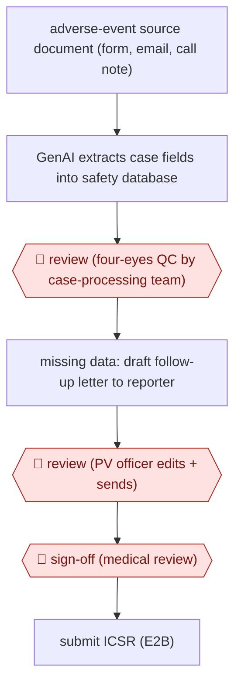

# QC-gated safety case intake

`PRO › HLT › CLINTRIAL` · checkpointed · evidence A · **draft: needs a reference example** ([how to add one](../../../../../CONTRIBUTING.md#1-add-an-example-run))

**Shape:** `adverse-event source document (form, email, call note) → GenAI extracts case fields into safety database → 🛑 review (four-eyes QC by case-processing team) → missing data: draft follow-up letter to reporter → 🛑 review (PV officer edits + sends) → 🛑 sign-off (medical review) → submit ICSR (E2B)`
**How it differs:** AWF-0033 Coordinator-reviewed prescreen matches patients to trial criteria, and AWF-0091 drafts a CSR. Here the deliverable is a regulated per-case safety report with double-check QC and a reporter follow-up loop; different deliverable and checkpoints.
**Variants:** `arisglobal-lifesphere-navax` · `bayer-mygenassist` · `indegene-naem`

<!-- shape diagram: generated by scripts/build_diagrams.py from `shape`; don't edit -->

<!-- end shape diagram -->

## Steps
1. Reports arrive by phone, mail or electronic means and are compiled into a source document in the pharmacovigilance database [[2]](#sources).
2. GenAI 'Advanced Intake' extracts the case-form data into the safety system's fields; process qualification checks that 'the fields are extracted into the right data points in the system' [[1]](#sources)[[3]](#sources).
3. 🛑 **Review**: quality control by the case-processing vendor under a 'Four Eyes' principle (a second set of eyes) on extracted data [[1]](#sources).
4. Where the case is incomplete, an LLM drafts the documentation (follow-up) letter to the reporter from a table of case data and questions [[2]](#sources).
5. 🛑 **Review**: the pharmacovigilance officer reviews and modifies the draft letter before sending; a second contact attempt follows good-vigilance-practice rules [[2]](#sources).
6. 🛑 **Sign-off**: safety teams perform medical review and benefit-risk analysis on the processed case [[3]](#sources).

**Output:** Completed ICSR in the safety database, ready for regulatory submission.
**Failure modes → guards:** Fields mapped to wrong data points after integration → re-validate the whole process, not just the AI step [1]. Hallucinated case facts → four-eyes QC and user training on AI risks [1]. Serious events hidden in non-serious free text → extract from free-text narration [1].

## Public runs

Coverage as of 2026-11-13: **Strong**: a first-hand, detailed run that matches most of the shape. Collected and re-checked in [Third collection pass](../../../../../research/2026-11-third-pass.md).

- [Bayer France PV, MyGenAssist cross-over study](https://pmc.ncbi.nlm.nih.gov/articles/PMC11933758/) (2025-03-10). 4-month before/after study; officer reviews LLM-drafted follow-up letters; response rate unchanged. "An average of 23.3% (95% CI 13.8%-32.8%) of time saving was made". *First-hand: yes; confidence: high.*
- [ArisGlobal, Boehringer Ingelheim NavaX go-live](https://www.arisglobal.com/media/press-release/boehringer-ingelheim-harnesses-genai-to-transform-case-intake-with-lifesphere-navax/) (2025-07-08). GenAI intake live for ICSRs with QC steps retained; BI PV head quoted. "up to 90% average data extraction accuracy". *First-hand: vendor; confidence: med.*
- [Journal of mHealth, BI PV Q&A](https://thejournalofmhealth.com/lessons-in-ai-use-what-worked-for-boehringer-ingelheim-in-a-pv-context/) (2025-10-09). BI PV operations head on validation, vendor QC, four-eyes review; no new number. "We have adopted the “Four Eyes” principle (a second set of eyes)". *First-hand: interview; confidence: med.*

## Sources

1. Lehmann C. (Boehringer Ingelheim) and Smith L. (ArisGlobal), Lessons in AI Use – What Worked for Boehringer Ingelheim in a PV Context?, Journal of mHealth, 2025-10-09. https://thejournalofmhealth.com/lessons-in-ai-use-what-worked-for-boehringer-ingelheim-in-a-pv-context/
2. Benaïche A., Billaut-Laden I., Randriamihaja H., Bertocchio J-P., Assessment of the Efficiency of a ChatGPT-Based Tool, MyGenAssist, in an Industry Pharmacovigilance Department for Case Documentation: Cross-Over Study, JMIR (PMC11933758), 2025-03-10. https://pmc.ncbi.nlm.nih.gov/articles/PMC11933758/
3. ArisGlobal, Boehringer Ingelheim Harnesses GenAI to Transform Case Intake with LifeSphere NavaX, 2025-07-08. https://www.arisglobal.com/media/press-release/boehringer-ingelheim-harnesses-genai-to-transform-case-intake-with-lifesphere-navax/
