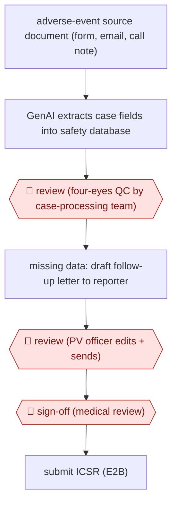

# QC-gated safety case intake

`PRO › HLT › CLINTRIAL` · checkpointed · evidence A · **draft: needs a reference example** ([how to add one](../../../../../CONTRIBUTING.md#1-add-an-example-run))

**Shape:** `adverse-event source document (form, email, call note) → GenAI extracts case fields into safety database → 🛑 review (four-eyes QC by case-processing team) → missing data: draft follow-up letter to reporter → 🛑 review (PV officer edits + sends) → 🛑 sign-off (medical review) → submit ICSR (E2B)`
**Variants:** `arisglobal-lifesphere-navax` · `bayer-mygenassist` · `indegene-naem`

<!-- shape diagram: generated by scripts/build_diagrams.py from `shape`; don't edit -->

<!-- end shape diagram -->

## Background

A drug company must collect every report of a possible harmful effect of its medicines, whether it comes from a doctor, a patient or its own staff, and send each one to regulators as a structured case report within fixed deadlines. This work is called pharmacovigilance. Staff read the incoming form, email or call note, key the details into a safety database, write to the reporter for missing information, and a physician reviews what each case means medically. Keying cases by hand is slow at high volume, and a wrong field or a serious event missed in the free text is a compliance failure. Here generative AI extracts the case details into the database and drafts the follow-up letters. People still check the extracted data under a two-person rule, a pharmacovigilance officer edits and sends each letter, and safety physicians perform medical review, because the company is legally accountable for every case it submits and for noticing safety problems in them.

**Terms:**
- **Adverse event (AE)**: any harmful or unwanted medical event in a person taking a medicine, whether or not the medicine caused it.
- **Pharmacovigilance (PV), PV officer**: the monitoring of medicines' safety after they are in use; the staff member who handles cases and contacts reporters.
- **Source document**: the original report of a case, compiled from the form, email or call.
- **Safety database**: the validated system in which a company records and submits its cases.
- **ICSR (individual case safety report), E2B**: the report of one case sent to regulators; E2B is the international electronic format for it.
- **Case processing, four-eyes principle**: entering and checking cases, often done by an outside vendor; a rule that a second person checks each piece of work.
- **Follow-up (documentation) letter**: a request to the reporter for information missing from the case.
- **Good vigilance practice**: the regulators' rules for pharmacovigilance work, including how often to contact a reporter.
- **GenAI, LLM**: generative AI, models that produce text; a large language model is one such model.
- **Hallucination**: a fact the model states that is not in the source.
- **QC**: quality control, the check of the extracted data.
- **Process qualification, validation**: testing, under regulatory rules for computer systems, that a system does what it should; it covers the whole process, not only the AI step.
- **Medical review, benefit-risk analysis**: a physician's assessment of a case; weighing a medicine's benefits against its risks.
- **CSR (clinical study report)**: the full report of a finished trial.
- **Serious event**: in safety reporting, an event that leads to death, hospital admission, disability or another grave outcome; such cases have shorter deadlines.

## Build it with an agent

**Form:** `platform`. Cases live in a validated safety database and are submitted to regulators from it, and in the sources the extraction is a module of that database's vendor; a general agent cannot stand in for a validated system. It can take on the follow-up letter as a `skill` (one officer, one case, in the conversation) and could prepare extraction drafts as a `service` that never writes into the database itself.

**You need:** for the letter skill, the case data and the open questions as a table, and the letter templates and the contact-attempt rules as reference files beside the skill; for an extraction service, a queue of incoming source documents and a staging file per case that the case-processing team loads after QC; a setup the company's validation group has approved for personal health data. Connect no mail tool and give the agent no access to the safety database.

| Step | Built as |
|---|---|
| adverse-event source document (form, email, call note) → GenAI extracts case fields into safety database | The safety database's intake module. A general agent could only write a staging file of fields, each with the source passage it came from, for the team to check and load. |
| 🛑 review (four-eyes QC by case-processing team) | The case-processing team, in the safety database. |
| missing data: draft follow-up letter to reporter | The skill: from the case table and the question list, fill the letter template with one question per missing item. |
| 🛑 review (PV officer edits + sends) | The PV officer, from their own mail system. |
| 🛑 sign-off (medical review) → submit ICSR (E2B) | Safety physicians, in the safety database, which also makes the submission. |

**Checkpoints:** `review`: QC of extracted data happens in the safety database, outside the agent; the letter skill stops after presenting the draft, and with no mail tool the officer edits and sends it. `sign-off`: medical review and the E2B submission happen in the validated system, to which the agent has no access, so nothing reaches a regulator through the agent.

**Since the sources:** Sources and public runs date from 2025-03 to 2025-10. A 2026-06 trade article reviews AI in case processing and points to 2025–2026 regulatory principles for AI and to structured reporting formats under ICH E2D(R1) and M14, but reports no new run of this workflow ([Pharmaceutical Commerce, 2026-06-11](https://pharmaceuticalcommerce.com/view/how-automation-and-ai-can-transform-pharmacovigilance)). No newer first-hand account found as of 2026-11. The sources are a vendor press release, an interview about the same deployment, and a study in which PV officers used a company's ChatGPT-based assistant to draft letters; none reports an agent running the line, so the build above covers the letter and a staging draft only.

*A design based on this entry's steps and the tool documentation as of 2026-11, not a reported run.*

## Steps

*As reported by the sources.*

1. Staff compile reports that arrive by phone, mail or electronic means into a source document in the pharmacovigilance database [[2]](#sources).
2. A GenAI 'Advanced Intake' module extracts the case-form data into the safety system's fields; process qualification checks that 'the fields are extracted into the right data points in the system' [[1]](#sources)[[3]](#sources).
3. 🛑 **Review**: the case-processing vendor performs quality control on the extracted data under a 'Four Eyes' principle (a second set of eyes) [[1]](#sources).
4. Where the case is incomplete, an LLM drafts the documentation (follow-up) letter to the reporter from a table of case data and questions [[2]](#sources).
5. 🛑 **Review**: the pharmacovigilance officer reviews and modifies the draft letter before sending; a second contact attempt follows good-vigilance-practice rules [[2]](#sources).
6. 🛑 **Sign-off**: safety teams perform medical review and benefit-risk analysis on the processed case [[3]](#sources).

**Output:** Completed ICSR in the safety database, ready for regulatory submission.
**Failure modes → guards:** Fields mapped to wrong data points after integration → re-validate the whole process, not just the AI step [1]. Hallucinated case facts → four-eyes QC and user training on AI risks [1]. Serious events hidden in non-serious free text → extract from free-text narration [1].
**How it differs:** AWF-0033 Coordinator-reviewed prescreen matches patients to trial criteria, and AWF-0091 drafts a CSR. Here the deliverable is a regulated per-case safety report with double-check QC and a reporter follow-up loop; different deliverable and checkpoints.

## Public runs

Coverage as of 2026-11-13: **Strong**: a first-hand, detailed run that matches most of the shape. Collected and re-checked in [Third collection pass](../../../../../research/2026-11-third-pass.md).

- [Bayer France PV, MyGenAssist cross-over study](https://pmc.ncbi.nlm.nih.gov/articles/PMC11933758/) (2025-03-10). 4-month before/after study; officer reviews LLM-drafted follow-up letters; response rate unchanged. "An average of 23.3% (95% CI 13.8%-32.8%) of time saving was made". *First-hand: yes; confidence: high.*
- [ArisGlobal, Boehringer Ingelheim NavaX go-live](https://www.arisglobal.com/media/press-release/boehringer-ingelheim-harnesses-genai-to-transform-case-intake-with-lifesphere-navax/) (2025-07-08). GenAI intake live for ICSRs with QC steps retained; BI PV head quoted. "up to 90% average data extraction accuracy". *First-hand: vendor; confidence: med.*
- [Journal of mHealth, BI PV Q&A](https://thejournalofmhealth.com/lessons-in-ai-use-what-worked-for-boehringer-ingelheim-in-a-pv-context/) (2025-10-09). BI PV operations head on validation, vendor QC, four-eyes review; no new number. "We have adopted the “Four Eyes” principle (a second set of eyes)". *First-hand: interview; confidence: med.*

## Sources

1. Lehmann C. (Boehringer Ingelheim) and Smith L. (ArisGlobal), Lessons in AI Use – What Worked for Boehringer Ingelheim in a PV Context?, Journal of mHealth, 2025-10-09. https://thejournalofmhealth.com/lessons-in-ai-use-what-worked-for-boehringer-ingelheim-in-a-pv-context/
2. Benaïche A., Billaut-Laden I., Randriamihaja H., Bertocchio J-P., Assessment of the Efficiency of a ChatGPT-Based Tool, MyGenAssist, in an Industry Pharmacovigilance Department for Case Documentation: Cross-Over Study, JMIR (PMC11933758), 2025-03-10. https://pmc.ncbi.nlm.nih.gov/articles/PMC11933758/
3. ArisGlobal, Boehringer Ingelheim Harnesses GenAI to Transform Case Intake with LifeSphere NavaX, 2025-07-08. https://www.arisglobal.com/media/press-release/boehringer-ingelheim-harnesses-genai-to-transform-case-intake-with-lifesphere-navax/
