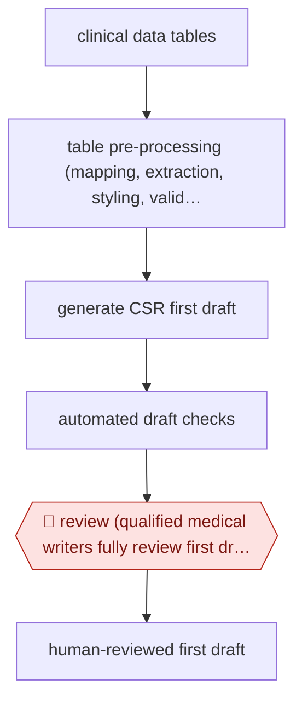

# Writer-reviewed CSR draft

`PRO › HLT › CLINTRIAL` · checkpointed · evidence A · **draft: needs a reference example** ([how to add one](../../../../../CONTRIBUTING.md#1-add-an-example-run))

**Shape:** `clinical data tables → table pre-processing (mapping, extraction, styling, validation) → generate CSR first draft → automated draft checks → 🛑 review (qualified medical writers fully review first draft) → human-reviewed first draft`
**How it differs:** AWF-0033 Coordinator-reviewed prescreen is the nearest, but it screens patients for eligibility, one criterion at a time. This workflow writes a regulatory document from trial outputs, with one checkpoint where writers review the whole document.
**Variants:** `claude-bedrock-novoscribe` · `merck-internal-genai-platform` · `merck-quantumblack`

<!-- shape diagram: generated by scripts/build_diagrams.py from `shape`; don't edit -->

<!-- end shape diagram -->

## Steps
1. Collect the study's clinical data tables, which run to thousands of pages, for the clinical study report [[1]](#sources).
2. Pre-process the tables: map them, extract the data, apply styles and validate [[1]](#sources).
3. Large language models write the CSR first draft, in as little as five minutes [[1]](#sources).
4. The platform validates the tables and checks the draft for errors in data, messaging, citations, terminology and typography [[1]](#sources).
5. 🛑 **Review**: qualified medical writers review the whole first draft before it moves on [[1]](#sources).

**Output:** A fully human-reviewed CSR first draft, handed to the normal document review and submission process.
**Failure modes → guards:** Errors in data, citations or terminology → table validation plus the medical writers' review (the company reports 50% fewer errors in these categories). Inconsistent data across sources → pre-processing before drafting.

## Public runs

Coverage as of 2026-11-06: **Partial**: first-hand runs that cover part of the shape or put checkpoints elsewhere. Collected and re-checked in [Second collection pass](../../../../../research/2026-11-second-pass.md).

- [Merck news release](https://merck.com/news/merck-expands-innovative-internal-generative-ai-solutions-helping-to-deliver-medicines-to-patients-faster) (2025-06-25). Merck's own CSR authoring platform with medical writers reviewing each draft. "fully human reviewed CSR first draft" time fell from an average of 180 hours to 80 hours. *First-hand: yes; confidence: med.*
- [Anthropic, Novo Nordisk](https://claude.com/customers/novo-nordisk) (n.d.). NovoScribe covers CSRs, device protocols and patient booklets. "Claude has helped us cut writing times on CSRs by 90%". *First-hand: vendor; confidence: med.*
- [Practical AI in Healthcare, Sanofi](https://practicalaiinhealthcare.com/when-ai-meets-real-patients-inside-sanofis-ai-powered-clinical-development-pipeline/) (2026-04-26). Conference account; also drafts responses to regulator questions, which humans own. "Eighty percent of AI-generated first drafts already meet submission quality standards.". *First-hand: interview; confidence: med.*

## Sources

1. Merck, Merck Expands Innovative Internal Generative AI Solutions Helping to Deliver Medicines to Patients Faster, 2025-06-25. https://merck.com/news/merck-expands-innovative-internal-generative-ai-solutions-helping-to-deliver-medicines-to-patients-faster
2. Anthropic, Novo Nordisk customer story. https://claude.com/customers/novo-nordisk
3. Practical AI in Healthcare, Inside Sanofi's AI-Powered Clinical Development Pipeline, 2026-04-26. https://practicalaiinhealthcare.com/when-ai-meets-real-patients-inside-sanofis-ai-powered-clinical-development-pipeline/
