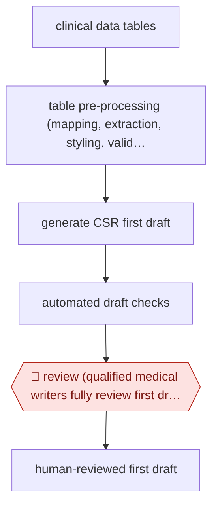

# Writer-reviewed CSR draft

`PRO › HLT › CLINTRIAL` · checkpointed · evidence A · **draft: needs a reference example** ([how to add one](../../../../../CONTRIBUTING.md#1-add-an-example-run))

**Shape:** `clinical data tables → table pre-processing (mapping, extraction, styling, validation) → generate CSR first draft → automated draft checks → 🛑 review (qualified medical writers fully review first draft) → human-reviewed first draft`
**Variants:** `claude-bedrock-novoscribe` · `merck-internal-genai-platform` · `merck-quantumblack`

<!-- shape diagram: generated by scripts/build_diagrams.py from `shape`; don't edit -->

<!-- end shape diagram -->

## Background

When a company has finished testing a medicine on patients, it must write a clinical study report (CSR): a long document, written in a fixed regulatory structure, that sets out how the trial was run and what the results were. Regulators read it when deciding whether to approve the medicine. Medical writers produce it from thousands of pages of result tables, resolving conflicting figures, checking each result and phrasing the findings in precise regulatory language, which is slow. The agent takes over the first draft: it prepares the tables, writes the text and checks the draft for slips. Qualified medical writers still review the whole draft, because the company is accountable to the regulator for every statement in a submission and a wrong figure or unsupported claim can delay approval.

**Terms:**
- **Clinical study report (CSR)**: the document that reports one clinical trial's design, conduct and results to regulators.
- **Clinical data tables**: the statistical output of a trial, as tables of results, often thousands of pages for one study.
- **Medical writer**: a specialist who writes and checks regulatory documents about clinical trials.
- **First draft**: the complete first version of the report, before the normal document review and submission steps.
- **Table mapping**: matching each results table to the section of the report where it is discussed.

## Build it with an agent

**Form:** `skill`. One medical writer works on one study's report at a time and stays in the conversation; the procedure, the report structure and the checks fit in one skill with scripts beside it.

**You need:** the study's results tables as files; the report template and the company's approved wording and terminology as reference files beside the skill; a script that checks each figure the draft quotes against the table it came from; a setup your organisation has approved for unpublished trial data. Do not give the agent a tool that files, submits or sends anything outside the team.

| Step | Built as |
|---|---|
| clinical data tables → table pre-processing (mapping, extraction, styling, validation) | Scripts beside the skill read the tables, map each to a report section, extract the values into a structured file and check the tables for gaps and inconsistencies. |
| generate CSR first draft | The skill drafts the report section by section from the extracted values and the approved wording. For a long report, built-in subagents each take one group of sections and return the draft text with the table each statement rests on. |
| automated draft checks | A script compares every number in the draft with the extracted values; a second pass in the main conversation checks citations, terminology and consistency between sections. |
| 🛑 review (qualified medical writers fully review first draft) → human-reviewed first draft | See Checkpoints. |

**Checkpoints:** `review`: the skill ends by presenting the draft with every check result and every statement it could not tie to a table, then stops. The medical writer edits the draft; the agent has no tool that sends it on, so it moves to document review only when the writer takes it there.

**Since the sources:** Sources date from 2025-06 to 2026-04; the Novo Nordisk page is undated. The sources describe company platforms and give no step-by-step detail: Merck's is an internal platform that combines table pre-processing with language-model drafting, and the other two accounts report results with little of the method. The build above is therefore a design for a general agent, not a reproduction of any of them. Merck's account describes a purpose-built platform for the tables; the sources do not show whether a general agent with scripts can handle tables of that size. The sources report time and error figures; the build makes no such claim.

*A design based on this entry's steps and the tool documentation as of 2026-11, not a reported run.*

## Steps

*As reported by the sources.*

1. The study team collects the study's clinical data tables, which run to thousands of pages, for the clinical study report (CSR) [[1]](#sources).
2. The platform pre-processes the tables: it maps them, extracts the data, applies styles and validates [[1]](#sources).
3. Large language models write the CSR first draft, in as little as five minutes [[1]](#sources).
4. The platform validates the tables and checks the draft for errors in data, messaging, citations, terminology and typography [[1]](#sources).
5. 🛑 **Review**: qualified medical writers review the whole first draft before it moves on [[1]](#sources).

**Output:** A fully human-reviewed CSR first draft, handed to the normal document review and submission process.
**Failure modes → guards:** Errors in data, citations or terminology → table validation plus the medical writers' review (the company reports 50% fewer errors in these categories). Inconsistent data across sources → pre-processing before drafting.
**How it differs:** AWF-0033 Coordinator-reviewed prescreen is the nearest, but it screens patients for eligibility, one criterion at a time. This workflow writes a regulatory document from trial outputs, with one checkpoint where writers review the whole document.

## Public runs

Coverage as of 2026-11-06: **Partial**: first-hand runs that cover part of the shape or put checkpoints elsewhere. Collected and re-checked in [Second collection pass](../../../../../research/2026-11-second-pass.md).

- [Merck news release](https://merck.com/news/merck-expands-innovative-internal-generative-ai-solutions-helping-to-deliver-medicines-to-patients-faster) (2025-06-25). Merck's own CSR authoring platform with medical writers reviewing each draft. "fully human reviewed CSR first draft" time fell from an average of 180 hours to 80 hours. *First-hand: yes; confidence: med.*
- [Anthropic, Novo Nordisk](https://claude.com/customers/novo-nordisk) (n.d.). NovoScribe covers CSRs, device protocols and patient booklets. "Claude has helped us cut writing times on CSRs by 90%". *First-hand: vendor; confidence: med.*
- [Practical AI in Healthcare, Sanofi](https://practicalaiinhealthcare.com/when-ai-meets-real-patients-inside-sanofis-ai-powered-clinical-development-pipeline/) (2026-04-26). Conference account; also drafts responses to regulator questions, which humans own. "Eighty percent of AI-generated first drafts already meet submission quality standards.". *First-hand: interview; confidence: med.*

## Sources

1. Merck, Merck Expands Innovative Internal Generative AI Solutions Helping to Deliver Medicines to Patients Faster, 2025-06-25. https://merck.com/news/merck-expands-innovative-internal-generative-ai-solutions-helping-to-deliver-medicines-to-patients-faster
2. Anthropic, Novo Nordisk customer story. https://claude.com/customers/novo-nordisk
3. Practical AI in Healthcare, Inside Sanofi's AI-Powered Clinical Development Pipeline, 2026-04-26. https://practicalaiinhealthcare.com/when-ai-meets-real-patients-inside-sanofis-ai-powered-clinical-development-pipeline/
