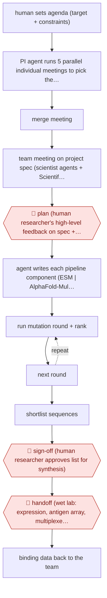

# Agent-team binder design

`PRO › HLT › DRUGDISC` · checkpointed · evidence A · **draft: needs a reference example** ([how to add one](../../../../../CONTRIBUTING.md#1-add-an-example-run))

**Shape:** `human sets agenda (target + constraints) → PI agent runs 5 parallel individual meetings to pick the scientist team → merge meeting → team meeting on project spec (scientist agents + Scientific Critic) → 🛑 plan (human researcher's high-level feedback on spec + tool choice) → agent writes each pipeline component (ESM | AlphaFold-Multimer | Rosetta) with critic loop (code ⟲ critic) → (run mutation round + rank ⟲ next round) → shortlist sequences → 🛑 sign-off (human researcher approves list for synthesis) → 🛑 handoff (wet lab: expression, antigen array, multiplexed ELISA) → binding data back to the team`
**How it differs:** Closest is AWF-0034 Chemist-gated DMTA loop (same class). Swap test fails: AWF-0034's deliverable is high-throughput-experimentation reaction grids and procedures that chemists correct before running, with chemists selecting a shortlist each cycle; here the deliverable is protein sequences from a pipeline the agents themselves designed, the human checkpoints are meeting-level agenda feedback (~1% of words) plus one sign-off before synthesis, and the validation is a handoff to a separate wet-lab team running ELISA rather than the proposing chemists repeating at bench scale. Autonomy is also looser: agents write and run their own tooling between checkpoints.
**Variants:** `virtual-lab-gpt4o` · `esm-alphafold-multimer-rosetta`

<!-- shape diagram: generated by scripts/build_diagrams.py from `shape`; don't edit -->

<!-- end shape diagram -->

## Steps
1. A human researcher states the research goal and constraints (design nanobody binders to a recent SARS-CoV-2 variant) and creates an LLM Principal Investigator agent [[1]](#sources).
2. The PI agent is asked, in five parallel individual meetings, which specialist agents the project needs; a merge meeting reconciles the five answers into one team. In the published run this produced a Computational Biologist, a Machine Learning Specialist and an Immunologist, plus a standing Scientific Critic agent [[1]](#sources)[[3]](#sources).
3. A team meeting fixes the project specification (nanobody vs antibody; de novo vs modifying known binders) and a second fixes the tool stack. 🛑 **Plan**: the human researcher intervenes only with high-level feedback at these meetings — across the project specification meeting the human wrote 0.5% of the words, and about 1% in individual meetings with a critic [[3]](#sources).
4. Individual meetings with one scientist agent plus the Scientific Critic produce each pipeline component; the critic's objections drive revision rounds before code is accepted [[1]](#sources)[[3]](#sources).
5. The agents run the pipeline they designed (ESM-1b log-likelihood-ratio scoring, AlphaFold-Multimer complex prediction, Rosetta energy scoring) over four iterative mutation rounds starting from four wild-type nanobodies (Ty1, Nb21, H11-D4, VHH-72), introducing one mutation per round [[1]](#sources)[[4]](#sources).
6. 🛑 **Sign-off**: the human supervisors accept the shortlist of top mutant sequences (92 new nanobodies) for synthesis, and sequence tags are added for experimental use [[1]](#sources)[[4]](#sources).
7. 🛑 **Handoff**: a separate wet-lab team runs nanobody expression, RBD expression, antigen-array printing and multiplexed ELISA against ancestral and recent spike RBDs; results are published with the computational scores and the full agent transcripts [[1]](#sources)[[2]](#sources).

**Output:** A ranked set of designed binder sequences plus the computational pipeline that produced them, handed to a wet lab; ELISA binding data and the full meeting transcripts are released publicly.
**Failure modes → guards:** Agents converge on vague role definitions or over-ambitious de novo design → parallel meetings plus a merge meeting, and a Scientific Critic agent in every meeting. Agents produce plausible but wrong code or scoring maths → component-level critic loops and human review of the final pipeline. Computational scores do not predict binding → wet-lab ELISA as the only accepted verdict (of 92 designs, two showed improved binding to JN.1 or KP.3).

## Public runs

Coverage as of 2026-11-13: **Strong**: a first-hand, detailed run that matches most of the shape. Collected and re-checked in [Fourth collection pass](../../../../../research/2026-11-fourth-pass.md).

- [Swanson, Wu, Bulaong, Pak & Zou, The Virtual Lab of AI agents designs new SARS-CoV-2 nanobodies](https://www.nature.com/articles/s41586-025-09442-9) (2025-07-29). Agent team designed its own pipeline; designs confirmed by wet-lab ELISA. "designed 92 new nanobodies"; "two new nanobodies exhibit improved binding to the recent JN.1 or KP.3 variants". *First-hand: yes; confidence: high.*
- [Swanson et al., Supplementary Information, Supplementary Note 3](https://media.springernature.com/original/springer-static/esm/art%3A10.1038%2Fs41586-025-09442-9/MediaObjects/41586_2025_9442_MOESM1_ESM.pdf) (2025). Quantifies how little the human contributed at each checkpoint. "with the human researcher only writing 0.5% of the words" (project specification team meeting). *First-hand: yes; confidence: high.*

## Sources

1. Swanson, K., Wu, W., Bulaong, N.L., Pak, J.E. & Zou, J., The Virtual Lab of AI agents designs new SARS-CoV-2 nanobodies, Nature, 29 July 2025. https://www.nature.com/articles/s41586-025-09442-9
2. CZ Biohub SF, With no need for sleep or food, AI-built 'scientists' get the job done quickly, 2025-07-29. https://biohub.org/news/with-no-need-for-sleep-or-food-ai-built-scientists-get-the-job-done-quickly/
3. Swanson et al., Supplementary Information for The Virtual Lab of AI Agents Designs New SARS-CoV-2 Nanobodies (Supplementary Notes 1-3). https://media.springernature.com/original/springer-static/esm/art%3A10.1038%2Fs41586-025-09442-9/MediaObjects/41586_2025_9442_MOESM1_ESM.pdf
4. zou-group/virtual_lab, GitHub repository README and nanobody_design notebook. https://github.com/zou-group/virtual_lab
