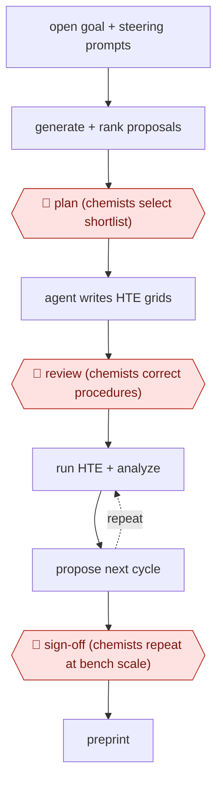

# Chemist-gated DMTA loop

`PRO › HLT › DRUGDISC` · checkpointed · evidence B · **draft: needs a reference example** ([how to add one](../../../../../CONTRIBUTING.md#1-add-an-example-run))

**Shape:** `open goal + steering prompts → generate + rank proposals → 🛑 plan (chemists select shortlist) → agent writes HTE grids → 🛑 review (chemists correct procedures) → (run HTE + analyze ⟲ propose next cycle) → 🛑 sign-off (chemists repeat at bench scale) → preprint`
**Variants:** `gpt-5-4-maria-lab` · `generative-model-robotic-synthesis`

<!-- shape diagram: generated by scripts/build_diagrams.py from `shape`; don't edit -->

<!-- end shape diagram -->

## Background

Finding a new medicine is a repeating cycle that chemists call design, make, test, analyse (DMTA): decide which compounds or reactions to try, make them, measure the results, and use what was learned to decide the next round. Each pass takes a team's time and lab materials, so a good choice of what to try next is worth a great deal. Here a language model reads the goal, proposes and ranks ideas, and a lab agent turns the chosen ones into experiment plans that an automated laboratory runs in large batches; the model then reads the results and proposes the next round. Chemists decide which ideas enter the lab, correct the procedures before anything runs, and repeat representative results by hand before the work is written up. They cannot be removed: they control which experiments are allowed to run, and tiny automated runs can give results that do not hold at the scale chemists actually work at.

**Terms:**
- **DMTA loop**: design, make, test, analyse; the repeating cycle of drug discovery.
- **HTE (high-throughput experimentation)**: running many small reactions in parallel in an automated lab, laid out as a grid of conditions.
- **Coupling reaction, substrate**: a reaction that joins two molecules; a substrate is a starting material that goes into it.
- **Yield**: the share of the possible product that a reaction actually produces.
- **Bench scale**: the ordinary scale at which a chemist works by hand, much larger than an HTE well.
- **Steering and grading prompts**: instructions in which scientists tell the model what to aim for and how to score its ideas.
- **Preprint**: a research write-up shared publicly before formal journal review.

## Build it with an agent

**Form:** `platform`. The experiments run on an automated high-throughput laboratory and are confirmed by chemists at the bench, which a general agent cannot replace. A general agent can take on the text stages (ranking proposals, writing the experiment grids, analysing results) as a `skill`, with a chemist present in the conversation at each stop.

**You need:** the goal and the chemists' steering and grading prompts as files; the literature and prior results the agent may read; the automated lab's grid format and the data it returns, as files; a chemist who selects proposals, corrects procedures and repeats results by hand. Keep the agent away from the lab's job-submission interface and its instrument controls.

| Step | Built as |
|---|---|
| open goal + steering prompts → generate + rank proposals | A skill reads the goal, the prompts and the files, and writes a ranked proposal list with the reason for each ranking. |
| 🛑 plan (chemists select shortlist) | See Checkpoints. |
| agent writes HTE grids | The skill writes each selected idea as a grid file in the lab's format: reagents, amounts, conditions, plate layout. |
| 🛑 review (chemists correct procedures) | See Checkpoints. |
| (run HTE + analyze ⟲ propose next cycle) | The lab runs the grids. The skill reads the returned data, analyses it and writes the next proposals; the chemists review them before another cycle runs. |
| 🛑 sign-off (chemists repeat at bench scale) → preprint | See Checkpoints. |

**Checkpoints:** `plan`: the skill ends by listing the ranked proposals and stops; the chemists choose which to test, and the agent does not write grids for any proposal the chemists have not marked. `review`: the skill stops after writing the grids; chemists edit them and load them into the lab themselves, because the agent has no access to the lab's submission interface. `sign-off`: chemists repeat representative reactions by hand and decide whether the result stands; the agent can draft the write-up from the data and the chemists' bench results, but has no tool that publishes it.

**Since the sources:** Sources date from 2026-06 (two articles, both 2026-06-22) and 2026 (the Google preprint, month not given). They are recent, so no search for newer accounts was made. The two main accounts are press reports of a company announcement and rest on the companies' own statements; the preprint they describe was not among the sources opened. The system they describe pairs a frontier model with a vendor's chemistry agent and an automated lab; the build above covers only the text stages and relies on the lab for the rest. The aptamer paper (source 3) describes a closed loop with a wet lab but its abstract does not say where humans approve, so it does not support the checkpoints in this build. Results on one reaction class do not show that the method generalises to other reactions or substrates; the sources say so themselves.

*A design based on this entry's steps and the tool documentation as of 2026-11, not a reported run.*

## Steps

*As reported by the sources.*

1. Scientists write the goal and the steering and grading prompts. The model generates and ranks research proposals [[1]](#sources)[[2]](#sources).
2. 🛑 **Plan**: human chemists review the top-ranked proposals and give the go-ahead on which to test [[1]](#sources)[[2]](#sources).
3. The lab agent turns the selected ideas into high-throughput experiment (HTE) workflows [[1]](#sources).
4. 🛑 **Review**: chemists make corrections to the experimental procedures before runs (described as minor) [[1]](#sources)[[2]](#sources).
5. The lab runs and analyzes the experiments. The model reanalyzes the data and proposes the next cycle [[1]](#sources).
6. 🛑 **Sign-off**: chemists repeat representative reactions by hand at bench scale to validate the result before write-up [[1]](#sources)[[2]](#sources).

**Output:** A validated reaction or molecule result with HTE data and bench confirmation, written up as a preprint for external expert review.
**Failure modes → guards:** Microscale artifacts → bench-scale manual repeats [[1]](#sources). Over-claiming autonomy or generality → the runners say the result may not generalize to other reactions or substrates [[2]](#sources). Safety scope → humans control which proposals enter the lab [[2]](#sources).
**How it differs:** None close. AWF-0023 Event-driven model update (INVEST) is a different domain.

## Public runs

Coverage as of 2026-11-06: **Partial**: first-hand runs that cover part of the shape or put checkpoints elsewhere. Collected and re-checked in [New workflows for empty categories](../../../../../research/2026-11-new-workflows.md).

- [R&D World, OpenAI + Molecule.one near-autonomous chemist](https://www.rdworldonline.com/openai-and-molecule-one-report-a-near-autonomous-ai-chemist-that-improved-a-stubborn-coupling-reaction/) (2026-06-22). Two HTE cycles with chemist go-ahead and bench validation; CEO describes human roles. "Maria ran 10,080 reactions in total". *First-hand: interview; confidence: med.*
- [Google, Aptamers lab-in-the-loop agentic discovery](https://research.google/pubs/aptamers-as-a-sandbox-for-lab-in-the-loop-agentic-molecular-discovery/) (2026). Agentic design-test-improve rounds on aptamer binders; human gates not described in abstract. "from 0.0% in Round 1 to 26.0% in Round 2 and 42.1% in Round 3 on α-thrombin". *First-hand: yes; confidence: low.*

## Sources

1. Buntz B., OpenAI and Molecule.one report a near-autonomous AI chemist that improved a stubborn coupling reaction, R&D World, 2026-06-22. https://www.rdworldonline.com/openai-and-molecule-one-report-a-near-autonomous-ai-chemist-that-improved-a-stubborn-coupling-reaction/
2. Waters J.K., AI Chemist Points to a More Automated Drug Discovery Loop, With Humans Still in Control, Pure AI, 2026-06-22. https://pureai.com/articles/2026/06/22/ai-chemist-points-to-a-more-automated-drug-discovery-loop_0.aspx
3. Cutts Z. et al. (Google), Aptamers as a sandbox for lab-in-the-loop agentic molecular discovery, arXiv 2610.24806, 2026. https://research.google/pubs/aptamers-as-a-sandbox-for-lab-in-the-loop-agentic-molecular-discovery/
