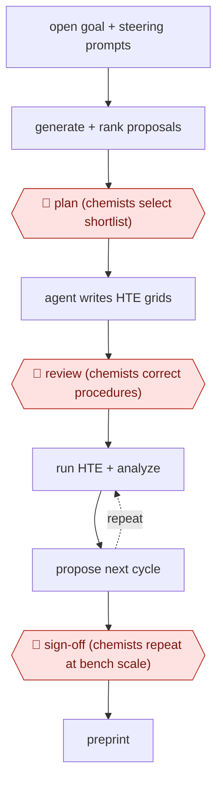

# Chemist-gated DMTA loop

`PRO › HLT › DRUGDISC` · checkpointed · evidence B · **draft: needs a reference example** ([how to add one](../../../../../CONTRIBUTING.md#1-add-an-example-run))

**Shape:** `open goal + steering prompts → generate + rank proposals → 🛑 plan (chemists select shortlist) → agent writes HTE grids → 🛑 review (chemists correct procedures) → (run HTE + analyze ⟲ propose next cycle) → 🛑 sign-off (chemists repeat at bench scale) → preprint`
**How it differs:** None close. AWF-0023 Event-driven model update (INVEST) is a different domain.
**Variants:** `gpt-5-4-maria-lab` · `generative-model-robotic-synthesis`

<!-- shape diagram: generated by scripts/build_diagrams.py from `shape`; don't edit -->

<!-- end shape diagram -->

## Steps
1. Scientists write the goal and steering/grading prompts. The model generates and ranks research proposals [[1]](#sources)[[2]](#sources).
2. 🛑 **Plan**: Human chemists review the top-ranked proposals and give the go-ahead on which to test [[1]](#sources)[[2]](#sources).
3. The lab agent turns the selected ideas into high-throughput experiment workflows [[1]](#sources).
4. 🛑 **Review**: Chemists make corrections to the experimental procedures before runs (described as minor) [[1]](#sources)[[2]](#sources).
5. The lab runs and analyzes the experiments. The model reanalyzes the data and proposes the next cycle [[1]](#sources).
6. 🛑 **Sign-off**: Chemists repeat representative reactions by hand at bench scale to validate the result before write-up [[1]](#sources)[[2]](#sources).

**Output:** A validated reaction or molecule result with HTE data and bench confirmation, written up as a preprint for external expert review.
**Failure modes → guards:** Microscale artifacts → bench-scale manual repeats [[1]](#sources). Over-claiming autonomy or generality → the runners say the result may not generalize to other reactions or substrates [[2]](#sources). Safety scope → humans control which proposals enter the lab [[2]](#sources).

## Public runs

Coverage as of 2026-11-06: **Partial**: first-hand runs that cover part of the shape or put checkpoints elsewhere. Collected and re-checked in [New workflows for empty categories](../../../../../research/2026-11-new-workflows.md).

- [R&D World, OpenAI + Molecule.one near-autonomous chemist](https://www.rdworldonline.com/openai-and-molecule-one-report-a-near-autonomous-ai-chemist-that-improved-a-stubborn-coupling-reaction/) (2026-06-22). Two HTE cycles with chemist go-ahead and bench validation; CEO describes human roles. "Maria ran 10,080 reactions in total". *First-hand: interview; confidence: med.*
- [Google, Aptamers lab-in-the-loop agentic discovery](https://research.google/pubs/aptamers-as-a-sandbox-for-lab-in-the-loop-agentic-molecular-discovery/) (2026). Agentic design-test-improve rounds on aptamer binders; human gates not described in abstract. "from 0.0% in Round 1 to 26.0% in Round 2 and 42.1% in Round 3 on α-thrombin". *First-hand: yes; confidence: low.*

## Sources

1. Buntz B., OpenAI and Molecule.one report a near-autonomous AI chemist that improved a stubborn coupling reaction, R&D World, 2026-06-22. https://www.rdworldonline.com/openai-and-molecule-one-report-a-near-autonomous-ai-chemist-that-improved-a-stubborn-coupling-reaction/
2. Waters J.K., AI Chemist Points to a More Automated Drug Discovery Loop, With Humans Still in Control, Pure AI, 2026-06-22. https://pureai.com/articles/2026/06/22/ai-chemist-points-to-a-more-automated-drug-discovery-loop_0.aspx
3. Cutts Z. et al. (Google), Aptamers as a sandbox for lab-in-the-loop agentic molecular discovery, arXiv 2610.24806, 2026. https://research.google/pubs/aptamers-as-a-sandbox-for-lab-in-the-loop-agentic-molecular-discovery/
