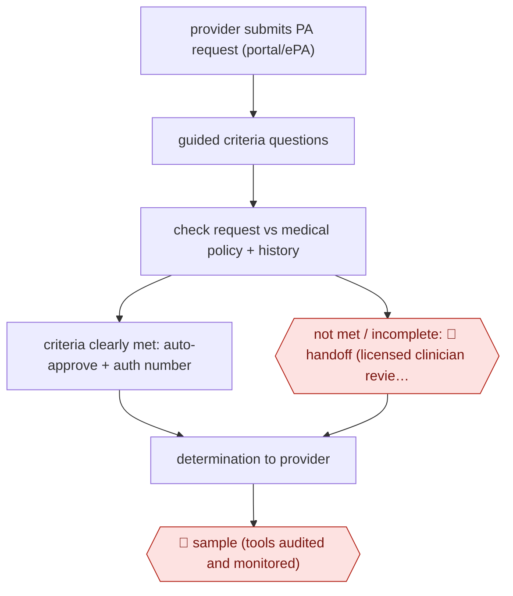

# Approve-only payer auto-auth

`PRO › HLT › RCM` · sampled · evidence A · **draft: needs a reference example** ([how to add one](../../../../../CONTRIBUTING.md#1-add-an-example-run))

**Shape:** `provider submits PA request (portal/ePA) → guided criteria questions → check request vs medical policy + history → criteria clearly met: auto-approve + auth number | not met / incomplete: 🛑 handoff (licensed clinician reviews; only humans deny) → determination to provider → 🛑 sample (tools audited and monitored)`
**How it differs:** AWF-0032 Criteria-gated prior auth is the provider side (assist): staff prepare and submit a request. This is the payer side and sampled: the agent issues approvals without per-item human approval, and humans handle only the non-approved remainder plus audits. Deliverable is the determination, not the submission packet.
**Variants:** `premera-clara` · `hcsc-blueapprovr` · `cohere-health` · `florida-blue-in-house`

<!-- shape diagram: generated by scripts/build_diagrams.py from `shape`; don't edit -->

<!-- end shape diagram -->

## Steps
1. Provider submits the prior-authorization request electronically; the tool asks 'the precise number of questions required to evaluate' the request (about six minutes on average to submit) [[2]](#sources)[[4]](#sources).
2. The engine checks the request against medical policy/clinical criteria and, for some codes, historical authorizations and claims; it 'helps identify requests that clearly meet medical criteria' [[1]](#sources)[[2]](#sources).
3. Criteria met and information complete: the request is auto-approved in real time and the authorization number is returned to the portal [[1]](#sources)[[4]](#sources).
4. 🛑 **Handoff**: anything not auto-approved goes to licensed clinicians (plan medical management / nurse and physician reviewers); the tool never denies: requests are 'only approved or advanced to a hands-on review by an HCSC clinician' [[1]](#sources)[[2]](#sources)[[3]](#sources)[[4]](#sources).
5. Final determination (approved, partially approved, or denied) is sent to the submitter [[4]](#sources).
6. 🛑 **Sample**: 'Automated tools are regularly audited and monitored to ensure accuracy, fairness, and accountability' [[1]](#sources).

**Output:** Real-time approval (auth number) or a clinician-made determination returned to the provider's portal/EHR.
**Failure modes → guards:** Automation drifting into denials → approve-only design, every non-approval routed to a licensed clinician. Incomplete submissions auto-pended → guided questions collect required data up front. Model drift/bias → periodic audit and monitoring.

## Public runs

Coverage as of 2026-11-13: **Strong**: a first-hand, detailed run that matches most of the shape. Collected and re-checked in [Third collection pass](../../../../../research/2026-11-third-pass.md).

- [Premera Blue Cross, Making prior authorization easier](https://healthsource.premera.com/your-premera-plan/prior-authorization-easier/) (2026-04-07). In-house CLARA tool approves clear-criteria requests; clinicians review all others; tools audited. "about 85 percent of electronic prior authorization requests are now approved in real time". *First-hand: yes; confidence: high.*
- [HCSC, Transforms Prior Authorization Process](https://www.hcsc.com/newsroom/news-releases/2023/artificial-intelligence-prior-authorization-process-helps-members-providers) (2023-07-13). Pilot then expansion across inpatient/outpatient categories; approve-or-advance design, no tool denials. "speed approvals were granted 80% of the time for behavioral health decisions and 66% for specialty pharmacy decisions". *First-hand: yes; confidence: high.*
- [GuideWell/Florida Blue, AI in action](https://www.beckerspayer.com/leadership/ai-in-action-how-guidewell-is-improving-the-healthcare-experience/) (2025-07-31). Plan VP describes AI approvals since 2022, never denials, with human oversight. "processed nearly 3 million prior authorizations, with a remarkable 78% of cases receiving approval in under 90 seconds". *First-hand: yes; confidence: high.*
- [Geisinger Health Plan, Ops Bulletin](https://www.geisinger.org/-/media/onegeisinger/files/pdfs/provider/navinet/opsbulletins/2023_03_15_ops_cohere_full_launch_v2.pdf?hash=6F68D56F947DACC613BBEF8E8EBE2A04&sc_lang=en) (2023-03-15). Cohere portal auto-approves; non-auto-approved requests go to plan Medical Management. "Over 82% of those requests have been auto-approved". *First-hand: yes; confidence: med.*

## Sources

1. Premera Blue Cross (Healthsource Staff), Making prior authorization easier for the communities we serve, 2026-04-07. https://healthsource.premera.com/your-premera-plan/prior-authorization-easier/
2. Health Care Service Corporation, HCSC Transforms Prior Authorization Process, 2023-07-13. https://www.hcsc.com/newsroom/news-releases/2023/artificial-intelligence-prior-authorization-process-helps-members-providers
3. Svetlana Bender (GuideWell/Florida Blue), AI in action: How GuideWell is improving the healthcare experience, Becker's Payer Issues, 2025-07-31. https://www.beckerspayer.com/leadership/ai-in-action-how-guidewell-is-improving-the-healthcare-experience/
4. Geisinger Health Plan, Operations Bulletin (Cohere full launch), 2023-03-15. https://www.geisinger.org/-/media/onegeisinger/files/pdfs/provider/navinet/opsbulletins/2023_03_15_ops_cohere_full_launch_v2.pdf?hash=6F68D56F947DACC613BBEF8E8EBE2A04&sc_lang=en
